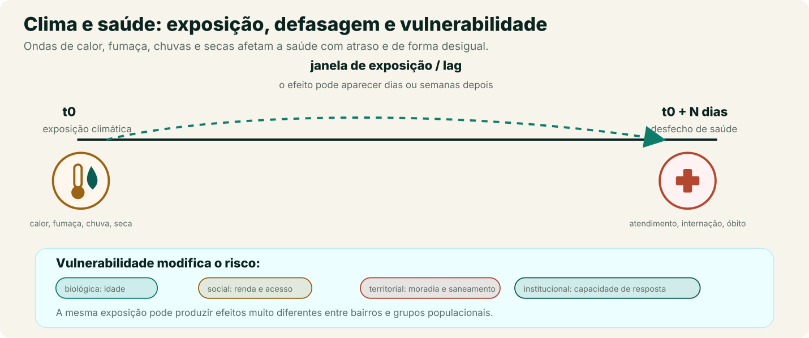

## Introdução

Um óbito por insuficiência cardíaca três dias depois de uma onda de calor é registrado no
**Sistema de Informação sobre Mortalidade (SIM)** como doença cardiovascular. Uma criança
com diarreia depois de beber água contaminada por uma enchente é atendida como **doença
diarreica aguda**. Um caso de dengue notificado semanas depois da chuva entra no
**Sistema de Informação de Agravos de Notificação (SINAN)** como dengue. O que esses casos aparenetemene isolados pode ter em comum é a exposição climática (ou condições meteorológicas) que os precedeu. Mas nenhum desses registros aparece a palavra "clima". É exatamente por isso que o problema fica invisível onde deveria ser previsto.

A ideia principal deste capítulo é que **a exposição climática se transforma em agravo
de saúde com atraso, sob outro nome e de forma desigual**. Quem olha apenas o boletim do dia reage ao problema quando ele já é fila, leito ocupado e óbito, e não quando ainda era previsão de calor, chuva ou fumaça.

A Amazônia é marcada por episódios de calor extremo, fumaça, seca e enchente com frequência e intensidade que exigem resposta específica e coordenação. No Semiárido, a ameaça climática que dita a agenda é a estiagem prolongada e a insegurança hídrica. No Sul, são as ondas de frio e as chuvas intensas seguidas de deslizamentos em área de risco. No Sudeste e no Centro-Oeste, são as ilhas de calor urbano, áreas da cidade que esquentam mais que o entorno, e a poluição do ar.  O que muda é a combinação de ameaça, exposição e
vulnerabilidade. O que permanece é a necessidade de olhar clima, saúde e território no
mesmo quadro.

::: {.callout-tip title="Como ler este capítulo"}
O capítulo responde a cinco perguntas essenciais: como o
clima contribui para o risco à saúde; por que o efeito demora; quem adoece primeiro; como medir a exposição;
e o que a gestão pode fazer com isso. Os blocos principais terminam com a base científica
que sustenta a afirmação para que o leitor possa conferir, contestar e aprofundar.
:::

## Como o clima se transforma em risco à saúde

Para entender o risco, responda quatro perguntas. A ordem importa, porque cada resposta
muda a interpretação da seguinte.

1. **Perigo/Ameaça:** qual processo físico pode causar dano? Onda de calor, chuva extrema,
   enchente, estiagem, incêndio florestal, fumaça, friagem. Perigo não é sinônimo de
   desastre: um perigo se torna desastre quando encontra população exposta, vulnerável e
   sem capacidade de resposta.
2. **Exposição:** quem esteve sujeito ao perigo, onde, por quanto tempo e com que
   intensidade? A exposição é materilizada por pessoas, no território, no tempo e intensidade. 
3. **Vulnerabilidade:** o que transforma exposição em dano? Idade, doença prévia, renda,
   moradia, saneamento, trabalho, mobilidade, racismo ambiental (a exposição desigual por
   raça e território), acesso à informação e acesso ao cuidado atuam juntos.
4. **Desfecho e resposta:** qual efeito foi observado e o que pode reduzi-lo? O desfecho
   pode ser óbito, internação, atendimento na atenção primária, notificação, sofrimento
   psíquico, interrupção de tratamento ou perda de acesso a um serviço.

O risco surge, portanto, da interação entre perigo, exposição e vulnerabilidade. A mesma onda de calor extrema pode ser perigosa para quem trabalha ao ar livre e irrelevante para quem está em casa com ar-condicionado. A mesma chuva pode ser perigosa para quem mora em área de risco e irrelevante para quem mora em condômio fechado. O desfecho e a
resposta são o que se mede e o que se faz depois.

A resposta pública atua sobre esses elementos: reduz a exposição (abrigo, alerta,
interrupção de atividade ao ar livre), protege grupos mais vulneráveis (busca ativa,
hidratação, transporte), fortalece a rede (plantão, insumos, protocolos) e mantém serviços
essenciais funcionando (água, energia, transporte, comunicação). Como o risco atravessa
setores, a resposta precisa ser intersetorial: saúde, meio ambiente, defesa civil,
assistência social, transporte e saneamento.

::: {.fonte role="note" aria-label="Base científica"}
O marco de perigo, exposição, vulnerabilidade e risco é o do [Sexto Relatório de Avaliação
do Painel Intergovernamental sobre Mudanças Climáticas (IPCC, AR6, Grupo de Trabalho II,
capítulo 7)](https://www.ipcc.ch/report/ar6/wg2/), que trata saúde e bem-estar como
resultado da interação entre clima, sociedade e capacidade de adaptação. A [Organização
Mundial da Saúde (OMS)](https://www.who.int/news-room/fact-sheets/detail/climate-change-and-health)
e o [Ministério da Saúde](https://www.gov.br/saude/pt-br/assuntos/saude-de-a-a-z/e/emergencias-climaticas)
adotam a mesma lógica: não basta medir o perigo; é preciso medir quem está exposto e
quem tem condições de se proteger.
:::

## Impactos do clima na saúde

Os mecanismos pelos quais as mudanças climáticas afetam a saúde humana são complexos e interdependentes. Em termos simples, esses impactos podem ser organizados em quatro dimensões inter-relacionadas. A primeira compreende os efeitos diretos da exposição a eventos extremos, como tempestades, inundações e ondas de calor, que podem provocar lesões, adoecimento e mortes. A segunda reúne os efeitos indiretos mediados por alterações nos ecossistemas e nas condições ambientais, capazes de modificar a distribuição de vetores e agentes patogênicos e a dinâmica de transmissão de doenças infecciosas, inclusive aquelas transmitidas por vetores, água e alimentos.
A terceira dimensão envolve efeitos mediados por processos sociais, econômicos e psicossociais, como perda de renda, insegurança alimentar, deslocamentos populacionais, ruptura de vínculos comunitários e perda do sentimento de pertencimento ao lugar. Esses processos podem comprometer a saúde física e mental. Em contextos de vulnerabilidade, os riscos climáticos também podem agravar fatores associados a conflitos. Por fim, a dimensão sistêmica e institucional abrange danos à infraestrutura e interrupções em serviços essenciais, como energia, abastecimento de água, saneamento, transporte, comunicação e assistência à saúde, que comprometem a capacidade de prevenção e resposta e a continuidade do cuidado. Essas dimensões se sobrepõem e podem potencializar umas às outras.

| Impacto | Como o clima entra | Exemplos de desfecho |
|---|---|---|
| **Direto e físico** | Calor, frio, tempestade, inundação, deslizamento e fumaça atuam sobre o corpo | Estresse térmico, agravos cardiovasculares e respiratórios, lesões, afogamentos e óbitos |
| **Ambiental e ecológico** | Alteração da qualidade da água e do ar, de criadouros e de habitats | Arboviroses, malária, doenças transmitidas por água e alimentos, alergias e desnutrição |
| **Social e psicossocial** | Perda de renda, insegurança alimentar, deslocamento, ruptura de vínculos e perda do lugar | Ansiedade, depressão, estresse pós-traumático, piora do cuidado e abandono de tratamento |
| **Sistêmico e institucional** | Danos à energia, água, transporte, comunicação e unidades de saúde | Tratamento interrompido, atraso no diagnóstico, aumento da demanda e redução da capacidade de resposta |

## Saúde Única

A Saúde Única (em inglês, One Health) é uma abordagem integrada que reconhece a interdependência entre a saúde das pessoas, dos animais, das plantas e dos ecossistemas. Sua adoção envolve a colaboração entre diferentes setores, disciplinas e comunidades para prevenir riscos e promover a saúde de forma sustentável. Na transmissão de algumas doenças, animais silvestres, mosquitos vetores e pessoas podem integrar uma mesma cadeia de transmissão, influenciada pelas condições ambientais e sociais.

Na Amazônia, o desmatamento e as queimadas, além de emitirem gases de efeito estufa e outras poluentes atmosféricos, transformam habitats e modificam as relações entre pessoas, animais e ambiente. Dependendo da situação, essas alterações podem favorecer determinados vetores e ampliar o contato humano com agentes infecciosos. Essa relação não é automática nem uniforme, ela varia conforme o uso do solo, o vetor e o patógeno envolvidos, ou mesmo as condições de moradia e saneamento, a mobilidade da população e o acesso à prevenção, ao diagnóstico e ao tratamento. 

::: {.fonte role="note" aria-label="Base científica"}
A abordagem de Saúde Única é adotada pela [OMS](https://www.who.int/health-topics/one-health)
e pelo [Plano de Ação Conjunto da Quadripartite — OMS, FAO, PNUMA e Organização Mundial de
Saúde Animal (WOAH)](https://www.who.int/publications/i/item/9789240059139).
Para a Amazônia, a revisão de [Ellwanger e colaboradores
(2020)](https://doi.org/10.1590/0001-3765202020191375) sistematiza como o desmatamento
altera a transmissão de malária, leishmaniose, arboviroses e outras doenças. A análise de
[Nobre e colaboradores (2016)](https://doi.org/10.1073/pnas.1605516113) mostra que
desmatamento e mudança do clima interagem e podem reduzir a resiliência da floresta,
com consequências para o bem-estar humano.
:::

## Tempo, clima e saúde

O tempo meteorológico e o clima não são sinônimos, e ambos afetam a saúde em diferentes escalas temporais. Confundir esses conceitos pode levar a dois erros de planejamento: tratar uma mudança de longo prazo como um evento passageiro ou interpretar um evento isolado como uma nova normalidade.

| Tipo | Escala | Pergunta que responde | Resposta adequada |
|---|---|---|---|
| **Tempo** | Horas a dias | O que vem nos próximos dias? | Alerta, abrigo, reforço de plantão, restrição de atividade ao ar livre |
| **Clima** | Décadas (~30 anos) | O padrão está mudando? | Adaptação de infraestrutura, revisão de protocolos, planejamento de rede |
| **Saúde** | Dias a meses (agudos); anos (crônicos) | Quando o agravo aparece? | Vigilância, busca ativa, preparação da atenção primária e da assistência |

O tempo meteorológico corresponde às condições da atmosfera em determinado lugar e momento. A previsão do tempo indica como essas condições devem evoluir nas próximas horas ou dias. Uma onda de calor de cinco dias, uma chuva intensa durante uma tarde e uma frente fria que chega no fim de semana são exemplos de eventos meteorológicos.

O clima, por sua vez, corresponde aos padrões e à variabilidade das condições atmosféricas de uma região ao longo de períodos prolongados, geralmente descritos com base em séries de pelo menos 30 anos. Sua caracterização considera registros de temperatura, precipitação e umidade, entre outras variáveis. As normais climatológicas sintetizam essas condições em períodos de referência de 30 anos, como o de 1991 a 2020, e permitem comparar as condições observadas com os padrões históricos.

Uma cidade com clima historicamente ameno pode registrar uma semana de calor atípico. Esse episódio, isoladamente, não demonstra uma mudança no clima; é necessário analisar sua relação com tendências observadas ao longo do tempo.

Uma onda de calor é um evento meteorológico. Já mudanças persistentes na frequência, na duração e na intensidade das ondas de calor caracterizam alterações no clima. As duas situações podem ocorrer simultaneamente e exigem respostas complementares: proteção imediata da população e adaptação de longo prazo.

### O que é "seca" na Amazônia

“Seca” não é uma coisa só. Ela pode ser caracterizada de diferentes formas, conforme seus efeitos sobre as chuvas, o solo, os recursos hídricos e a sociedade. Essa distinção importa para a saúde porque ajuda a identificar diferentes mecanismos de impacto, que podem ocorrer simultaneamente.

- **Seca meteorológica:** a precipitação fica abaixo do esperado para uma região e época do ano durante um período persistente.
- **Seca agrícola:** a água disponível no solo é insuficiente para atender às necessidades das culturas, comprometendo seu desenvolvimento e podendo reduzir a produção de alimentos.
- **Seca hidrológica:** as vazões dos rios, os níveis de lagos e reservatórios ou as reservas de água subterrânea ficam abaixo dos padrões esperados.
- **Seca socioeconômica:** a redução da disponibilidade de água associada à seca compromete a oferta de bens e serviços, como água para consumo, alimentos e energia, em relação à demanda da população

O chamado "verão amazônico" é um nome popular para o período de menor chuva, não uma
estação astronômica. Em boa parte da bacia, esse período vai de julho a outubro, com
variação regional. É também quando a fumaça das queimadas encontra o ar mais seco e a
dispersão fica pior.

Fenômenos de grande escala, como o **El Niño–Oscilação Sul (ENOS)**, deslocam a
probabilidade de chuva e seca. O El Niño tende a favorecer seca no norte da Amazônia; a
La Niña, o oposto em parte da bacia. Mas tendência não é destino: o efeito depende da
região, do uso do solo e de outros fatores oceânicos e atmosféricos. Planejar apenas pela
média histórica é insuficiente; é preciso planejar para o extremo.

::: {.fonte role="note" aria-label="Base científica"}
As definições de seca e a distinção entre seca meteorológica, agrícola e hidrológica
seguem a [Organização Meteorológica Mundial (OMM)](https://wmo.int/topics/drought). A
normal climatológica de 1991–2020 é o padrão adotado pelo [Instituto Nacional de
Meteorologia (INMET)](https://www.gov.br/inmet/pt-br).
A variabilidade climática da Amazônia, incluindo o papel do ENOS e das mudanças no uso do
solo, está sintetizada em [Marengo e colaboradores
(2018)](https://doi.org/10.3389/feart.2018.00228).
:::

## Por que alguns efeitos das exposições climáticas e ambientais sobre a saúde aparecem depois?

Os efeitos do calor, da fumaça, das enchentes e da seca sobre a saúde podem aparecer imediatamente ou após algum tempo. Nas análises epidemiológicas, o intervalo entre uma exposição e o desfecho observado é chamado de **defasagem** (em inglês, lag). Considerar esse intervalo ajuda a identificar associações que poderiam passar despercebidas se fossem comparados apenas os eventos ocorridos no mesmo dia.

A duração da defasagem varia conforme a exposição, o mecanismo envolvido, a população e o desfecho analisado. O início dos sintomas, o atendimento, a internação e o óbito são acontecimentos distintos e podem ocorrer em momentos diferentes.

| Exposição ou situação | Padrão temporal possível | Exemplos de efeitos ou consequências |
|---|---|---|
| **Calor extremo** | No mesmo dia e nos dias seguintes | Agravamento de doenças cardiovasculares e lesão renal aguda |
| **Fumaça de queimadas** | Durante a exposição ou nos dias seguintes, para efeitos agudos | Irritação respiratória, exacerbação da asma e aumento da procura por atendimento |
| **Chuva e condições favoráveis à dengue** | Semanas a meses, dependendo do contexto | Mudanças na incidência de dengue |
| **Enchentes** | Efeitos imediatos e outros que surgem nos dias ou semanas seguintes | Traumatismos e afogamentos; posteriormente, doenças associadas à exposição à água contaminada |
| **Seca prolongada** | Efeitos que podem se desenvolver e persistir ao longo de semanas, meses ou mais | Comprometimento do abastecimento, da segurança alimentar e da saúde mental |

Esses padrões são orientativos e não representam prazos fixos nem períodos de incubação comuns a todas as doenças. Na leptospirose, por exemplo, o Ministério da Saúde informa que os sintomas podem surgir entre 1 e 30 dias após a infecção, geralmente entre 7 e 14 dias. Esse intervalo é contado a partir da exposição à bactéria, não necessariamente do início da enchente. [Ministério da Saúde — Leptospirose](https://www.gov.br/saude/pt-br/assuntos/saude-de-a-a-z/l/leptospirose/leptospirose) 

No calor, parte dos efeitos aparece rapidamente. Em algumas populações, também pode ocorrer deslocamento de mortalidade, conhecido como “efeito colheita”, em que um aumento de mortes durante ou após o episódio é seguido por mortalidade abaixo do esperado. Esse padrão é compatível com a antecipação de parte das mortes de pessoas muito vulneráveis. Sua ocorrência e magnitude variam, e ele não deve ser presumido como explicação para todas as mortes associadas ao calor. Por isso, a avaliação precisa considerar tanto o período do evento quanto as semanas seguintes. [OMS/OMM — Ondas de calor e saúde](https://cdn.who.int/media/docs/default-source/climate-change/heat-waves-and-health---guidance-on-warning-system-development.pdf)

Na dengue, a defasagem pode envolver mudanças nos criadouros, o desenvolvimento dos mosquitos, a incubação do vírus no vetor e, após a picada infectante, a incubação na pessoa. Essas etapas ajudam a explicar por que alterações nas condições meteorológicas podem se associar a mudanças nos casos semanas ou meses depois. Entretanto, não se trata de uma sequência que obrigatoriamente começa a cada chuva; criadouros e mosquitos infectados podem já estar presentes. A temperatura influencia esses processos, mas não determina sozinha a transmissão. [OMS — Dengue](https://www.who.int/news-room/fact-sheets/detail/dengue-and-severe-dengue)

Na exposição à fumaça, sintomas respiratórios e agravamentos de doenças preexistentes podem ocorrer rapidamente. Já os efeitos de exposições repetidas ou prolongadas exigem avaliações específicas e, geralmente, não existe um prazo único de “meses” para sua manifestação ou identificação. [EPA — Efeitos da fumaça na saúde](https://www.epa.gov/wildfires/wildland-fires-and-public-health-effects)

{fig-alt="Diagrama mostra uma exposição climática no tempo zero, uma seta pontilhada indicando dias ou semanas de defasagem e, à direita, o desfecho de saúde. Abaixo, uma faixa indica que vulnerabilidade biológica, social, territorial e institucional modifica o risco."}

::: {.fonte role="note" aria-label="Base científica"}
A relação entre temperatura e mortalidade, com estrutura de defasagem e variação entre
cidades, foi demonstrada por [Gasparrini e colaboradores
(2015)](https://doi.org/10.1016/S0140-6736(14)62114-0), em estudo com cidades de vários
países. Para dengue e eventos hidrometeorológicos no Brasil, [Lowe e colaboradores
(2021)](https://doi.org/10.1016/S2542-5196(20)30292-8) mostram como chuva, temperatura e
urbanização combinam-se em janelas de risco. A [OMS](https://www.who.int/news-room/fact-sheets/detail/climate-change-heat-and-health)
resume os mecanismos fisiológicos do calor e a importância de considerar grupos e
defasagens.
A relação não linear entre temperatura e transmissão de dengue, Zika e chikungunya é
examinada por [Mordecai e colaboradores (2017)](https://pubmed.ncbi.nlm.nih.gov/28448507/).
:::

## O impacto é desigual

O mesmo evento não impacta todas as pessoas da mesma maneira. Dois bairros da mesma cidade podem passar pela mesma onda de calor e apresentar efeitos diferentes sobre a saúde. Essas diferenças dependem da exposição, das características da população, das condições de vida e do acesso à proteção e ao cuidado. Isso tem um nome: vulnerabilidade. 

Para entender a vulnerabilidade nesse contexto, considere a interação de quatro dimensões inter-relacionadas:

- **Biológica:** pessoas idosas podem apresentar menor capacidade de regular a temperatura corporal e menor percepção de sede, além de maior frequência de doenças crônicas. Gestantes, crianças pequenas e pessoas com doenças cardíacas, renais ou respiratórias também podem apresentar maior risco, dependendo da exposição e do grau de severidade do evento. No caso da fumaça, crianças merecem atenção porque seus pulmões estão em desenvolvimento e elas inalam proporcionalmente mais ar por unidade de massa corporal.
- **Social:** condições de trabalho, renda, escolaridade e acesso à água e à informação influenciam as possibilidades de proteção. Quem trabalha ao ar livre pode ficar mais exposto ao calor; quem não consegue interromper o trabalho ou pagar pelo transporte pode enfrentar dificuldades para buscar atendimento. Desigualdades e discriminação também podem limitar o acesso a recursos e serviços.
- **Territorial:** as características da moradia e do entorno influenciam a exposição climática. Coberturas sem isolamento térmico, pouca sombra e ventilação inadequada podem agravar o calor dentro das casas. A drenagem insuficiente pode favorecer alagamentos, enquanto a proximidade de fontes de emissão pode aumentar a exposição à poluição atmosférica. 
- **Institucional:** equipes, infraestrutura, vigilância, planejamento e articulação entre serviços condicionam a capacidade de prevenir danos e responder aos eventos. Falta de profissionais, interrupções no abastecimento e dificuldades de transporte ou encaminhamento podem comprometer a continuidade da assistência.

Portanto, a vulnerabilidade não se limita às características individuais, ela também depende das condições sociais, do território e da capacidade de proteção e resposta. Identificar grupos em maior risco deve orientar medidas concretas para reduzir a exposição, remover barreiras ao cuidado e fortalecer os serviços de atendimento. 

::: {.fonte role="note" aria-label="Base científica"}
O [IPCC (AR6, Grupo de Trabalho II, capítulo 7)](https://www.ipcc.ch/report/ar6/wg2/chapter/chapter-7/)
descreve a vulnerabilidade como dependente de características individuais e de condições
sociais, econômicas e institucionais. Exposição e vulnerabilidade são componentes
distintos do risco. O [Sumário para Formuladores de Políticas do AR6](https://www.ipcc.ch/report/ar6/wg2/chapter/summary-for-policymakers/)
destaca como desigualdades, marginalização e acesso limitado a serviços básicos ampliam
a vulnerabilidade, inclusive entre povos indígenas e comunidades locais.

A [OMS — riscos climáticos para gestantes, crianças e pessoas idosas](https://www.who.int/news/item/05-06-2024-experts-warn-of-serious-health-impacts-from-climate-change-for-pregnant-women--children--and-older-people)
apresenta fatores fisiológicos e riscos específicos desses grupos. O guia
[Wildfire Smoke: A Guide for Public Health Officials](https://www.airnow.gov/sites/default/files/2021-09/wildfire-smoke-guide.pdf)
explica a suscetibilidade das crianças à fumaça, incluindo o desenvolvimento pulmonar e
a maior quantidade de ar inalada em relação à massa corporal.

No Brasil, o [Observatório de Clima e Saúde da Fiocruz](https://climaesaude.icict.fiocruz.br/)
é uma fonte complementar para acompanhar as relações entre clima, ambiente e saúde.
A [Política Nacional de Vigilância em Saúde (Resolução CNS nº 588/2018)](https://www.gov.br/conselho-nacional-de-saude/pt-br/atos-normativos/resolucoes/2018/resolucao-no-588.pdf)
orienta a atuação sobre determinantes e condicionantes da saúde, considerando o
território e a redução de vulnerabilidades e riscos.
:::

## Como descrever uma exposição climática e ambiental

Antes de relacionar clima e saúde, defina o que será medido, em qual população e em que
intervalo de tempo. Temperatura máxima, temperatura média, índice de calor e duração de
uma onda de calor descrevem aspectos diferentes da exposição. Da mesma forma, chuva
acumulada em 24 horas não equivale ao total de um mês.

Para estudar fumaça, é necessário distinguir a ocorrência de fogo da presença de
poluentes no ar. **Focos de calor detectados por satélite não medem a concentração de
fumaça nem a exposição da população.** A concentração de material particulado fino pode
ser medida por instrumentos ou estimada por modelos, mas sua atribuição às queimadas
exige informações adicionais sobre as fontes e o transporte dos poluentes.

| Dimensão | Medidas possíveis | Cuidados na interpretação |
|---|---|---|
| **Calor** | Temperaturas máxima, mínima e média; índice de calor; intensidade e duração de ondas de calor | Médias podem ocultar picos e noites quentes. Percentis expressam a posição na distribuição local, mas não garantem riscos equivalentes entre regiões |
| **Chuva** | Acumulados em 24 horas, 7 dias ou 30 dias; anomalias; índices padronizados | Os efeitos dependem da intensidade, da duração, das condições anteriores e do território. Chuva não implica necessariamente inundação ou aumento de vetores |
| **Poluição do ar** | Concentração de material particulado fino (MP2,5), medida ou estimada; profundidade óptica de aerossóis (AOD) | MP2,5 pode ter várias fontes. AOD descreve propriedades ópticas dos aerossóis na coluna atmosférica e não equivale à concentração de MP2,5 junto ao solo |
| **Atividade de fogo** | Focos ativos e área queimada | São indicadores diferentes entre si e não substituem medidas de qualidade do ar |

Também é preciso distinguir a variável de sua **fonte de dados**. Uma estação registra
condições no local de instalação. Produtos em grade representam estimativas em pontos
ou células, conforme sua definição. Uma **reanálise** combina observações e modelos por
assimilação de dados para reconstruir condições atmosféricas passadas. Sua resolução e
suas incertezas precisam ser consideradas na análise.

Um valor atribuído ao município aproxima as condições ambientais às quais sua população
pode estar exposta, mas pode ocultar diferenças entre bairros, comunidades, moradias e
locais de trabalho. Em municípios extensos, a escolha entre média territorial, ponderação
pela população ou estimativa para áreas habitadas pode mudar a interpretação.

Três cuidados são essenciais:

- **Dado faltante não é zero.** Ausência de registro meteorológico não significa ausência
  do fenômeno. Nos dados de saúde, diferencie ausência de informação, zero registrado e
  possível subnotificação.
- **Média municipal não é exposição individual.** Ela pode apoiar análises populacionais,
  mas não informa, sozinha, quanto cada pessoa esteve exposta.
- **Documente a medida.** Registre fonte e versão dos dados, variável, unidade, resolução
  espacial e temporal, período, método de agregação e tratamento das lacunas. Informe
  também as defasagens consideradas entre exposição e desfecho.

::: {.callout-note title="Referência climática e limiar de risco"}
Uma **normal climatológica padrão** resume condições de um período de 30 anos. Ela não é
uma previsão meteorológica nem um limiar universal de perigo à saúde.

Ao definir uma onda de calor para uma análise, declare a variável, o período de referência,
o limiar e o número mínimo de dias consecutivos. Um critério possível é temperatura
acima do percentil 95 local por pelo menos dois dias consecutivos. Esse é um exemplo de
regra operacional, não uma definição universal. O percentil 95 corresponde ao valor
abaixo do qual se encontram aproximadamente 95% das observações do conjunto de referência.
A escolha deve ser justificada e, quando pertinente, comparada com critérios alternativos.
:::

::: {.fonte role="note" aria-label="Base científica"}
A [OMM — WMO Climatological Normals](https://community.wmo.int/site/knowledge-hub/programmes-and-initiatives/climate-services/wmo-climatological-normals)
define as normais climatológicas padrão. O [ECMWF — Fact sheet: Reanalysis](https://www.ecmwf.int/en/about/media-centre/focus/2023/fact-sheet-reanalysis)
explica a combinação de observações e modelos. A [NASA — Aerosols: Tiny Particles, Big Impact](https://science.nasa.gov/earth/earth-observatory/aerosols/)
descreve a profundidade óptica dos aerossóis; o [material de formação da NASA sobre qualidade do ar](https://appliedsciences.nasa.gov/sites/default/files/2020-11/InsideLookAQ_Part2_Final.pdf)
distingue a coluna atmosférica da concentração próxima à superfície. O
[INPE — Perguntas frequentes do Programa Queimadas](https://www.terrabrasilis.dpi.inpe.br/queimadas/portal/pages/secao_informacoes/faq/index.html)
explica os produtos de monitoramento do fogo e da fumaça. Diferentes definições de ondas
de calor foram comparadas por [Silveira e colaboradores (2023)](https://doi.org/10.1016/j.ijheh.2022.114109).
:::

## Recortes: calor, fumaça, chuva e seca

Os recortes abaixo mostram como a análise muda conforme a exposição, o território e o
desfecho. A Amazônia é o fio condutor, mas os mecanismos e cuidados metodológicos também
são relevantes para outras regiões.

### Calor e frio

Temperaturas elevadas podem afetar a saúde em diferentes regiões do Brasil. Na Amazônia,
a combinação de calor e umidade elevada pode dificultar a evaporação do suor e, assim,
a perda de calor pelo corpo. A exposição intensa pode causar sobrecarga cardiovascular,
desidratação e lesão renal. Pessoas idosas, crianças pequenas, gestantes, trabalhadores
ao ar livre e pessoas com doenças preexistentes podem apresentar maior risco, dependendo
das condições de exposição e proteção.

O estudo de Silveira e colaboradores sobre a Amazônia brasileira encontrou associação
entre ondas de calor e maior mortalidade por causas não externas e doenças cardiovasculares.
Na análise realizada, a intensidade teve maior importância que a duração para o risco
estimado. Esse resultado se refere às localidades, ao período e às definições avaliadas;
não estabelece uma regra universal de que a duração seja menos importante.

Incursões de ar frio de origem polar também atingem a Amazônia, produzindo episódios
conhecidos como **friagem**. A avaliação de seus impactos deve considerar a queda de
temperatura, sua duração, as condições das moradias e a população exposta. Atribuir um
aumento local de internações a esses episódios exige análise dos dados de saúde e de
outros fatores que variam no tempo.

::: {.fonte role="note" aria-label="Base científica"}
A [OMS — Heat and health](https://www.who.int/news-room/fact-sheets/detail/climate-change-heat-and-health)
descreve os efeitos do calor e os grupos de maior risco. Os resultados específicos da
Amazônia são de [Silveira e colaboradores (2023)](https://doi.org/10.1016/j.ijheh.2022.114109).
O [INMET — Panorama geral das condições meteorológicas de 2016](https://portal.inmet.gov.br/uploads/notastecnicas/Panorama-Geral-2016-Brasil.pdf)
documenta episódios de friagem associados à entrada de massas de ar frio.
:::

### Fumaça e qualidade do ar

A queima de vegetação emite gases e partículas, incluindo **material particulado fino
(MP2,5)**, formado por partículas com diâmetro aerodinâmico de até 2,5 micrômetros. Essas
partículas podem atingir regiões profundas dos pulmões. A exposição à fumaça está
associada a sintomas respiratórios, exacerbações de asma e outras doenças pulmonares e
aumento da procura por atendimento. Também pode afetar o sistema cardiovascular.

Crianças merecem atenção porque seus pulmões estão em desenvolvimento e elas inalam
proporcionalmente mais ar em relação à massa corporal. Pessoas idosas, gestantes e pessoas
com doenças respiratórias ou cardíacas também podem apresentar maior risco. Os efeitos
agudos podem ocorrer durante a exposição ou nos dias seguintes; isso não exclui possíveis
consequências de exposições repetidas ou prolongadas.

Dois pontos técnicos evitam confusão:

- **Foco ativo não é área queimada.** A detecção depende do sensor, do horário de passagem
  e das condições de observação. A contagem de focos não corresponde diretamente ao
  número de incêndios nem à extensão queimada.
- **A fumaça atravessa fronteiras municipais.** O transporte atmosférico pode levar
  poluentes a locais distantes das fontes. Por isso, a ausência de focos dentro do
  município não demonstra ausência de exposição.

Na Amazônia, o uso do fogo está relacionado a atividades humanas e à transformação do
território. A prevenção precisa considerar tanto as fontes de emissão quanto a proteção
das populações expostas, inclusive fora das áreas onde ocorrem as queimadas.

::: {.fonte role="note" aria-label="Base científica"}
A [EPA — Wildland Fires and Public Health Effects](https://www.epa.gov/wildfires/wildland-fires-and-public-health-effects)
e o [guia Wildfire Smoke](https://www.airnow.gov/sites/default/files/2021-09/wildfire-smoke-guide.pdf)
sintetizam os efeitos da fumaça e os grupos de maior risco. No sul da Amazônia,
[Machin e colaboradores (2019)](https://doi.org/10.1590/1414-431X20188130)
analisaram a associação entre concentrações estimadas de MP2,5 e internações respiratórias
de pessoas idosas. As limitações das detecções por satélite e o transporte da fumaça são
explicados pelo [INPE](https://www.terrabrasilis.dpi.inpe.br/queimadas/portal/pages/secao_informacoes/faq/index.html).
:::

### Chuva, enchente e vetores

Chuvas intensas podem contribuir para inundações, deslizamentos e contaminação da água,
conforme as condições do terreno, da drenagem e do saneamento. Esses eventos podem causar
lesões, interromper serviços e ampliar o risco de doenças transmitidas pela água.

A relação entre chuva e doenças transmitidas por mosquitos depende da espécie e do
ambiente. O *Aedes aegypti* utiliza frequentemente recipientes com água no ambiente
urbano e doméstico; a prevenção deve abranger os recipientes capazes de acumular água,
sem depender apenas de sua aparência de limpeza. Já o *Anopheles darlingi*, principal
vetor da malária no Brasil, apresenta ecologia distinta, frequentemente associada a
coleções de água de baixo fluxo, com características que variam entre localidades.

Chuva, temperatura, condições dos criadouros, presença de pessoas infectadas e imunidade
populacional influenciam a transmissão. Acesso ao diagnóstico e qualidade da notificação,
por sua vez, influenciam os casos observados nos sistemas de informação. Essas duas
questões precisam ser distinguidas na interpretação dos resultados.

A transmissão de malária no Brasil concentra-se na região amazônica. Mobilidade,
atividades econômicas, alterações ambientais e acesso ao diagnóstico e ao tratamento
fazem parte da análise. Dengue e malária exigem estratégias específicas, de acordo com
seus agentes, vetores e contextos de transmissão.

::: {.fonte role="note" aria-label="Base científica"}
O Ministério da Saúde descreve as características do [Aedes aegypti](https://www.gov.br/saude/pt-br/assuntos/saude-de-a-a-z/a/aedes-aegypti)
e os mecanismos de transmissão e prevenção da [malária](https://www.gov.br/saude/pt-br/assuntos/saude-de-a-a-z/m/malaria).
[Lowe e colaboradores (2021)](https://doi.org/10.1016/S2542-5196(20)30292-8)
analisam as relações entre extremos hidrometeorológicos, urbanização e risco de dengue no Brasil.
:::

### Seca, rios e isolamento

A seca hidrológica pode comprometer a navegação e o transporte de vacinas, medicamentos,
insumos e equipes. Conforme a intensidade do evento e a infraestrutura disponível,
comunidades podem enfrentar isolamento, interrupção de tratamentos e dificuldades de
acesso à água e aos alimentos. Esses impactos podem ocorrer em conjunto com calor e
fumaça, mas também precisam ser avaliados por seus mecanismos próprios.

O isolamento é uma condição que pode comprometer o acesso à saúde. Para acompanhar suas
consequências, podem ser usados indicadores como tempo de deslocamento, consultas e
procedimentos adiados, interrupções de tratamento e atividades de vacinação não realizadas.
Esses indicadores complementam os registros de adoecimento e mortalidade.

Não se deve pressupor que a seca sempre aumente a malária. A análise local precisa
considerar as alterações nos criadouros, a exposição da população, a mobilidade e as
condições de vigilância e assistência.

::: {.fonte role="note" aria-label="Base científica"}
O [Plano Distrital de Saúde Indígena de Porto Velho 2024–2027](https://www.gov.br/saude/pt-br/composicao/sesai/planos-distritais-2024-2027/plano-distrital-porto-velho/%40%40download/file)
descreve dificuldades de acesso fluvial durante a redução dos níveis dos rios. A
[OMS — Famine and health](https://www.who.int/health-topics/drought/famine-and-health)
apresenta consequências das secas para a saúde, a nutrição e o bem-estar.
:::

::: {.callout-important title="Dois erros que distorcem a interpretação"}
**1. Interpretar uma associação como prova de causalidade.** Uma associação observada
pode refletir um efeito causal, mas também confundimento, vieses ou acaso. Há
**confundimento** quando outros fatores relacionados à exposição e ao desfecho distorcem
a associação estimada, conforme a estrutura causal considerada. Diferenças na detecção
e notificação dos casos também podem afetar os resultados, sem serem necessariamente
confundimento. A interpretação exige uma pergunta clara, um desenho adequado e avaliação
dessas possíveis explicações.

**2. Inferir relações individuais a partir de resultados agregados — falácia ecológica.**
Uma associação entre chuva e incidência de dengue por município não demonstra que os
indivíduos mais expostos à chuva foram aqueles que adoeceram. Análises agregadas podem
apoiar decisões populacionais, mas não permitem transferir automaticamente suas conclusões
para cada pessoa.

O [CDC — Analyzing and Interpreting Data](https://www.cdc.gov/field-epi-manual/php/chapters/analyze-interpret-data.html)
discute associação, causalidade, confundimento e vieses. O
[glossário da OMS sobre indicadores](https://cdn.who.int/media/docs/default-source/documents/ddi/indicatorworkinggroup/glossary_of_terms_june-2024.pdf)
define a falácia ecológica.
:::

## A oportunidade de saúde: co-benefícios

Ações de mitigação e adaptação podem gerar **co-benefícios para a saúde**. Substituir
viagens motorizadas por caminhada ou bicicleta, quando há condições de segurança e
acessibilidade, pode reduzir emissões e ampliar a atividade física. Reduzir a poluição
do ar beneficia a saúde respiratória e cardiovascular. Melhorias nas moradias e ampliação
de áreas verdes podem reduzir a exposição ao calor, conforme o projeto e o contexto.

Na Amazônia, conservar a floresta contribui para a regulação climática e a manutenção dos
ecossistemas. Seus efeitos sobre doenças infecciosas dependem dos agentes, dos vetores e
das formas de ocupação e contato; não se deve afirmar que a conservação reduza
uniformemente todas as zoonoses.

**Adaptação** envolve ajustes aos efeitos atuais ou esperados do clima para reduzir danos.
**Mitigação** envolve reduzir emissões de gases de efeito estufa ou ampliar sua remoção da
atmosfera. As duas podem ser articuladas com políticas de saúde, habitação, transporte,
energia e alimentação.

Ao comparar medidas, registre o benefício esperado, quem será beneficiado, quem poderá
ficar de fora e como os resultados serão acompanhados. Melhorar a média de uma cidade
não garante redução das desigualdades entre seus territórios.

Também é preciso distinguir a identificação de associações da avaliação dos efeitos de
uma política. Uma análise observacional pode ter objetivo descritivo ou causal. Para
estimar o efeito de uma intervenção, é necessário justificar como se representa o que
teria ocorrido sem ela, declarar as hipóteses utilizadas e avaliar possíveis vieses.

::: {.fonte role="note" aria-label="Base científica"}
[Ebi, Hess e Watkiss (2017)](https://www.ncbi.nlm.nih.gov/books/NBK525226/)
discutem riscos, custos e benefícios de respostas à variabilidade e à mudança do clima.
O [IPCC, AR6, Grupo de Trabalho II, capítulo 7](https://www.ipcc.ch/report/ar6/wg2/chapter/chapter-7/)
examina adaptação e co-benefícios para a saúde. O [Lancet Countdown](https://lancetcountdown.org/)
acompanha indicadores sobre saúde e mudanças climáticas.
:::

## Comunicação para ação

A comunicação de risco deve ajudar as pessoas e os serviços a tomar decisões. Para isso,
precisa ser clara, oportuna, acessível e coerente com os recursos disponíveis. Explique o
risco, indique medidas viáveis de proteção e informe onde e como buscar ajuda.

Quando houver incerteza, apresente o que se sabe, as limitações do conhecimento e as razões
para a orientação adotada. Atualize as mensagens quando surgirem novas informações.
Comunicar também envolve ouvir dúvidas, reconhecer barreiras e construir respostas com
as comunidades.

Três princípios ajudam:

- **Vincule o alerta à capacidade de resposta.** Orientações para evacuar ou procurar
  atendimento precisam ser acompanhadas de informações sobre abrigo, transporte e
  serviços disponíveis. Recomendações inviáveis podem comprometer a confiança.
- **Use canais adequados ao território.** Rádio, agentes de saúde, lideranças comunitárias,
  escolas e meios digitais podem ser combinados conforme o acesso e as preferências da
  população, considerando idiomas e necessidades de acessibilidade.
- **Explique as responsabilidades.** Cuidados individuais devem ser acompanhados de ações
  públicas de proteção, infraestrutura e assistência. A comunicação deve evitar culpar
  as pessoas por condições que elas não conseguem modificar sozinhas.

::: {.fonte role="note" aria-label="Base científica"}
As [diretrizes da OMS para comunicação de risco em emergências de saúde pública](https://www.who.int/publications/b/31390)
tratam de confiança, participação comunitária, canais de comunicação e preparação dos
serviços. A [Política Nacional de Vigilância em Saúde](https://www.gov.br/conselho-nacional-de-saude/pt-br/atos-normativos/resolucoes/2018/resolucao-no-588.pdf)
inclui comunicação, participação social e atuação territorial entre seus componentes.
:::

## De observação a ação

Calor, fumaça, chuva e seca atuam por mecanismos diferentes, mas sua análise exige
perguntas comuns: qual foi a exposição, quem esteve exposto, quando o efeito pode ocorrer
e quais condições ampliam ou reduzem o risco? A contribuição ambiental nem sempre é
identificada explicitamente nos registros de saúde.

Boletins meteorológicos e epidemiológicos ajudam a reconhecer situações de risco. Para
acompanhar esses padrões ao longo do tempo, é necessário integrar dados de maneira
consistente e documentada.

As fontes incluem:

- **Saúde:** Sistema de Informações sobre Mortalidade (SIM), Sistema de Informações
  Hospitalares do SUS (SIH/SUS), Sistema de Informação de Agravos de Notificação (SINAN),
  registros da atenção primária e Sistema de Informação de Vigilância Epidemiológica da
  Malária (SIVEP-Malária).
- **Clima e ambiente:** estações meteorológicas, reanálises, produtos de satélite,
  monitoramento de qualidade do ar, focos ativos, áreas queimadas e indicadores de seca.
- **Território e população:** limites territoriais, distribuição populacional, moradia,
  saneamento, renda e acesso aos serviços.

A integração exige compatibilizar unidades espaciais e temporais, avaliar a qualidade dos
dados e documentar decisões. Contagens de casos precisam ser interpretadas considerando
a população, a cobertura dos serviços e os processos de notificação. As análises também
precisam considerar sazonalidade, tendências e defasagens, conforme a pergunta investigada.

O objetivo é construir uma rotina que permita reconhecer mudanças no risco e orientar a
resposta. Uma associação retrospectiva, porém, não garante capacidade de previsão. Para
usar um modelo como alerta, é necessário avaliar seu desempenho com dados que não foram
usados em seu ajuste e definir como a informação acionará medidas concretas.

O restante deste guia apresenta métodos para organizar e analisar essas informações. Sua
aplicação deve respeitar as características dos dados, da população e da rede de saúde de
cada território.

## Em cinco frases

- O risco à saúde depende da interação entre perigo, exposição e vulnerabilidade.
- Os efeitos podem ocorrer no mesmo dia ou depois; o intervalo varia conforme o mecanismo
  e o desfecho.
- A contribuição do clima e do ambiente pode não estar explícita nos registros de saúde.
- Características individuais, condições sociais, território e capacidade de resposta
  influenciam quem sofre os maiores impactos.
- Integrar dados com método e transformar resultados em ações são tarefas complementares.

::: {.callout-note collapse="true"}
## Verifique se ficou

**1. Por que mudanças nos casos de dengue podem aparecer semanas ou meses depois de uma chuva?**

Porque alterações nos criadouros, no desenvolvimento dos mosquitos e na transmissão
podem ocorrer ao longo do tempo. A incubação e o intervalo até o atendimento ou a
notificação também influenciam os registros. Não é uma sequência que recomeça a cada
chuva: vetores e transmissão podem já estar presentes, e o efeito varia conforme o contexto.

**2. Dois bairros passam pela mesma onda de calor. Por que podem registrar números diferentes de atendimentos?**

Porque a exposição efetiva, a população e as condições de proteção variam. Moradia,
sombra, acesso à água, trabalho e doenças preexistentes podem influenciar o adoecimento.
Tamanho da população, acesso aos serviços e qualidade dos registros também afetam a
comparação. Menos atendimentos não significa necessariamente menos adoecimento.

**3. Qual é a diferença entre uma onda de calor de cinco dias e uma mudança no clima?**

A onda de calor é um evento meteorológico delimitado no tempo. Uma mudança no clima é
identificada em alterações persistentes nos padrões e na variabilidade das condições
atmosféricas. Um episódio isolado não demonstra essa mudança; tendências de longo prazo
exigem análise de séries históricas.

**4. Uma associação entre chuva e dengue por município prova que a chuva causou os casos?**

Não. É necessário avaliar o mecanismo, a sequência temporal, outros fatores relevantes e
possíveis vieses. Além disso, uma associação agregada não demonstra quais indivíduos
estiveram expostos ou adoeceram. A transmissão ocorre pela picada de mosquitos infectados,
e não pelo contato com a chuva ou com uma poça de água.

**5. Por que contar apenas óbitos com menção explícita ao calor pode subestimar seu impacto?**

Porque o calor pode contribuir para o agravamento de doenças sem que essa contribuição
seja reconhecida e registrada na declaração de óbito. O SIM reúne informações sobre
causas declaradas, não apenas a causa básica. Análises epidemiológicas de temperatura e
mortalidade podem complementar esses registros, mas suas estimativas populacionais não
identificam automaticamente quais mortes individuais foram causadas pelo calor.

O [manual do SIM — Ministério da Saúde/DATASUS](https://www.sim.saude.pr.gov.br/ajuda/help_sim.pdf)
descreve a consulta a causas básicas e múltiplas. A
[documentação técnica da EPA sobre mortes relacionadas ao calor](https://www.epa.gov/system/files/documents/2024-06/heat-deaths_documentation.pdf)
discute limitações dos registros e a identificação da contribuição do calor.
:::

## Referências

**Fontes institucionais e políticas**

- OMM (WMO). *WMO Climatological Normals*.
  [Documento](https://community.wmo.int/site/knowledge-hub/programmes-and-initiatives/climate-services/wmo-climatological-normals).
- ECMWF. *Fact sheet: Reanalysis*. 2023.
  [Documento](https://www.ecmwf.int/en/about/media-centre/focus/2023/fact-sheet-reanalysis).
- NASA. *Aerosols: Tiny Particles, Big Impact*.
  [Documento](https://science.nasa.gov/earth/earth-observatory/aerosols/).
- NASA, Applied Remote Sensing Training Program (ARSET). Material de formação sobre qualidade do ar: AOD e MP2,5.
  [Documento](https://appliedsciences.nasa.gov/sites/default/files/2020-11/InsideLookAQ_Part2_Final.pdf).
- INPE. *Perguntas frequentes — Programa Queimadas*.
  [Documento](https://www.terrabrasilis.dpi.inpe.br/queimadas/portal/pages/secao_informacoes/faq/index.html).
- INMET. *Panorama geral das condições meteorológicas de 2016*.
  [Documento](https://portal.inmet.gov.br/uploads/notastecnicas/Panorama-Geral-2016-Brasil.pdf).
- Ministério da Saúde. *Aedes aegypti*.
  [Documento](https://www.gov.br/saude/pt-br/assuntos/saude-de-a-a-z/a/aedes-aegypti).
- Ministério da Saúde, SESAI. *Plano Distrital de Saúde Indígena de Porto Velho 2024–2027*.
  [Documento](https://www.gov.br/saude/pt-br/composicao/sesai/planos-distritais-2024-2027/plano-distrital-porto-velho/%40%40download/file).
- Organização Mundial da Saúde (OMS). *Famine and health*.
  [Documento](https://www.who.int/health-topics/drought/famine-and-health).
- Organização Mundial da Saúde (OMS). *Communicating risk in public health emergencies*.
  [Documento](https://www.who.int/publications/b/31390).
- CDC. *Analyzing and Interpreting Data*. CDC Field Epidemiology Manual.
  [Documento](https://www.cdc.gov/field-epi-manual/php/chapters/analyze-interpret-data.html).
- Organização Mundial da Saúde (OMS). *Glossary of terms*. Junho de 2024. Verbete: Ecological fallacy.
  [Documento](https://cdn.who.int/media/docs/default-source/documents/ddi/indicatorworkinggroup/glossary_of_terms_june-2024.pdf).
- Ministério da Saúde/DATASUS. *Sistema de Informação sobre Mortalidade: ajuda do sistema*.
  [Documento](https://www.sim.saude.pr.gov.br/ajuda/help_sim.pdf).
- United States Environmental Protection Agency (EPA). *Technical Documentation: Heat-Related Deaths*. 2024.
  [Documento](https://www.epa.gov/system/files/documents/2024-06/heat-deaths_documentation.pdf).

- IPCC. *Health, Wellbeing and the Changing Structure of Communities*. In: *Climate
  Change 2022: Impacts, Adaptation and Vulnerability*. Capítulo 7.
  [Texto](https://www.ipcc.ch/report/ar6/wg2/chapter/chapter-7/).
- IPCC. *Summary for Policymakers*. In: *Climate Change 2022: Impacts, Adaptation and
  Vulnerability*.
  [Texto](https://www.ipcc.ch/report/ar6/wg2/chapter/summary-for-policymakers/).
- Organização Mundial da Saúde (OMS). *Experts warn of serious health impacts from
  climate change for pregnant women, children, and older people*. 5 jun. 2024.
  [Comunicado](https://www.who.int/news/item/05-06-2024-experts-warn-of-serious-health-impacts-from-climate-change-for-pregnant-women--children--and-older-people).
- *Wildfire Smoke: A Guide for Public Health Officials*.
  [Guia disponível no AirNow](https://www.airnow.gov/sites/default/files/2021-09/wildfire-smoke-guide.pdf).

- IPCC. *Climate Change 2022: Impacts, Adaptation and Vulnerability*. Contribuição do
  Grupo de Trabalho II ao Sexto Relatório de Avaliação. [Relatório
  completo](https://www.ipcc.ch/report/ar6/wg2/).
- Organização Mundial da Saúde (OMS). *Climate change and health*. [Nota
  técnica](https://www.who.int/news-room/fact-sheets/detail/climate-change-and-health).
- Organização Mundial da Saúde (OMS). *Heat and health*. [Nota
  técnica](https://www.who.int/news-room/fact-sheets/detail/climate-change-heat-and-health).
- Organização Mundial da Saúde (OMS). *One Health*. [Página
  temática](https://www.who.int/health-topics/one-health).
- OMS, FAO, PNUMA e WOAH. *One Health Joint Plan of Action (2022–2026)*. [Publicação
  OMS](https://www.who.int/publications/i/item/9789240059139).
- Ministério da Saúde. *Emergências climáticas*. [Página
  oficial](https://www.gov.br/saude/pt-br/assuntos/saude-de-a-a-z/e/emergencias-climaticas).
- Ministério da Saúde. *Mudanças climáticas para profissionais de saúde: guia de bolso*.
  2. ed. rev. Brasília, 2026.
  [PDF](https://www.gov.br/saude/pt-br/centrais-de-conteudo/publicacoes/guias-e-manuais/2026/mudancas-climaticas-para-profissionais-de-saude-guia-de-bolso.pdf).
- Ministério da Saúde. *Vigilância em Saúde*. [Página
  oficial](https://www.gov.br/saude/pt-br/composicao/svsa).
- Ministério da Saúde. *Malária*. [Página
  oficial](https://www.gov.br/saude/pt-br/assuntos/saude-de-a-a-z/m/malaria).
- Ministério da Saúde. *Dengue*. [Página
  oficial](https://www.gov.br/saude/pt-br/assuntos/saude-de-a-a-z/d/dengue).
- Conselho Nacional de Saúde. *Resolução nº 588/2018 — Política Nacional de Vigilância em
  Saúde*. [PDF](https://www.gov.br/conselho-nacional-de-saude/pt-br/atos-normativos/resolucoes/2018/resolucao-no-588.pdf).
- Presidência da República. *Lei nº 8.080/1990 — Lei Orgânica da Saúde*.
  [Texto](https://www.planalto.gov.br/ccivil_03/leis/l8080.htm).
- INMET. *Dados e normais climatológicas*. [Portal](https://www.gov.br/inmet/pt-br).
- INPE. *Monitoramento de queimadas e áreas queimadas*.
  [TerraBrasilis](https://terrabrasilis.dpi.inpe.br/queimadas/).
- CEMADEN. *Monitoramento e alertas de desastres naturais*.
  [Portal](https://www.gov.br/cemaden/pt-br).
- Fiocruz. *Observatório de Clima e Saúde*. [Portal](https://climaesaude.icict.fiocruz.br/).
- InfoDengue. *Monitoramento de arboviroses*. [Portal](https://info.dengue.mat.br/).
- Lancet Countdown. *Tracking progress on health and climate change*.
  [Portal](https://lancetcountdown.org/).
- OMM (WMO). *Drought*. [Página temática](https://wmo.int/topics/drought).
- IARC. *Outdoor Air Pollution*. IARC Monographs Volume 109.
  [Publicação](https://publications.iarc.who.int/Book-And-Report-Series/Iarc-Monographs-On-The-Identification-Of-Carcinogenic-Hazards-To-Humans/Outdoor-Air-Pollution-2015).
- Ministério do Meio Ambiente e Mudança do Clima. *Mudança do clima e Plano Clima*.
  [Página oficial](https://www.gov.br/mma/pt-br/assuntos/mudanca-do-clima).

- Organização Mundial da Saúde (OMS) e Organização Meteorológica Mundial (OMM).
  *Heatwaves and Health: Guidance on Warning-System Development*.
  [Guia](https://cdn.who.int/media/docs/default-source/climate-change/heat-waves-and-health---guidance-on-warning-system-development.pdf).
- Organização Mundial da Saúde (OMS). *Dengue and severe dengue*.
  [Página informativa](https://www.who.int/news-room/fact-sheets/detail/dengue-and-severe-dengue).
- Ministério da Saúde. *Leptospirose*.
  [Página oficial](https://www.gov.br/saude/pt-br/assuntos/saude-de-a-a-z/l/leptospirose/leptospirose).
- United States Environmental Protection Agency (EPA). *Wildland Fires and Public Health Effects*.
  [Página institucional](https://www.epa.gov/wildfires/wildland-fires-and-public-health-effects).

**Literatura científica**

- EBI, K. L.; HESS, J. J.; WATKISS, P. Health risks and costs of climate variability and
  change. In: MOCK, C. N. et al. (ed.). *Injury Prevention and Environmental Health*. 3.
  ed. Washington: World Bank, 2017. cap. 8.
  [DOI](https://doi.org/10.1596/978-1-4648-0522-6_ch8).
- ELLWANGER, J. H. et al. Beyond diversity loss and climate change: impacts of Amazon
  deforestation on infectious diseases and public health. *Anais da Academia Brasileira de
  Ciências*, v. 92, n. 1, e20191375, 2020.
  [DOI](https://doi.org/10.1590/0001-3765202020191375).
- GASPARRINI, A. et al. Mortality risk attributable to high and low ambient temperature: a
  multicountry observational study. *The Lancet*, v. 386, n. 9991, p. 369–375, 2015.
  [DOI](https://doi.org/10.1016/S0140-6736(14)62114-0).
- LOWE, R. et al. Combined effects of hydrometeorological hazards and urbanisation on
  dengue risk in Brazil: a spatiotemporal modelling study. *The Lancet Planetary Health*,
  v. 5, n. 4, p. e209–e219, 2021.
  [DOI](https://doi.org/10.1016/S2542-5196(20)30292-8).
- MACHIN, A. B. et al. Effects of exposure to fine particulate matter in elderly
  hospitalizations due to respiratory diseases in the South of the Brazilian Amazon.
  *Brazilian Journal of Medical and Biological Research*, v. 52, n. 2, e8130, 2019.
  [DOI](https://doi.org/10.1590/1414-431X20188130).
- MARENGO, J. A. et al. Changes in climate and land use over the Amazon region: current
  and future variability and trends. *Frontiers in Earth Science*, v. 6, art. 228, 2018.
  [DOI](https://doi.org/10.3389/feart.2018.00228).
- MORDECAI, E. A. et al. Detecting the impact of temperature on transmission of Zika,
  dengue, and chikungunya using mechanistic models. 2017.
  [Registro no PubMed](https://pubmed.ncbi.nlm.nih.gov/28448507/).
- NOBRE, C. A. et al. Land-use and climate change risks in the Amazon and the need of a
  novel sustainable development paradigm. *Proceedings of the National Academy of
  Sciences*, v. 113, n. 39, p. 10759–10768, 2016.
  [DOI](https://doi.org/10.1073/pnas.1605516113).
- SILVEIRA, I. H. et al. Heat waves and mortality in the Brazilian Amazon: effect
  modification by heat wave characteristics, population subgroup, and cause of death.
  *International Journal of Hygiene and Environmental Health*, v. 248, art. 114109, 2023.
  [DOI](https://doi.org/10.1016/j.ijheh.2022.114109).
