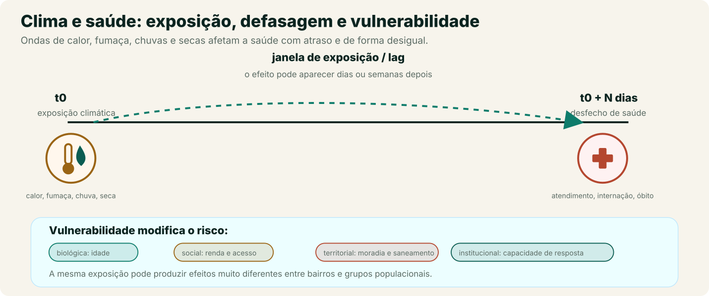

::: {.amazonia}

Cena de abertura · Amazônia

**Setembro, fim da tarde, em uma cidade média do Amazonas.** Há três semanas não chove.
O céu está cinza, mas não é nublado: é fumaça. Ela vem de queimadas que ardem a dezenas
ou centenas de quilômetros dali e cobre o ar com material particulado fino — as
partículas que entram fundo no pulmão. Na fila do pronto atendimento infantil, mães
seguram crianças com crise de asma. No hospital regional, leitos de cardiologia são
ocupados por idosos que chegaram com falta de ar e pressão descompensada.

**Rio acima, em uma comunidade ribeirinha, o mesmo período tem outra face.** O nível do
rio baixou, e o barco que leva vacinas, medicamentos e a equipe de saúde não conseguiu
atracar. A água de beber ficou mais turva. A malária voltou a aparecer em famílias que
moram perto da margem. Ninguém ali diria que está vivendo um "evento climático": estão
vivendo uma seca, uma fumaça, um rio que não dá passagem.

<cite>Cena composta a partir de situações recorrentes na Amazônia. Não descreve um
município específico.</cite>
:::

## A ideia principal

Clima e saúde, na Amazônia, não são dois assuntos vizinhos. São o mesmo problema visto de
dois ângulos.

Um óbito por insuficiência cardíaca três dias depois de uma onda de calor é registrado no
**Sistema de Informação sobre Mortalidade (SIM)** como doença cardiovascular. Uma criança
com diarreia depois de beber água contaminada por uma enchente é atendida como **doença
diarreica aguda**. Um caso de dengue notificado semanas depois da chuva entra no
**Sistema de Informação de Agravos de Notificação (SINAN)** como dengue. Em nenhum
desses registros aparece a palavra "clima". É exatamente por isso que o problema fica
invisível onde deveria ser previsto.

A tese deste capítulo cabe em uma frase: **a exposição climática se transforma em agravo
de saúde com atraso, sob outro nome e de forma desigual**. Quem organiza a resposta
apenas pelo boletim do dia vê o problema quando ele já virou fila, leito ocupado e óbito.

### Um guia nacional, com a Amazônia como ponto de partida

A Amazônia abre este guia porque é onde fumaça, seca, enchente e isolamento aparecem
juntos, com frequência e intensidade que exigem resposta específica. Mas o raciocínio não é
amazônico: é brasileiro. Este guia é nacional — foi escrito para qualquer município
brasileiro, e a Amazônia é o ponto de partida, não o limite.

No Semiárido, o perigo que organiza a agenda é a estiagem prolongada e a insegurança
hídrica. No Sul, são as ondas de frio e as chuvas intensas. No Sudeste e no Centro-Oeste,
são as ilhas de calor urbano — áreas da cidade que esquentam mais que o entorno — e a
poluição do ar. No litoral, são a ressaca, a enchente e a intrusão salina, o avanço da
água do mar sobre a água doce. O que muda é a combinação de perigo, exposição e
vulnerabilidade. O que permanece é a necessidade de olhar clima, saúde e território no
mesmo quadro.

::: {.callout-tip title="Como ler este capítulo"}
Não é preciso decorar siglas. O capítulo responde a cinco perguntas centrais: como o
clima vira risco; por que o efeito demora; quem adoece primeiro; como medir a exposição;
e o que a gestão pode fazer com isso. Os blocos principais terminam com a base científica
que sustenta a afirmação — para que o leitor possa conferir, contestar e aprofundar.
:::

## Como o clima se transforma em risco à saúde

Antes de olhar números, responda quatro perguntas. A ordem importa, porque cada resposta
muda a interpretação da seguinte.

1. **Perigo:** qual processo físico pode causar dano? Onda de calor, chuva extrema,
   enchente, estiagem, incêndio florestal, fumaça, friagem. Perigo não é sinônimo de
   desastre: um perigo se torna desastre quando encontra população exposta, vulnerável e
   sem capacidade de resposta.
2. **Exposição:** quem esteve sujeito ao perigo, onde, por quanto tempo e com que
   intensidade? A temperatura média do município não representa o telhado de zinco de um
   bairro periférico, nem o trabalhador que passa o dia em área aberta.
3. **Vulnerabilidade:** o que transforma exposição em dano? Idade, doença prévia, renda,
   moradia, saneamento, trabalho, mobilidade, racismo ambiental (a exposição desigual por
   raça e território), acesso à informação e acesso ao cuidado atuam juntos.
4. **Desfecho e resposta:** qual efeito foi observado e o que pode reduzi-lo? O desfecho
   pode ser óbito, internação, atendimento na atenção primária, notificação, sofrimento
   psíquico, interrupção de tratamento ou perda de acesso a um serviço.

O risco nasce da interação entre perigo, exposição e vulnerabilidade. O desfecho e a
resposta são o que se mede e o que se faz depois. A formulação não é uma multiplicação
matemática; é uma forma de lembrar que nenhum dos três explica o problema sozinho. A
mesma chuva que alaga um bairro sem drenagem pode ser apenas chuva em um bairro com
drenagem adequada. A mesma temperatura pode ser suportável para quem tem moradia ventilada
e insuportável para quem vive sob telhado de amianto.

A resposta pública atua sobre esses elementos: reduz a exposição (abrigo, alerta,
interrupção de atividade ao ar livre), protege grupos mais vulneráveis (busca ativa,
hidratação, transporte), fortalece a rede (plantão, insumos, protocolos) e mantém serviços
essenciais funcionando (água, energia, transporte, comunicação). Como o risco atravessa
setores, a resposta precisa ser intersetorial: saúde, meio ambiente, defesa civil,
assistência social, transporte e saneamento.

::: {.fonte role="note" aria-label="Base científica"}
O marco de perigo, exposição, vulnerabilidade e risco é o do [Sexto Relatório de Avaliação
do Painel Intergovernamental sobre Mudanças Climáticas (IPCC, AR6, Grupo de Trabalho II,
capítulo 7)](https://www.ipcc.ch/report/ar6/wg2/), que trata saúde e bem-estar como
resultado da interação entre clima, sociedade e capacidade de adaptação. A [Organização
Mundial da Saúde (OMS)](https://www.who.int/news-room/fact-sheets/detail/climate-change-and-health)
e o [Ministério da Saúde](https://www.gov.br/saude/pt-br/assuntos/saude-de-a-a-z/e/emergencias-climaticas)
adotam a mesma lógica: não basta medir o perigo; é preciso medir quem está exposto e
quem tem condições de se proteger.
:::

## Os caminhos pelos quais o clima chega à saúde

Agrupar os caminhos pelo mecanismo predominante ajuda a escolher o dado e o desfecho
corretos. Os grupos não são etapas sucessivas: eles se combinam no mesmo território.

| Caminho | Como o clima entra | Exemplos de desfecho |
|---|---|---|
| **Direto e físico** | Calor, frio, tempestade, inundação, deslizamento e fumaça atuam sobre o corpo | Estresse térmico, agravos cardiovasculares e respiratórios, lesões, afogamentos e óbitos |
| **Ambiental e ecológico** | Alteração da qualidade da água e do ar, de criadouros e de habitats | Arboviroses, malária, doenças transmitidas por água e alimentos, alergias e desnutrição |
| **Social e psicossocial** | Perda de renda, insegurança alimentar, deslocamento, ruptura de vínculos e perda do lugar | Ansiedade, depressão, estresse pós-traumático, piora do cuidado e abandono de tratamento |
| **Sistêmico e institucional** | Danos à energia, água, transporte, comunicação e unidades de saúde | Tratamento interrompido, atraso no diagnóstico, aumento da demanda e redução da capacidade de resposta |

Uma enchente pode aparecer nos quatro caminhos ao mesmo tempo: causa lesões, contamina a
água, desloca famílias e impede o funcionamento de uma unidade de saúde. Por isso, não
convém escolher um único "efeito principal" sem informar a população, o território, a
janela temporal e o serviço afetado.

### Saúde Única: a floresta, o vetor e a pessoa

**Saúde Única** (em inglês, *One Health*) é a abordagem que trata a saúde humana, a saúde
animal e a saúde dos ecossistemas como um único problema de gestão. Não é um slogan
ambiental: é uma forma de organizar a vigilância. Um patógeno que circula em animais
silvestres, um mosquito que se cria em água acumulada e uma pessoa que adoece fazem parte
do mesmo sistema ecológico.

Na Amazônia, desmatamento e fogo não apenas emitem carbono. Eles alteram a borda da
floresta, criam condições para determinados criadouros, deslocam animais e aproximam
pessoas de vetores e patógenos. A relação não é automática nem uniforme: depende do tipo
de uso do solo, da espécie de mosquito, da imunidade da população e das condições de
saneamento. Mas ela é forte o suficiente para que a política de saúde precise dialogar
com a política fundiária, ambiental e de fiscalização.

Uma advertência importante: **não é a floresta que "transmite" doenças**. É a forma como
ocupamos, desmatamos e alteramos a floresta que cria condições de transmissão. Culpar a
floresta ou as populações que vivem nela é um erro técnico e um preconceito recorrente.

::: {.fonte role="note" aria-label="Base científica"}
A abordagem de Saúde Única é adotada pela [OMS](https://www.who.int/health-topics/one-health)
e pelo [Plano de Ação Conjunto da Quadripartite — OMS, FAO, PNUMA e Organização Mundial de
Saúde Animal (WOAH)](https://www.who.int/publications/i/item/9789240059139).
Para a Amazônia, a revisão de [Ellwanger e colaboradores
(2020)](https://doi.org/10.1590/0001-3765202020191375) sistematiza como o desmatamento
altera a transmissão de malária, leishmaniose, arboviroses e outras doenças. A análise de
[Nobre e colaboradores (2016)](https://doi.org/10.1073/pnas.1605516113) mostra que
desmatamento e mudança do clima interagem e podem reduzir a resiliência da floresta,
com consequências para o bem-estar humano.
:::

## Três relógios: tempo, clima e saúde

"Tempo" e "clima" não são sinônimos, e a saúde responde a cada um em uma escala diferente.
Confundir as escalas leva a duas decisões erradas: tratar uma mudança estrutural como
evento passageiro ou tratar um evento passageiro como a nova normalidade.

| Relógio | Escala | Pergunta que responde | Resposta adequada |
|---|---|---|---|
| **Tempo** | Horas a dias | O que vem nos próximos dias? | Alerta, abrigo, reforço de plantão, restrição de atividade ao ar livre |
| **Clima** | Décadas | O padrão está mudando? | Adaptação de infraestrutura, revisão de protocolos, planejamento de rede |
| **Saúde** | Dias a meses (agudos); anos (crônicos) | Quando o agravo aparece? | Vigilância, busca ativa, preparação da atenção primária e da assistência |

**Tempo** é o que está acontecendo agora ou nos próximos dias: uma onda de calor de cinco
dias, uma chuva forte de uma tarde, uma frente fria que chega no fim de semana. É um
evento com começo e fim identificáveis no calendário.

**Clima** é o padrão de longo prazo: como temperatura, chuva e umidade se comportam em
uma região ao longo de décadas e como esse padrão está mudando. A referência usada para
comparar é a **normal climatológica** — no Brasil, em geral o período de 1991 a 2020. Uma
cidade pode ter clima historicamente ameno e, ainda assim, viver uma semana de calor
atípico: o evento pontual ocorre dentro de um pano de fundo que está mudando.

Uma onda de calor é um evento de tempo. O aumento da frequência, da duração e da
intensidade das ondas de calor é uma mudança de clima. As duas afirmações podem ser
verdadeiras ao mesmo tempo — e pedem respostas diferentes.

### O que é "seca" na Amazônia

"Seca" não é uma coisa só. A distinção importa para a saúde porque cada tipo de seca
produz um caminho diferente de dano.

- **Seca meteorológica:** chove menos que o esperado por um período prolongado.
- **Seca agrícola:** a umidade do solo cai e compromete a produção de alimentos.
- **Seca hidrológica:** o nível dos rios e dos reservatórios cai. Na Amazônia, é a que
  mais rapidamente vira problema de saúde, porque o rio é estrada, abastecimento e
  logística de medicamentos.
- **Seca socioeconômica:** a demanda por água supera a oferta, mesmo quando chove.

O chamado "verão amazônico" é um nome popular para o período de menor chuva, não uma
estação astronômica. Em boa parte da bacia, esse período vai de julho a outubro, com
variação regional. É também quando a fumaça das queimadas encontra o ar mais seco e a
dispersão fica pior.

Fenômenos de grande escala, como o **El Niño–Oscilação Sul (ENOS)**, deslocam a
probabilidade de chuva e seca. O El Niño tende a favorecer seca no norte da Amazônia; a
La Niña, o oposto em parte da bacia. Mas tendência não é destino: o efeito depende da
região, do uso do solo e de outros fatores oceânicos e atmosféricos. Planejar apenas pela
média histórica é insuficiente; é preciso planejar para o extremo.

::: {.fonte role="note" aria-label="Base científica"}
As definições de seca e a distinção entre seca meteorológica, agrícola e hidrológica
seguem a [Organização Meteorológica Mundial (OMM)](https://wmo.int/topics/drought). A
normal climatológica de 1991–2020 é o padrão adotado pelo [Instituto Nacional de
Meteorologia (INMET)](https://www.gov.br/inmet/pt-br).
A variabilidade climática da Amazônia, incluindo o papel do ENOS e das mudanças no uso do
solo, está sintetizada em [Marengo e colaboradores
(2018)](https://doi.org/10.3389/feart.2018.00228).
:::

## Por que o efeito demora a aparecer

Entre a exposição climática — o calor, a chuva, a fumaça, a seca — e o desfecho de saúde
— a internação, o atendimento, o óbito — existe um intervalo. Esse intervalo se chama
**defasagem** (em inglês, *lag*). Ignorá-lo é um dos erros mais comuns de quem olha clima
e saúde lado a lado.

A duração da defasagem depende do mecanismo:

| Exposição | Quando o efeito costuma aparecer | Exemplo |
|---|---|---|
| Calor extremo | Mesmo dia até cerca de uma semana | Infarto, insuficiência cardíaca, agravamento renal |
| Fumaça de queimada | Horas a poucos dias | Crise de asma, bronquite, internação respiratória |
| Chuva e dengue | Cerca de 2 a 8 semanas | O mosquito se desenvolve, o vírus incuba e a pessoa adoece |
| Enchente | Dias a semanas | Leptospirose, diarreia, infecção de pele |
| Seca prolongada | Semanas a meses | Insegurança hídrica e alimentar, malária (depende do contexto), sofrimento psíquico |

No calor, parte do efeito aparece rápido, mas também pode haver **deslocamento de
mortalidade** (o chamado efeito colheita): pessoas muito frágeis morrem alguns dias antes
do que morreriam sem o evento. Isso não torna o evento menos grave; muda a forma de
contar. Em séries curtas, o total pode parecer estável mesmo quando o risco de morrer
naquele período aumentou.

Na dengue, a defasagem tem uma explicação concreta. A água da chuva precisa acumular; a
larva precisa se desenvolver; o mosquito adulto precisa picar uma pessoa infectada; o
vírus precisa incubar no mosquito; e a pessoa precisa adoecer e ser atendida. Cada etapa
consome dias. O intervalo total costuma ser de semanas, não de horas. Além da chuva, o
**acúmulo de calor** — resumido em graus-dia (GDD) — também governa o desenvolvimento do
vetor e a incubação do vírus; por isso o estudo de caso do Capítulo 8 usa GDD como
exposição principal e chuva como extensão.

Na fumaça, o efeito respiratório pode aparecer no mesmo dia ou em poucos dias, enquanto o
efeito acumulado de uma temporada inteira sobre doenças crônicas leva meses para ser
percebido.

::: {.callout-important title="Importante"}
Se o boletim de saúde do dia seguinte a uma onda de calor não mostra nada fora do normal,
a conclusão errada é "não teve efeito". A conclusão mais adequada é "ainda não deu tempo
de aparecer" — ou "o efeito apareceu com outro nome". Esse intervalo costuma ser ignorado
quando clima e saúde são tratados como dois assuntos separados.
:::

{fig-alt="Diagrama mostra uma exposição climática no tempo zero, uma seta pontilhada indicando dias ou semanas de defasagem e, à direita, o desfecho de saúde. Abaixo, uma faixa indica que vulnerabilidade biológica, social, territorial e institucional modifica o risco."}

::: {.fonte role="note" aria-label="Base científica"}
A relação entre temperatura e mortalidade, com estrutura de defasagem e variação entre
cidades, foi demonstrada por [Gasparrini e colaboradores
(2015)](https://doi.org/10.1016/S0140-6736(14)62114-0), em estudo com cidades de vários
países. Para dengue e eventos hidrometeorológicos no Brasil, [Lowe e colaboradores
(2021)](https://doi.org/10.1016/S2542-5196(20)30292-8) mostram como chuva, temperatura e
urbanização combinam-se em janelas de risco. A [OMS](https://www.who.int/news-room/fact-sheets/detail/climate-change-heat-and-health)
resume os mecanismos fisiológicos do calor e a importância de considerar grupos e
defasagens.
:::

## Quem sente primeiro e quem sente mais forte

O mesmo evento não afeta todo mundo do mesmo jeito. Dois bairros da mesma cidade podem
receber a mesma onda de calor e registrar números muito diferentes de atendimento — e a
diferença raramente está só na temperatura medida.

A vulnerabilidade tem quatro camadas que se somam:

- **Biológica:** idosos regulam temperatura com menos eficiência, sentem menos sede e têm
  mais doenças crônicas de base; crianças pequenas têm vias aéreas menores, respiram mais
  rápido por unidade de peso e têm sistema imunológico em maturação; gestantes e pessoas
  com doença renal, cardíaca ou respiratória também têm risco aumentado.
- **Social:** quem trabalha ao ar livre, depende do rio para se deslocar, tem menos acesso
  a água potável ou não pode faltar ao trabalho para buscar atendimento chega mais exposto
  e mais tarde ao serviço de saúde. Renda, escolaridade, racismo e violência institucional
  — barreiras no atendimento — moldam esse caminho.
- **Territorial:** moradia sem ventilação vira forno; bairro sem drenagem acumula água;
  ausência de arborização eleva a temperatura; proximidade de queimadas ou de vias de
  tráfego intenso aumenta a exposição à fumaça e à poluição. Na Amazônia, o tempo de barco
  até a unidade de saúde também é território.
- **Institucional:** município sem equipe de vigilância completa, sem sala de situação,
  sem plano de contingência ou com hospital de referência a centenas de quilômetros tem
  menos capacidade de responder.

Essas camadas não competem entre si. Elas se somam. Um idoso que mora em casa de zinco,
num bairro sem área verde, com a unidade de saúde fechada no fim de semana, acumula
riscos que nenhuma das camadas explica sozinha.

Na Amazônia, populações ribeirinhas, indígenas e quilombolas acumulam, com frequência,
maior exposição e menor acesso a serviços — não por características culturais, mas por
desigualdades históricas de território e infraestrutura.

Por isso, **vulnerabilidade não é um atributo da pessoa; é a relação entre a pessoa, o
lugar e a capacidade de resposta**. Dizer que um grupo é "mais vulnerável" não é apenas
uma constatação biológica. É, sobretudo, uma constatação social, territorial e
institucional — e, portanto, uma questão de decisão pública.

::: {.callout-tip title="Dica"}
A mesma onda de calor pode atingir toda a cidade, mas o risco não se distribui de forma
igual. Em geral, ele acompanha desigualdades já conhecidas pela gestão: moradia,
saneamento, renda, trabalho e acesso ao cuidado. Se o mapa de risco coincide com o mapa da
desigualdade, não é coincidência.
:::

::: {.fonte role="note" aria-label="Base científica"}
O IPCC (AR6, Grupo de Trabalho II, capítulo 7) trata vulnerabilidade como combinação de
sensibilidade, exposição e capacidade adaptativa, e não como característica individual.
O [Observatório de Clima e Saúde da Fiocruz](https://climaesaude.icict.fiocruz.br/)
documenta como condições de moradia, saneamento e território modulam o efeito do clima
sobre a saúde no Brasil. A [Política Nacional de Vigilância em Saúde (Resolução CNS nº
588/2018)](https://www.gov.br/conselho-nacional-de-saude/pt-br/atos-normativos/resolucoes/2018/resolucao-no-588.pdf) determina que a
vigilância atue sobre determinantes sociais e ambientais, e não apenas sobre casos
notificados.
:::

## Como descrever uma exposição climática

Antes de cruzar clima e saúde, defina o que está sendo medido. "Calor" pode significar
temperatura máxima, temperatura média, sensação térmica, duração de uma onda de calor ou
distância em relação à normal climatológica. "Chuva" pode significar acumulado em 24
horas, em sete dias ou no mês. "Fumaça" pode ser representada por focos de calor
detectados por satélite ou pela concentração estimada de material particulado. Essas
medidas não são intercambiáveis.

| Palavra | Pode significar | O que muda na interpretação |
|---|---|---|
| **Calor** | Temperatura máxima, média, sensação térmica, percentil, duração | Uma média pode esconder picos; um percentil local é mais comparável entre regiões |
| **Chuva** | Acumulado em 24 h, 7 dias, 30 dias, anomalia, índice padronizado | Chuva intensa em pouco tempo produz enchente; chuva acumulada produz criadouro |
| **Fumaça** | Focos de calor, material particulado fino (MP2,5), espessura óptica de aerossóis (medida de quanto a fumaça bloqueia a luz) | Foco de calor não é área queimada; concentração não é exposição individual |
| **Clima** | Estação meteorológica, grade interpolada, reanálise | Estação mede um ponto; grade estima uma área com incerteza |

Uma estação mede condições em um ponto. Uma grade — incluindo uma **reanálise**, que
combina observações e modelos para estimar o clima em uma grade regular — estima condições
em uma área, com incerteza. O valor atribuído a um município é uma aproximação da
exposição da população e pode esconder diferenças entre bairros, moradias e locais de
trabalho. Na Amazônia, esse problema é ampliado pelo tamanho dos municípios: alguns têm
área maior que a de Portugal, com dezenas de comunidades distribuídas por rios e estradas.

Três cuidados evitam conclusões erradas:

- **Dado faltante não é zero.** Estação sem registro não significa ausência de calor;
  município sem notificação não significa ausência de dengue.
- **Média municipal não é exposição individual.** Ela serve para comparar territórios,
  não para dizer o que aconteceu com cada pessoa.
- **Fonte, resolução, unidade, período, agregação e lacunas precisam ser registrados.**
  Sem isso, duas análises podem usar a mesma palavra para exposições diferentes.

::: {.callout-note title="Nota"}
Uma **normal climatológica** é uma referência histórica, não uma previsão e não um limiar
universal de perigo. Ao classificar um extremo, informe o período de referência e o
critério usado para definir o limiar. O INMET e a literatura epidemiológica não usam
necessariamente o mesmo critério de "onda de calor"; um critério frequente em estudos de
saúde é o percentil 95 da temperatura para cada local — o valor que só é ultrapassado em
5% dos dias — por dois ou mais dias consecutivos. Outros métodos usam percentis
diferentes; o importante é declarar o critério e o período de referência. Por isso, o
critério deve ser declarado antes da análise.
:::

::: {.fonte role="note" aria-label="Base científica"}
As normas sobre normais climatológicas e monitoramento de seca são da
[OMM](https://wmo.int/topics/drought); no Brasil, os dados de referência são do
[INMET](https://www.gov.br/inmet/pt-br). Os focos de calor e as áreas queimadas são
monitorados pelo [Instituto Nacional de Pesquisas Espaciais
(INPE)](https://terrabrasilis.dpi.inpe.br/queimadas/). A classificação da poluição do ar
exterior e do material particulado como carcinogênicos para humanos (Grupo 1) está na
monografia 109 da [Agência Internacional para Pesquisa em Câncer
(IARC)](https://publications.iarc.who.int/Book-And-Report-Series/Iarc-Monographs-On-The-Identification-Of-Carcinogenic-Hazards-To-Humans/Outdoor-Air-Pollution-2015).
:::

## Recortes: calor, fumaça, chuva e seca

Os quatro recortes abaixo não esgotam o tema. Eles mostram como o mesmo raciocínio muda
de acordo com o perigo, o território e o desfecho. A Amazônia é o fio condutor, mas cada
bloco indica onde o padrão se repete em outras regiões.

### Calor e frio

O calor extremo não é privilégio do Sudeste. Em Manaus e em cidades do interior da
Amazônia, a combinação de temperatura alta com umidade elevada reduz a eficiência da
sudorese e aumenta a sensação de calor. O corpo tem mais dificuldade de perder calor, o
coração trabalha mais e os rins sofrem com a desidratação. Idosos, crianças, gestantes,
trabalhadores ao ar livre e pessoas com doença cardiovascular ou renal são os primeiros a
sentir.

Estudo sobre ondas de calor na Amazônia brasileira encontrou associação entre calor e
aumento de mortalidade, com variação por causa de morte, subgrupo populacional e
características da onda. A intensidade da onda pesou mais que a duração — o que reforça
que não basta contar dias de calor; é preciso medir o quanto o calor passou do padrão
local.

O frio também tem face amazônica. As incursões de ar polar, conhecidas na região como
**friagem**, derrubam a temperatura por alguns dias, sobretudo no sul da Amazônia, e
podem aumentar internações respiratórias e cardiovasculares em populações com moradia sem
isolamento térmico. É um perigo menos frequente, mas não desprezível.

### Fumaça e qualidade do ar

Na temporada de queimadas, a fumaça lança material particulado fino (MP2,5; partículas com
até 2,5 micrômetros de diâmetro) na atmosfera. Essas partículas são pequenas o suficiente
para penetrar nos alvéolos pulmonares; parte delas pode alcançar a corrente sanguínea. A
exposição está associada a crises de asma, bronquite, pneumonia, agravamento de doença
pulmonar obstrutiva crônica e aumento de eventos cardiovasculares.

Crianças pequenas são especialmente afetadas porque têm vias aéreas menores e respiram
mais rápido. Idosos, gestantes e pessoas com doença respiratória ou cardíaca prévia também
fazem parte do grupo de maior risco. O efeito pode aparecer no mesmo dia ou em poucos
dias — diferente da dengue, que leva semanas.

Dois pontos técnicos evitam confusão:

- **Foco de calor não é o mesmo que área queimada.** O satélite detecta anomalias
  térmicas; uma queimada pequena e intensa pode gerar foco sem produzir uma grande
  cicatriz visível, e uma área queimada pode ter poucos focos no momento da passagem.
- **A fumaça não respeita fronteira municipal.** Ela viaja por centenas de quilômetros e
  pode afetar cidades que não têm queimada no seu território.

A queimada amazônica não é, em geral, um evento natural isolado. Ela está ligada a uso do
solo, desmatamento e manejo agrícola. Tratar apenas o incêndio, sem tratar a origem, é
apagar o sintoma.

### Chuva, enchente e vetores

A chuva intensa pode produzir enchente, deslizamento, contaminação da água e aumento de
doenças transmitidas por água e alimentos. Em áreas urbanas sem drenagem, a água parada
permanece por dias e cria condições para mosquitos.

Mas a relação entre chuva e dengue não é automática. O *Aedes aegypti* prefere água limpa
acumulada em recipientes domésticos; o *Anopheles darlingi*, principal vetor da
malária na Amazônia, tem ecologia diferente, ligada a coleções de água com vegetação e
sombra. A mesma chuva não produz os mesmos mosquitos. Temperatura, saneamento, imunidade
pregressa da população e qualidade da notificação também modulam o efeito.

No Brasil, quase todos os casos autóctones de malária concentram-se na Amazônia Legal. A
doença não é apenas um problema de área rural distante: ela acompanha o deslocamento de
pessoas, a ocupação do território, o garimpo e as mudanças ambientais. Confundir malária
com dengue — ou tratar as duas como "doença de chuva" — leva a resposta errada.

### Seca, rios e isolamento

Na Amazônia, a seca hidrológica produz efeitos de saúde próprios, que não dependem de
enchente, calor extremo ou fumaça. Quando o rio baixa, o transporte de vacinas,
medicamentos, insumos e equipes fica comprometido. Comunidades ficam isoladas;
tratamentos são interrompidos; a água de beber fica mais escassa e mais contaminada; a
produção de alimentos cai.

O isolamento, nesse contexto, é um desfecho de saúde. Não aparece no SIM como causa de
morte, mas aparece como atraso no diagnóstico, interrupção de diálise, parto sem
assistência e vacinação não realizada.

A relação entre seca e malária não é uniforme. Em alguns contextos, a redução do nível
dos rios e a formação de poças nas margens podem favorecer criadouros; em outros, a seca
pode reduzir a disponibilidade de água e a densidade do vetor. O que vale para um trecho
do rio pode não valer para outro. Por isso, a análise precisa ser local e declarar o
mecanismo esperado.

::: {.callout-important title="Dois erros que distorcem a leitura"}
**1. Confundir associação com causa (confundimento).** Um município com mais chuva pode ter mais dengue
porque também tem mais calor, menos saneamento ou melhor notificação. A chuva pode ser
parte da explicação, não a explicação inteira.

**2. Cometer erro de interpretação ecológica (erro ecológico).** Um padrão agregado por município ou por semana não garante
que cada pessoa exposta vai adoecer. Dizer "a cidade teve mais casos" é diferente de dizer
"esta pessoa vai ter dengue". O padrão coletivo serve para priorizar onde e quando agir;
não substitui a avaliação clínica de um caso individual.
:::

::: {.fonte role="note" aria-label="Base científica"}
Para calor e mortalidade na Amazônia, ver [Silveira e colaboradores
(2023)](https://doi.org/10.1016/j.ijheh.2022.114109). Para material particulado e
internações respiratórias de idosos no sul da Amazônia, ver [Machin e colaboradores
(2019)](https://doi.org/10.1590/1414-431X20188130). Para a combinação de chuva,
temperatura e urbanização no risco de dengue no Brasil, ver [Lowe e colaboradores
(2021)](https://doi.org/10.1016/S2542-5196(20)30292-8). Dados de focos de calor estão no
[INPE](https://terrabrasilis.dpi.inpe.br/queimadas/); o cenário epidemiológico da malária e
da dengue no país é atualizado pelo [Ministério da Saúde](https://www.gov.br/saude/pt-br/assuntos/saude-de-a-a-z/m/malaria)
e pelo [InfoDengue](https://info.dengue.mat.br/).
:::

## A oportunidade de saúde: co-benefícios

A resposta ao clima não produz apenas custos. Ela pode gerar benefícios imediatos para a
saúde — os chamados **co-benefícios**. Transporte ativo reduz emissões e aumenta atividade
física. Ar mais limpo reduz crises de asma. Moradia com ventilação e isolamento adequados
reduz internações por calor e frio. Áreas verdes reduzem a temperatura local. Alimentação
saudável e produção local reduzem a insegurança alimentar.

Na Amazônia, manter a floresta em pé é também uma decisão de saúde: a floresta regula
chuva, influencia a qualidade do ar e reduz a exposição a zoonoses associadas à ocupação
de borda florestal. **Adaptação** é reduzir o risco do que já está acontecendo;
**mitigação** é reduzir as emissões que intensificam o problema. Uma não substitui a
outra. Isso significa que política climática e política de saúde podem compartilhar
instrumentos.

Ao comparar medidas, registre quatro pontos: o benefício esperado, quem será beneficiado,
quem pode ficar de fora e como o resultado será acompanhado. Uma medida que reduz a
temperatura média de um bairro nobre, mas não do bairro mais quente, não reduz
desigualdade — apenas melhora a média.

Também é preciso distinguir uma **estimativa observacional** de uma **avaliação de impacto
de política**. A primeira descreve associação entre exposição e desfecho; a segunda tenta
identificar o efeito causal de uma intervenção. As duas são úteis, mas respondem a
perguntas diferentes.

::: {.fonte role="note" aria-label="Base científica"}
O conceito de co-benefícios e a relação entre resposta climática e saúde são discutidos
em [Ebi, Hess e Watkiss (2017)](https://www.ncbi.nlm.nih.gov/books/NBK525226/), no
capítulo sobre riscos e custos da variabilidade e da mudança do clima. O [Lancet
Countdown](https://lancetcountdown.org/) acompanha indicadores de saúde e clima no Brasil
e no mundo, incluindo exposição a calor, poluição do ar, adaptação do setor saúde e
co-benefícios de medidas de mitigação. As diretrizes de adaptação do setor saúde estão no
[Ministério da Saúde](https://www.gov.br/saude/pt-br/assuntos/saude-de-a-a-z/e/emergencias-climaticas)
e no [Plano Clima](https://www.gov.br/mma/pt-br/assuntos/mudanca-do-clima).
:::

## Comunicação para ação

Resultado técnico não protege ninguém se não chega a quem precisa decidir e agir. A
comunicação de risco precisa ser curta, repetida e emitida por fontes reconhecidas no
território. Explique o risco sem alarmismo, indique uma conduta possível e informe onde
buscar cuidado.

Quando houver incerteza, diga o que se sabe, o que ainda não se sabe e qual medida
preventiva é razoável enquanto a informação é aprimorada. Não prometa certeza que o dado
não tem. Não apresente projeção como destino inevitável.

Três princípios ajudam:

- **Alerta sem resposta possível aumenta a descrença.** Se a mensagem manda evacuar e não
  há abrigo, ou manda procurar o posto e o posto está fechado, a próxima mensagem será
  ignorada.
- **A fonte importa.** Em áreas ribeirinhas e rurais, rádio, agente comunitário de saúde,
  agente de endemias, liderança comunitária e escola chegam onde o aplicativo não chega.
  Não substitua o contato humano por uma tela.
- **Não culpe a população.** A pessoa pode adotar cuidados, mas é a gestão que organiza
  serviços, informação, infraestrutura e proteção social. Comunicar risco é explicar
  responsabilidades institucionais, não transferir culpa.

::: {.fonte role="note" aria-label="Base científica"}
As orientações de comunicação de risco e de preparação para emergências em saúde estão no
[guia do Ministério da Saúde para profissionais de saúde](https://www.gov.br/saude/pt-br/centrais-de-conteudo/publicacoes/guias-e-manuais/2026/mudancas-climaticas-para-profissionais-de-saude-guia-de-bolso.pdf)
e nas diretrizes da [OMS para mudança do clima e saúde](https://www.who.int/news-room/fact-sheets/detail/climate-change-and-health).
A [Política Nacional de Vigilância em Saúde](https://www.gov.br/conselho-nacional-de-saude/pt-br/atos-normativos/resolucoes/2018/resolucao-no-588.pdf)
inclui a comunicação e a mobilização social como componentes da resposta.
:::

## De observação a ação

Até aqui, cada recorte foi contado como uma história separada: uma onda de calor, uma
temporada de fumaça, uma chuva, uma seca. Mas o padrão que atravessa os quatro é sempre o
mesmo: um perigo climático, uma defasagem, um grupo mais exposto e com menos capacidade de
resposta, que sente o efeito primeiro e mais forte. E, quase sempre, um registro de saúde
que não menciona o clima.

Descrever esse padrão uma vez, para um evento específico, é possível com um boletim
climático em uma mão e um boletim epidemiológico na outra. O problema é fazer isso de
forma **repetível**: para o próximo evento, no próximo município, com o próximo agravo,
sem recomeçar a análise do zero e sem juntar planilhas manualmente.

As peças existem, mas estão separadas:

- **Saúde:** SIM (óbitos), Sistema de Informações Hospitalares do Sistema Único de Saúde
  (SIH/SUS), SINAN (notificações), e-SUS APS (registros da atenção primária) e Sistema de
  Informação de Vigilância Epidemiológica da Malária (SIVEP-Malária).
- **Clima e ambiente:** estações do INMET, grades de reanálise e satélite, focos de calor
  do INPE, monitoramento de seca do Centro Nacional de Monitoramento e Alertas de
  Desastres Naturais (CEMADEN).
- **Território:** malha municipal, população, saneamento, renda e condições de moradia.

O que falta, com frequência, não é apenas o dado: é o método que coloca essas bases na
mesma unidade de tempo e de território, com documentação suficiente para que outra equipe
consiga repetir e auditar o caminho. No SUS, essa rotina é atribuição da vigilância em
saúde, que deve articular dados, território e resposta assistencial.

É nesse ponto que a observação precisa virar rotina de trabalho. Para passar de
"percebemos que isso aconteceu" para "sabemos quando isso costuma acontecer, para quem e
com antecedência suficiente para preparar uma resposta", a equipe precisa analisar esses
dados em conjunto, com método documentado e repetível. É isso que o restante deste guia
ensina — e os mesmos passos valem para qualquer município brasileiro. O que muda são as
fontes, as perguntas e a combinação de vulnerabilidades.

## Em cinco frases

- O clima não age sozinho: ele empurra um corpo já vulnerável, num território já desigual,
  para mais perto do adoecimento.
- O efeito quase nunca aparece no mesmo dia; cada agravo tem uma defasagem própria.
- O registro de saúde raramente diz "clima": ele diz infarto, diarreia, dengue, asma.
- A vulnerabilidade é biológica, social, territorial e institucional — e, por isso, é
  assunto de decisão pública.
- Para antecipar o problema, é preciso juntar saúde, clima e território com método
  documentado e repetível.

::: {.callout-note collapse="true"}
## Verifique se ficou

**1. Por que um caso de dengue pode aparecer semanas depois de uma chuva forte, e não no
dia seguinte?**

Porque existe uma defasagem entre a exposição climática e o desfecho, e essa defasagem tem
duração diferente para cada tipo de exposição. Na dengue, a água precisa acumular, a larva
precisa se desenvolver, o mosquito precisa picar uma pessoa infectada, o vírus precisa
incubar no mosquito e a pessoa precisa adoecer e ser atendida. Esse ciclo leva semanas.
Esperar o efeito no dia seguinte leva à conclusão errada de que "não teve efeito".

**2. Dois bairros recebem a mesma onda de calor. Por que um pode ter muito mais
atendimentos de emergência que o outro?**

Porque a vulnerabilidade não é só biológica. Moradia, ventilação, arborização, acesso a
água, renda, trabalho e distância até o serviço de saúde variam de bairro para bairro e
ampliam ou reduzem o efeito da mesma exposição. A temperatura média da cidade não captura
essas diferenças.

**3. Qual a diferença entre "uma onda de calor de 5 dias" e "o clima está esquentando"?**

A onda de calor é um evento de **tempo**: pontual, com começo e fim, que pede resposta de
curto prazo (alerta, plantão reforçado, abrigo). "O clima está esquentando" descreve uma
mudança de padrão de longo prazo, que pede planejamento estrutural (adaptação urbana,
redesenho da rede de saúde, revisão de protocolos). Confundir os dois relógios leva a
decisões equivocadas.

**4. Um município com mais chuva registrou mais casos de dengue no mesmo período. Isso
significa que qualquer pessoa exposta a uma poça de água vai desenvolver dengue?**

Não. Existem dois erros possíveis aqui. O primeiro é confundir associação com causa: o
município pode ter mais dengue por causa de temperatura, saneamento, imunidade da
população ou qualidade da notificação. O segundo é o **erro de interpretação ecológica**
(erro ecológico): um padrão
agregado por município não garante o que acontecerá com cada pessoa. O padrão coletivo
serve para decidir onde e quando agir; não substitui a avaliação clínica individual.

**5. Por que um óbito causado por calor raramente aparece como "morte por calor" no
sistema de saúde?**

Porque o SIM registra a causa básica segundo a Classificação Internacional de Doenças
(CID-10). O calor raramente é codificado como causa; o que aparece é a consequência —
infarto, insuficiência cardíaca, insuficiência renal, agravamento de doença respiratória.
Além disso, o efeito pode ocorrer dias depois da exposição. Por isso, contar apenas óbitos
codificados como "calor" subestima o problema.
:::

## Referências

**Fontes institucionais e políticas**

- IPCC. *Climate Change 2022: Impacts, Adaptation and Vulnerability*. Contribuição do
  Grupo de Trabalho II ao Sexto Relatório de Avaliação. [Relatório
  completo](https://www.ipcc.ch/report/ar6/wg2/).
- Organização Mundial da Saúde (OMS). *Climate change and health*. [Nota
  técnica](https://www.who.int/news-room/fact-sheets/detail/climate-change-and-health).
- Organização Mundial da Saúde (OMS). *Heat and health*. [Nota
  técnica](https://www.who.int/news-room/fact-sheets/detail/climate-change-heat-and-health).
- Organização Mundial da Saúde (OMS). *One Health*. [Página
  temática](https://www.who.int/health-topics/one-health).
- OMS, FAO, PNUMA e WOAH. *One Health Joint Plan of Action (2022–2026)*. [Publicação
  OMS](https://www.who.int/publications/i/item/9789240059139).
- Ministério da Saúde. *Emergências climáticas*. [Página
  oficial](https://www.gov.br/saude/pt-br/assuntos/saude-de-a-a-z/e/emergencias-climaticas).
- Ministério da Saúde. *Mudanças climáticas para profissionais de saúde: guia de bolso*.
  2. ed. rev. Brasília, 2026.
  [PDF](https://www.gov.br/saude/pt-br/centrais-de-conteudo/publicacoes/guias-e-manuais/2026/mudancas-climaticas-para-profissionais-de-saude-guia-de-bolso.pdf).
- Ministério da Saúde. *Vigilância em Saúde*. [Página
  oficial](https://www.gov.br/saude/pt-br/composicao/svsa).
- Ministério da Saúde. *Malária*. [Página
  oficial](https://www.gov.br/saude/pt-br/assuntos/saude-de-a-a-z/m/malaria).
- Ministério da Saúde. *Dengue*. [Página
  oficial](https://www.gov.br/saude/pt-br/assuntos/saude-de-a-a-z/d/dengue).
- Conselho Nacional de Saúde. *Resolução nº 588/2018 — Política Nacional de Vigilância em
  Saúde*. [PDF](https://www.gov.br/conselho-nacional-de-saude/pt-br/atos-normativos/resolucoes/2018/resolucao-no-588.pdf).
- Presidência da República. *Lei nº 8.080/1990 — Lei Orgânica da Saúde*.
  [Texto](https://www.planalto.gov.br/ccivil_03/leis/l8080.htm).
- INMET. *Dados e normais climatológicas*. [Portal](https://www.gov.br/inmet/pt-br).
- INPE. *Monitoramento de queimadas e áreas queimadas*.
  [TerraBrasilis](https://terrabrasilis.dpi.inpe.br/queimadas/).
- CEMADEN. *Monitoramento e alertas de desastres naturais*.
  [Portal](https://www.gov.br/cemaden/pt-br).
- Fiocruz. *Observatório de Clima e Saúde*. [Portal](https://climaesaude.icict.fiocruz.br/).
- InfoDengue. *Monitoramento de arboviroses*. [Portal](https://info.dengue.mat.br/).
- Lancet Countdown. *Tracking progress on health and climate change*.
  [Portal](https://lancetcountdown.org/).
- OMM (WMO). *Drought*. [Página temática](https://wmo.int/topics/drought).
- IARC. *Outdoor Air Pollution*. IARC Monographs Volume 109.
  [Publicação](https://publications.iarc.who.int/Book-And-Report-Series/Iarc-Monographs-On-The-Identification-Of-Carcinogenic-Hazards-To-Humans/Outdoor-Air-Pollution-2015).
- Ministério do Meio Ambiente e Mudança do Clima. *Mudança do clima e Plano Clima*.
  [Página oficial](https://www.gov.br/mma/pt-br/assuntos/mudanca-do-clima).

**Literatura científica**

- EBI, K. L.; HESS, J. J.; WATKISS, P. Health risks and costs of climate variability and
  change. In: MOCK, C. N. et al. (ed.). *Injury Prevention and Environmental Health*. 3.
  ed. Washington: World Bank, 2017. cap. 8.
  [DOI](https://doi.org/10.1596/978-1-4648-0522-6_ch8).
- ELLWANGER, J. H. et al. Beyond diversity loss and climate change: impacts of Amazon
  deforestation on infectious diseases and public health. *Anais da Academia Brasileira de
  Ciências*, v. 92, n. 1, e20191375, 2020.
  [DOI](https://doi.org/10.1590/0001-3765202020191375).
- GASPARRINI, A. et al. Mortality risk attributable to high and low ambient temperature: a
  multicountry observational study. *The Lancet*, v. 386, n. 9991, p. 369–375, 2015.
  [DOI](https://doi.org/10.1016/S0140-6736(14)62114-0).
- LOWE, R. et al. Combined effects of hydrometeorological hazards and urbanisation on
  dengue risk in Brazil: a spatiotemporal modelling study. *The Lancet Planetary Health*,
  v. 5, n. 4, p. e209–e219, 2021.
  [DOI](https://doi.org/10.1016/S2542-5196(20)30292-8).
- MACHIN, A. B. et al. Effects of exposure to fine particulate matter in elderly
  hospitalizations due to respiratory diseases in the South of the Brazilian Amazon.
  *Brazilian Journal of Medical and Biological Research*, v. 52, n. 2, e8130, 2019.
  [DOI](https://doi.org/10.1590/1414-431X20188130).
- MARENGO, J. A. et al. Changes in climate and land use over the Amazon region: current
  and future variability and trends. *Frontiers in Earth Science*, v. 6, art. 228, 2018.
  [DOI](https://doi.org/10.3389/feart.2018.00228).
- NOBRE, C. A. et al. Land-use and climate change risks in the Amazon and the need of a
  novel sustainable development paradigm. *Proceedings of the National Academy of
  Sciences*, v. 113, n. 39, p. 10759–10768, 2016.
  [DOI](https://doi.org/10.1073/pnas.1605516113).
- SILVEIRA, I. H. et al. Heat waves and mortality in the Brazilian Amazon: effect
  modification by heat wave characteristics, population subgroup, and cause of death.
  *International Journal of Hygiene and Environmental Health*, v. 248, art. 114109, 2023.
  [DOI](https://doi.org/10.1016/j.ijheh.2022.114109).
