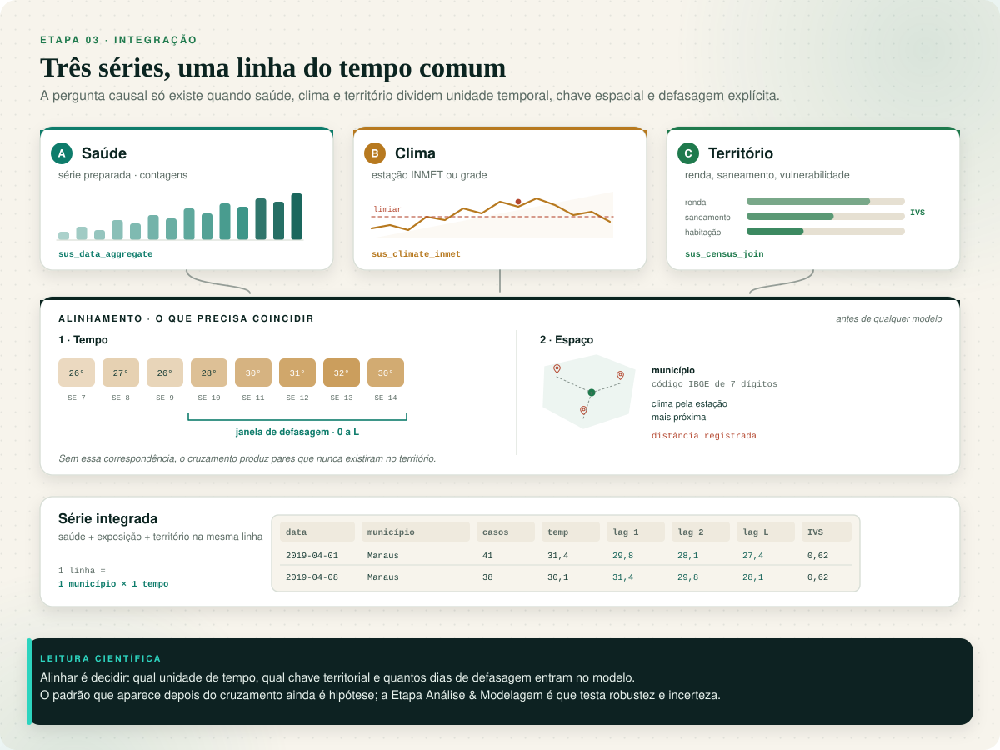
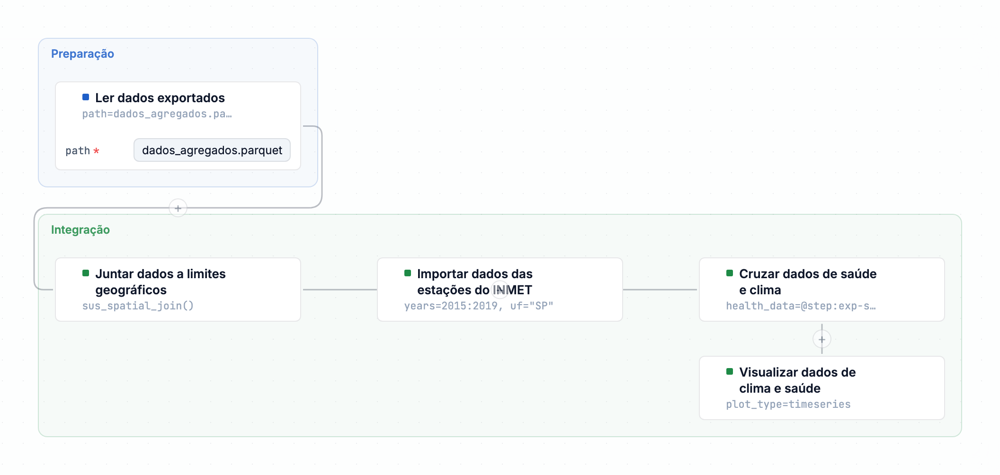

No Capítulo 0 apresentamos a ideia de que os efeitos das exposições climáticas podem ser imediatos ou apresentar
**defasagem** — o calor de hoje pode virar internação em poucos dias, a chuva de
uma semana pode virar caso de dengue semanas depois. Até aqui, no Capítulo 2, você
aprendeu a deixar uma série de saúde limpa, recortada e agregada. Falta uma peça: essa
série de saúde, isoladamente, não permite estudar esse efeito — é preciso ter uma série de
clima ao lado, casada no tempo e no espaço com os dados de saúde, e — na maioria dos
casos — também uma medida do território em que isso acontece. É esse cruzamento
que a Etapa **Integração** faz.

O exemplo operacional deste capítulo usa dengue no Nordeste; a mesma lógica vale para a
Amazônia, onde a grade costuma ser ainda mais necessária pela distribuição irregular das
estações.

Este capítulo mantém a régua operacional do Capítulo 2, mas inclui decisões
metodológicas: qual fonte de clima usar, qual defasagem escolher. Essas escolhas
reaparecem como Parâmetros concretos de uma Função, as mesmas
ideias que o Capítulo 0 apresentou de forma leiga.

## Por que juntar clima, saúde e território

Relacionar dados de saúde, clima e território permite investigar associações com uma
unidade espacial e temporal explícita. A integração, por si só, não identifica causas.

Características territoriais podem modificar a exposição, a suscetibilidade e o acesso
aos serviços. Algumas podem atuar como confundidoras, outras como modificadoras de efeito
ou mediadoras, conforme a pergunta e a estrutura causal. Não se deve classificar renda ou
saneamento automaticamente como confundidores nem incluir todas as variáveis disponíveis
sem justificativa. Em uma série de um único município, características praticamente
constantes têm papel diferente daquele observado em comparações entre municípios.

## As 33 Funções da Integração, em 4 grupos

A Biblioteca reúne 33 ações na Etapa Integração, organizadas em quatro famílias:

**(a) Clima por estação** — dados observados em estações meteorológicas do INMET.

- **Importar dados das estações do INMET** (`sus_climate_inmet`) — importa e processa dados meteorológicos do INMET.
- **Preencher falhas nos dados do INMET** (`sus_climate_fill_inmet`) — completa os valores ausentes das séries das estações (temperatura, umidade, chuva, vento...), estimando cada lacuna com um modelo de aprendizado de máquina treinado por estação. Rode depois de importar o INMET e antes de cruzar o clima com a saúde. Use `run_evaluation = TRUE` para testar a qualidade do preenchimento antes de confiar nele; o gráfico de conferência é **Visualizar preenchimento de falhas climáticas** (`sus_climate_plot_fill`).
- **Baixar normais climatológicas do INMET** (`sus_climate_normals`) — baixa normais climatológicas de 30 anos do INMET (três
  períodos de referência disponíveis; o mais recente é 1991–2020), usadas como linha de base histórica.
- **Consultar variáveis das normais climáticas** (`sus_climate_normals_meta`) — permite explorar o catálogo de variáveis das normais
  antes de baixá-las.
- **Calcular anomalias climáticas** (`sus_climate_anomaly`) — calcula anomalias climáticas por comparação entre dados observados do
  INMET contra as normais de 30 anos.
- **Detectar ondas de calor** (`sus_climate_compute_heatwaves`) e **Detectar ondas de
  frio** (`sus_climate_compute_coldwaves`) — oferecem sete opções de método no catálogo. Os rótulos das opções não substituem a
  verificação da fórmula, do limiar e da duração efetivamente implementados.
- **Calcular índices de conforto térmico** (`sus_climate_compute_indicators`) — calcula indicadores bioclimáticos e de estresse
  térmico.
- **Calcular índice de seca por chuva (SPI)** (`sus_climate_compute_spi`) e **Calcular
  índice de seca (SPEI)** (`sus_climate_compute_spei`) — caracterizam seca por
  precipitação e por balanço entre precipitação e evapotranspiração potencial.
- **Importar dados de chuva (UNIPLU-BR)** (`sus_climate_uniplu`) — importa o conjunto unificado de dados de chuva do Brasil
  (UNIPLU-BR).
- Visualizações dedicadas: **Visualizar dados de clima e saúde**
  (`sus_climate_plot_aggregate`), **Visualizar ondas de calor**
  (`sus_climate_plot_heatwaves`), **Visualizar ondas de frio**
  (`sus_climate_plot_coldwaves`) e **Visualizar preenchimento de falhas climáticas**
  (`sus_climate_plot_fill`).

**(b) Clima e ambiente em grade** — dados de satélite ou reanálise, com cobertura do território
de forma contínua, sem depender da existência de uma estação próxima.

- **Importar clima por satélite (ERA5)** (`sus_grid_era5`) — dados climáticos diários de reanálise ERA5-Land.
- **Importar chuva por satélite (CHIRPS)** (`sus_grid_chirps`) — estimativas de precipitação CHIRPS, que combinam informações de satélite e estações.
- **Importar focos de queimadas** (`sus_grid_fires`) — focos de queimada.
- Três fontes de poluição do ar em grade: **Importar poluição do ar (CAMS)**
  (`sus_grid_pollution_cams`), **Importar poluição do ar de alta resolução (GHAP)**
  (`sus_grid_pollution_ghap`) e **Importar poluição do ar (MERRA-2)**
  (`sus_grid_pollution_merra2`).
- **Importar índice de seca (PDSI)** (`sus_grid_pdsi`) — índice de severidade de seca de Palmer.
- **Calcular seca-relâmpago (SMVI)** (`sus_grid_smvi`) — índice de volatilidade de umidade do solo (seca-relâmpago).
- **Importar dados de desmatamento (PRODES)** (`sus_grid_prodes`) — dados de desmatamento do PRODES/TerraBrasilis.
- **Classificar clima por Köppen** (`sus_grid_koppen`) — classificação climática de Köppen-Geiger por município.
- **Juntar dados ambientais por município** (`sus_grid_join`) — junta qualquer dado ambiental em grade aos dados de saúde.
- **Mapear uma grade ambiental** (`sus_grid_plot`) — visualiza um raster (GeoTIFF/NetCDF) como mapa pronto para publicação.

**(c) Território, censo e vínculo espacial** — quem vive onde, em quais condições, e como
o dado de saúde se liga ao mapa:

- **Adicionar variáveis do Censo** (`sus_census_join`) — junta variáveis socioeconômicas do Censo aos dados de saúde já
  vinculados ao território. É o caminho para levar renda, saneamento, alfabetização e
  composição domiciliar para dentro da análise.
- **Explorar variáveis do Censo** (`sus_census_select`) — abre uma interface interativa para consultar as variáveis do Censo
  disponíveis e copiar os códigos usados em **Adicionar variáveis do Censo**.
- **Calcular indicadores socioeconômicos e de saúde** (`sus_socio_compute_indicators`) — calcula indicadores socioeconômicos e
  epidemiológicos padronizados a partir de colunas já presentes nos dados (demografia,
  vulnerabilidade socioeconômica, entre outros).
- **Consultar indicadores disponíveis** (`sus_socio_list_indicators`) — lista todos os indicadores disponíveis no catálogo, com
  categoria e método de incerteza de cada um.
- **Vincular dados do SUS às unidades geográficas** (`sus_spatial_join`) — associa cada registro de saúde ao município,
  à região de saúde ou a outra unidade geográfica. É o Passo que dá endereço ao dado e
  permite cruzá-lo com clima, Censo e vizinhança.

**(d) A Função que amarra tudo** — o encontro entre saúde e clima:

- **Cruzar dados de saúde e clima** (`sus_climate_aggregate`) — casa a série de saúde com a série de
  clima (de estação ou de grade), a peça descrita na próxima seção.

::: {.callout-tip}
## Estação ou grade: quando usar cada uma
Uma estação pode ser adequada quando representa as condições da população estudada e
possui cobertura e qualidade suficientes. Produtos em grade podem ampliar a cobertura,
mas exigem avaliação de resolução, método e desempenho local. ERA5-Land é reanálise;
CHIRPS combina satélite e estações. Chuva também pode ser medida por estações e
pluviômetros, e poluentes por redes específicas de monitoramento. A ausência de uma
estação meteorológica próxima não torna qualquer produto em grade automaticamente adequado.

:::

## Função-chave da Etapa: Cruzar dados de saúde e clima
**Cruzar dados de saúde e clima** (`sus_climate_aggregate`) é uma das Funções com mais
Parâmetros do catálogo porque define *como* clima e saúde se encontram no tempo. Recebe a série
de saúde já preparada (Capítulo 2) e a série de clima (de estação ou de grade), e exige
duas decisões centrais:

- `climate_var` — qual variável climática usar (`"all"` para todas, ou uma específica
  como `tair_dry_bulb_c` para temperatura do ar).
- `time_unit` — a unidade de agregação temporal do clima antes do cruzamento (`day`,
  `week`, `month`, `quarter`, `year`, `season`).

A decisão mais importante, porém, é `temporal_strategy` — o Parâmetro que formaliza a
defasagem apresentada de forma leiga no Capítulo 0. Ele responde à pergunta "quantos
dias entre a exposição climática e o desfecho de saúde eu quero considerar, e de que
jeito?". O catálogo oferece dez estratégias; as mais usadas no guia são:

| `temporal_strategy` | Pergunta que responde | Exemplo de desfecho |
|---|---|---|
| `exact` | O desfecho reage no mesmo dia da exposição? | Calor de hoje × óbito cardiovascular agudo hoje |
| `discrete_lag` | O desfecho reage num dia específico depois da exposição? | Temperatura de N dias atrás × óbito de hoje |
| `moving_window` | O desfecho reage ao acúmulo de exposição numa janela de dias? | Chuva acumulada de 7–14 dias × casos de dengue |
| `distributed_lag` | Como organizar os históricos de exposição para uma modelagem posterior? | Temperatura 0–21 dias × mortalidade respiratória |
| `degree_days` | Como resumir o excesso de temperatura acima de uma base ao longo do tempo? | GDD base 11 °C × dengue |
| `offset_window` | O acúmulo relevante começa depois de um atraso (ex.: incubação)? | Chuva de 2–5 semanas atrás × dengue |

Para investigar associações no mesmo dia, `exact` pode ser usado no alinhamento. Para
considerar efeitos posteriores, construa históricos de exposição compatíveis com a
resolução do desfecho. A duração da janela deve ser justificada, sem assumir um limite
universal de uma semana para todos os efeitos do calor.

Para dengue, GDD é uma medida possível, não uma exposição universalmente superior à
temperatura. Os valores 11 °C e 35 °C são escolhas do exemplo e precisam de justificativa
para a aplicação. Na implementação consultada, o teto limita o incremento térmico; não
representa mortalidade do vetor ou supressão da transmissão acima de 35 °C.

O catálogo calcula `gdd_c` a partir das temperaturas de entrada. Com dados horários, a
soma dos incrementos precisa ser convertida para °C·dia antes de ser descrita como GDD
diário. A exposição semanal pode ser construída a partir dos valores diários, mantendo
registro da soma ou média utilizada.

**Colunas de histórico diário associadas a um desfecho semanal não são automaticamente
incorretas:** um DLNM pode receber uma matriz de históricos com resolução própria.
Entretanto, é preciso definir a âncora temporal de cada contagem semanal e demonstrar o
que cada coluna representa. Elas não equivalem a defasagens de médias semanais. Os casos
7 e 8 comparam essas construções e suas limitações.

## Exercício guiado: saúde + clima + território em um só Pipeline

Vamos continuar o arco de **dengue e clima** (`ec-02-dengue-clima`) aberto no recorte de
chuva, enchente e vetores do Capítulo 0. A exposição principal do Modelo é **graus-dia
(GDD)**, como hipótese de representação do acúmulo térmico relevante ao vetor; chuva acumulada e umidade entram como extensão. O Modelo de catálogo
`clima-aggregate-exposicao` traz o esqueleto desse cruzamento — uma série de saúde diária
ou semanal, estações INMET e defasagens de 0 a 21 dias — e pode ser carregado no Centro de
Pipelines para conferência. Aqui explicamos como adaptar esse esqueleto ao desfecho e ao
território.

{fig-alt="Três entradas — saúde, clima e território — convergem em um alinhamento temporal e espacial: uma linha do tempo com janela de defasagem e um mapa municipal com estações próximas. O resultado é uma tabela integrada com colunas de defasagem e indicador de vulnerabilidade."}

O projeto deste Pipeline está em [`pipeline/clima-aggregate-exposicao.climasus.json`](pipeline/clima-aggregate-exposicao.climasus.json), com o código em [`pipeline/R/01-integracao.R`](pipeline/R/01-integracao.R).

{fig-alt="Captura do canvas do climasus+ Studio mostrando um Pipeline de Integração com série de saúde, vínculo municipal, estações INMET, cruzamento saúde-clima com defasagem distribuída e visualização."}

::: {.callout-tip}
## Parâmetros que merecem atenção
Na Integração, os Parâmetros centrais são os que definem **exposição** e **defasagem**:
`climate_var` escolhe a variável climática, `time_unit` harmoniza a escala temporal,
`temporal_strategy` define como o clima entra no tempo, e `window_days`, `lag_days` ou
`offset_days` controlam quantos dias de exposição entram no cruzamento. Para dengue,
`temp_base` (11 °C) e o teto térmico definem o GDD. São esses Parâmetros que mudam a
leitura epidemiológica do Resultado.
:::

### Passo a passo

1. **Ponto de partida** — a série de saúde já preparada no Capítulo 2. Para dengue, use a
   série **semanal por primeiros sintomas**; para desfechos agudos, a série diária. A
   resolução do desfecho precisa ser compatível com a resolução da defasagem.

2. **Trazer o clima** — use **Importar dados das estações do INMET**
   (`sus_climate_inmet`) quando houver boa cobertura de estação, com `years` cobrindo o
   período de estudo e `uf` do estado ou da região de interesse. Para dengue, acrescente
   **Calcular índices de conforto térmico** (`sus_climate_compute_indicators`) com
   `indicators = "gdd"` e `custom_thresholds = list(gdd_base = 11, gdd_upper = 35)` para
   obter `gdd_c`. Se a área for grande ou tiver baixa cobertura de estação, use
   **Importar chuva por satélite (CHIRPS)** (`sus_grid_chirps`) com
   `resolution = "daily"` como exposição complementar — nunca mensal para defasagens
   semanais.

3. **Trazer o território** — use **Calcular indicadores socioeconômicos e de saúde**
   (`sus_socio_compute_indicators`) para gerar indicadores como saneamento e renda a
   partir dos dados já ligados ao território dos municípios em estudo. O template de
   integração não inclui esse passo; ele é uma extensão.

4. **Integrar** — Função **Cruzar dados de saúde e clima** (`sus_climate_aggregate`).
   Para dengue, os Parâmetros-chave são `climate_var = "gdd_c"`,
   `temporal_strategy = "distributed_lag"` e `lag_days = 84` (12 semanas). Para um
   desfecho agudo, use temperatura com `distributed_lag` de 0–21 dias. Para chuva
   acumulada, use `moving_window` com uma janela de 2–6 semanas e, se necessário,
   `offset_window` para deslocar a janela antes da data do caso. O Resultado é uma única
   série temporal com saúde, clima e território lado a lado, na mesma linha do tempo.

   Atenção à resolução: uma janela de 7 dias requer informação nessa resolução. Dados mensais
   não permitem reconstruir variações diárias sem hipóteses adicionais. Para uma série
   semanal, documente a data-âncora e se o histórico contém dias ou semanas.

5. **Visualizar** — Função **Visualizar dados de clima e saúde** (`sus_climate_plot_aggregate`), que produz um Resultado gráfico
   da série integrada, adequada para uma primeira leitura antes de qualquer modelagem.

O Modelo de catálogo `ec-02-dengue-clima` retoma esse cruzamento e segue até a curva de
risco; a fração atribuível não faz parte deste caso, pelas razões discutidas no Capítulo 8.
Neste capítulo, o objetivo é mostrar a etapa intermediária: a construção da série
integrada que será usada na modelagem.

## Cuidado: correlação não é o mesmo que causa

O Resultado que sai de **Cruzar dados de saúde e clima** (`sus_climate_aggregate`) é uma série integrada — não é ainda um
modelo, e não prova causa. Ele deixa saúde, clima e território comparáveis lado a lado;
transformar essa comparação em evidência estatística exige modelagem, controle de
confundimento e medida de incerteza. Essa é a função da Etapa Análise & Modelagem. Para o
gestor público, a fronteira é importante: uma série integrada ajuda a levantar hipótese e
comunicar um problema, mas não prova, isoladamente, que uma ação sobre o clima reduzirá o
desfecho de saúde.

::: {.callout-note collapse="true"}
## Verifique se ficou

**1. Para alinhar a temperatura de um dia aos óbitos desse mesmo dia, qual estratégia usar?**

`exact` faz esse alinhamento. Isso não exclui efeitos posteriores: a investigação de
associações com defasagem exige históricos adicionais e uma janela justificada.
Um único dia quente não deve ser chamado automaticamente de onda de calor.

**2. Por que integrar indicadores socioeconômicos?**

Eles ajudam a descrever o território e, conforme o desenho, a investigar confundimento
ou diferenças de associação entre populações. O papel de cada indicador deve ser
justificado; incluí-lo no modelo não garante eliminação dos vieses.

**3. Qual a diferença entre clima "por estação" e clima "em grade", e me dê um exemplo
de quando cada um seria a escolha certa?**

Clima por estação, importado por **Importar dados das estações do INMET**
(`sus_climate_inmet`), vem de pontos de medição do INMET — indicado quando há estação
bem localizada perto da população estudada. Clima em grade, como **Importar clima por
satélite (ERA5)** (`sus_grid_era5`) ou **Importar chuva por satélite (CHIRPS)**
(`sus_grid_chirps`), vem de satélite/reanálise e cobre o território de forma contínua —
indicado quando a área é grande, tem municípios sem estação próxima, ou é necessário complementar os dados observados. Produtos de satélite e reanálise
não têm os mesmos métodos, limitações ou resoluções.
:::
