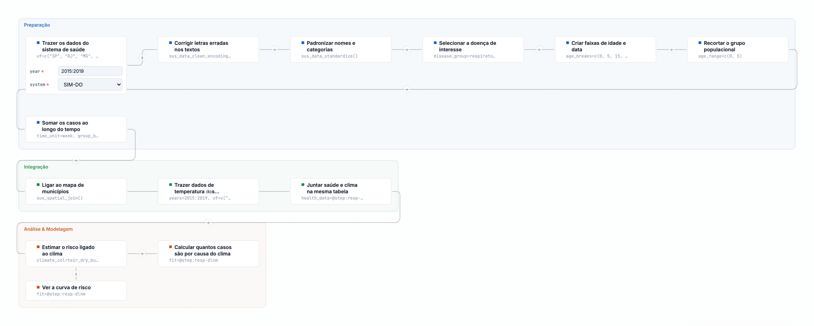
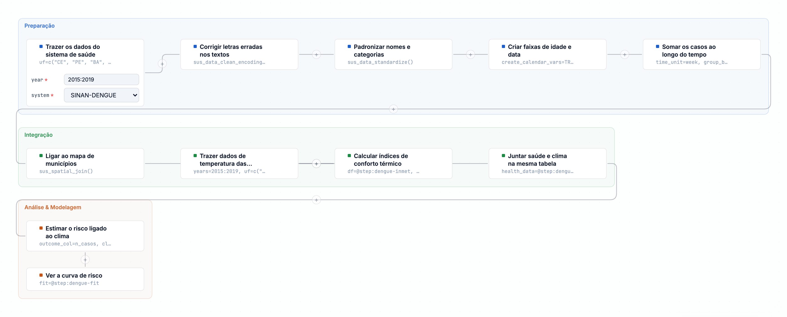
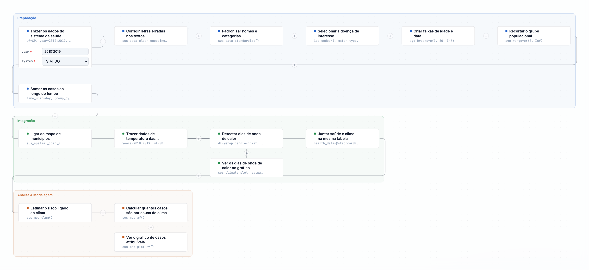
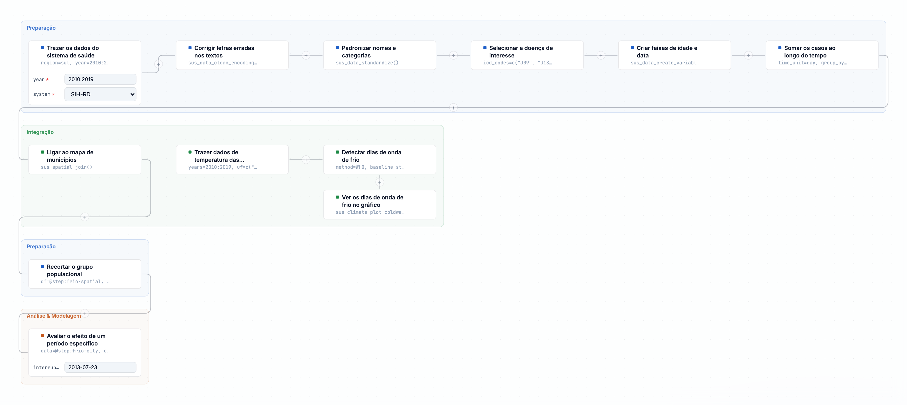

O Capítulo 1 apresentou o seletor de Modo de uso: em **Vigilância e gestão**, os nomes das
Funções aparecem em linguagem direta e os Parâmetros avançados ficam recolhidos por padrão.
Este capítulo mostra o efeito prático dessa escolha: os quatro Modelos de estudo de caso do
guia, prontos para carregar em um clique no **Centro de Pipelines**, com cada Passo já na
linguagem de Vigilância e gestão.

Os quatro Modelos abaixo são os mesmos arcos analisados em profundidade estatística nos
Capítulos 7 a 10 — aqui o objetivo é outro: mostrar a montagem completa do Pipeline, passo a
passo, para quem quer carregar um Modelo, ajustar o território e o período, e obter um
primeiro Resultado sem escrever uma única linha de código.

| Modelo | Pergunta de vigilância | Território e período | Passos |
|---|---|---|---|
| Mortalidade respiratória pediátrica e temperatura | Crianças menores de 5 anos têm mais óbitos respiratórios em dias de temperatura extrema? | Sudeste (SP, RJ, MG, ES), 2015-2019 | 13 |
| Dengue e graus-dia | O acúmulo de calor favorável ao vetor antecipa alta de casos de dengue? | CE, PE, BA e MA, 2015-2019 | 11 |
| Mortalidade cardiovascular em idosos e ondas de calor | Ondas de calor aumentam óbitos cardiovasculares em idosos? | São Paulo, 2010-2019 | 15 |
| Hospitalizações respiratórias e frio | Um evento de frio muda o nível de internações respiratórias? | Porto Alegre (RS), 2010-2019 | 12 |

Os territórios da tabela são exemplos nacionais, não um limite do método. Para aplicar à
Amazônia, ajuste UF ou região, período e fonte climática; em municípios com pouca cobertura
de estação, a grade (CHIRPS, ERA5) costuma ser mais adequada.

Os Capítulos 7 a 10 mostram os **resultados reais** de uma execução congelada em
26/10/2026, com fonte, N, figuras e scripts. Eles descrevem aquele snapshot; não são
previsões nem achados generalizáveis para outros territórios.

| Modelo | Resultado principal no snapshot | Leitura |
|---|---|---|
| Respiratório pediátrico | RR 0,97 (0,78–1,21); AF total -29,1% | Sem associação estável; AF negativa não interpretável como carga |
| Dengue/GDD | RR 0,71 (0,53–0,96); dispersão 95,6; lag no limite | Modelo instável; não concluir proteção nem pico em 84 dias |
| Cardiovascular/calor | AF calor 2,12%; frio 2,25%; total 4,36% | Carga modesta, dominada pelo frio; cautela com MMT/poluição |
| Hospitalizações/frio | RR de nível 0,62 (0,58–0,66) | Queda, não aumento; não concluir que frio protege |

Esses resultados são um exercício de **leitura crítica**: nem toda execução real produz
a associação esperada, e o guia mostra o que fazer quando isso acontece.

::: {.callout-tip}
## Como carregar um Modelo
No botão **Pipelines** da barra superior, busque pelo nome do Modelo (por exemplo, "dengue")
e clique em **Carregar**. Todos os Passos entram de uma vez no Pipeline, já ligados na ordem
correta — você não precisa montar nó por nó.
:::

## Mortalidade respiratória pediátrica e temperatura

1. **Trazer os dados do sistema de saúde** — óbitos (SIM-DO) em SP, RJ, MG e ES, 2015 a 2019.
2. **Corrigir letras erradas nos textos** — acentos e caracteres quebrados do DATASUS.
3. **Padronizar nomes e categorias** — nomes de coluna num formato único.
4. **Selecionar a doença de interesse** — causas respiratórias (CID-10 capítulo J).
5. **Criar faixas de idade e data** — faixas etárias e variáveis de calendário.
6. **Recortar o grupo populacional** — crianças menores de 5 anos.
7. **Somar os casos ao longo do tempo** — agregado por **semana** e por município, com semanas completas.
8. **Juntar dados a limites geográficos** — liga a série aos municípios.
9. **Trazer dados de temperatura e umidade das estações** — INMET, mesmos estados e anos.
10. **Juntar saúde e clima na mesma tabela** — cria defasagens de 0–21 dias para temperatura e umidade.
11. **Estimar o risco ligado ao clima** — DLNM com ajuste para umidade (`rh_mean_porc_lag0`) e tendência de 2 graus de liberdade por ano.
12. **Ver a curva de risco** — gráfico exposição-defasagem-risco.
13. **Calcular quantos casos são por causa do clima** — fração e número atribuível.

{fig-alt="Captura do Pipeline do climasus+ Studio com os 13 passos do modelo de mortalidade respiratória pediátrica, em linguagem simples."}

Para gestão, o Resultado que mais importa é o último: que fração dos óbitos respiratórios
em crianças pequenas está associada a dias fora da faixa segura de temperatura. O
Capítulo 7 retoma este mesmo arco com a leitura estatística completa.

## Dengue e graus-dia

1. **Trazer os dados do sistema de saúde** — casos notificados de dengue (SINAN), UFs CE, PE, BA e MA, 2015 a 2019.
2. **Corrigir letras erradas nos textos**
3. **Padronizar nomes e categorias**
4. **Criar faixas de idade e data** — inclui a semana epidemiológica.
5. **Somar os casos ao longo do tempo** — agregado por **semana epidemiológica**, usando a data de primeiros sintomas e semanas completas.
6. **Juntar dados a limites geográficos** — liga a série aos municípios.
7. **Trazer dados de temperatura das estações** — INMET, mesmos estados e anos.
8. **Calcular índices de conforto térmico** — calcula GDD com base 11 °C e teto 35 °C.
9. **Juntar saúde e clima** — cria defasagens de 0–84 dias (12 semanas) do GDD.
10. **Estimar o risco ligado ao clima** — DLNM sobre a contagem semanal de casos, com tendência de 2 graus de liberdade por ano.
11. **Ver a curva de risco**

{fig-alt="Captura do Pipeline do climasus+ Studio com os 11 passos do modelo de dengue e graus-dia, em linguagem simples."}

Para vigilância de arboviroses, o sinal prático é a curva de defasagem: em que janela de
semanas o acúmulo de GDD antecipa o aumento de casos. O Modelo usa 0–84 dias como ponto de
partida biológico; teste 28/56/84 dias e a base térmica (11 °C versus base regional) como
sensibilidade. Chuva acumulada e umidade são extensões importantes: use CHIRPS **diário**
ou estação diária, nunca CHIRPS mensal para defasagens semanais. O Capítulo 8 aprofunda a
interpretação e a gestão de vetores.

## Mortalidade cardiovascular em idosos e ondas de calor

1. **Trazer os dados do sistema de saúde** — óbitos (SIM-DO) em SP, 2010 a 2019 (janela mais longa: ondas de calor extremas não acontecem todo ano).
2. **Corrigir letras erradas nos textos**
3. **Padronizar nomes e categorias**
4. **Selecionar a doença de interesse** — capítulo I do CID-10 (cardiovasculares).
5. **Criar faixas de idade e data** — separa idosos (60+) do restante.
6. **Recortar o grupo populacional** — população idosa.
7. **Somar os casos ao longo do tempo** — agregado por dia, com dias completos.
8. **Juntar dados a limites geográficos**
9. **Trazer dados de temperatura das estações** — INMET, SP.
10. **Detectar dias de onda de calor** — método WHO, percentil 90, com referência fixa 2010–2015; há sete metodologias disponíveis, e a escolha deve ser declarada e testada.
11. **Visualizar ondas de calor** — ramo descritivo, não um regressor do modelo.
12. **Juntar saúde e clima** — defasagens de 0–21 dias da temperatura.
13. **Estimar o risco ligado ao clima** — DLNM sobre a série diária; a referência padrão é a mediana e deve ser substituída por MMT para carga atribuível.
14. **Calcular quantos casos são por causa do clima**
15. **Ver o gráfico de casos atribuíveis** — pronto para apresentar.

{fig-alt="Captura do Pipeline do climasus+ Studio com os 15 passos do modelo de mortalidade cardiovascular e ondas de calor, em linguagem simples."}

Este é o Modelo mais direto para justificar um **alerta de calor**: a detecção de onda de
calor já entra como Passo próprio, antes mesmo do modelo estatístico. O Capítulo 9 detalha a
metodologia escolhida e recomenda testar mais de uma definição.

## Hospitalizações respiratórias e frio

1. **Trazer os dados do sistema de saúde** — internações (SIH-RD), região Sul, 2010 a 2019, todos os meses (a detecção de onda de frio por percentil precisa da distribuição do ano inteiro).
2. **Corrigir letras erradas nos textos**
3. **Padronizar nomes e categorias**
4. **Selecionar a doença de interesse** — faixa J09-J18 (pneumonias e influenza).
5. **Criar faixas de idade e data**
6. **Somar os casos ao longo do tempo** — agregado por dia e por município, com dias completos.
7. **Juntar dados a limites geográficos**
8. **Trazer dados de temperatura das estações** — INMET, região Sul.
9. **Detectar dias de onda de frio** — método WHO, percentil 10, com referência fixa 2010–2015; há sete metodologias disponíveis.
10. **Visualizar ondas de frio** — ramo descritivo.
11. **Filtrar um município** — restringe a série a Porto Alegre, porque a ITS é um desenho de série única.
12. **Avaliar o efeito de um evento específico** — série temporal interrompida: internações mudaram de nível depois do evento de frio? A data é um exemplo e deve ser substituída por um evento real.

{fig-alt="Captura do Pipeline do climasus+ Studio com os 12 passos do modelo de hospitalizações respiratórias e frio, em linguagem simples."}

Este é o único dos quatro Modelos que não usa DLNM: a pergunta é sobre um **evento de
frio delimitado**, não sobre uma curva de exposição-resposta contínua — por isso o Passo
final é uma série temporal interrompida em uma série de um único município. O Capítulo 10
explica quando escolher esse desenho em vez do DLNM e por que a data de interrupção
precisa ser real.

## Depois de carregar um Modelo

Um Modelo carregado é só o ponto de partida. Antes de usar um Resultado para justificar uma
decisão:

- **Ajuste o território e o período** nos Passos de importação — os valores do Modelo (estados,
  anos) são um exemplo, não a sua área de responsabilidade.
- **Abra os Parâmetros avançados** quando precisar — em Modo Vigilância e gestão eles ficam
  recolhidos por padrão no Inspetor, mas continuam lá, um clique de distância.
- **Leve o Resultado ao capítulo "Da evidência à ação"** — é o roteiro para transformar o
  que este Pipeline produziu numa decisão verificável, com qualidade, equidade e incerteza
  documentadas.

::: {.callout-note collapse="true"}
## Verifique se ficou

**1. Por que os quatro Modelos aparecem tanto no Modo Vigilância e gestão quanto no Modo
Pesquisa avançada?**

Porque o Modo de uso muda apresentação (linguagem, Parâmetros recolhidos ou abertos), não
acesso: nenhum Modelo, Função ou Resultado fica bloqueado para nenhum dos dois modos.

**2. Qual dos quatro Modelos não usa DLNM, e por quê?**

Hospitalizações respiratórias e frio. A pergunta é sobre o efeito de um evento
específico (uma onda de frio) sobre o nível das internações, não sobre uma curva contínua de
exposição-resposta — por isso o desenho é a série temporal interrompida.

**3. Depois de carregar um Modelo com os estados e anos de outro estudo, o que precisa ser
revisado antes de confiar no Resultado?**

O território e o período de importação (Passo 1), no mínimo — eles definem a população e o
recorte de tempo do estudo, e raramente coincidem exatamente com a sua pergunta de gestão.
:::
