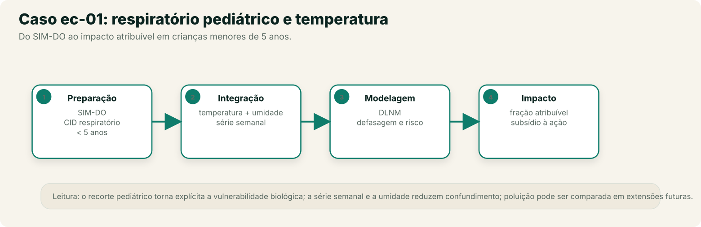
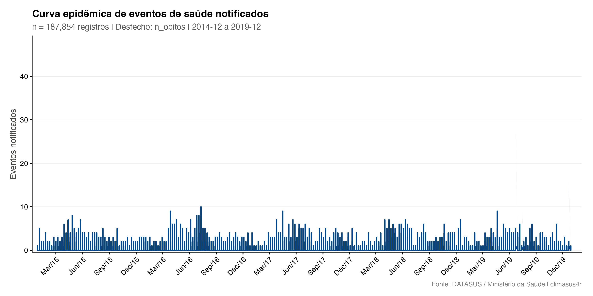
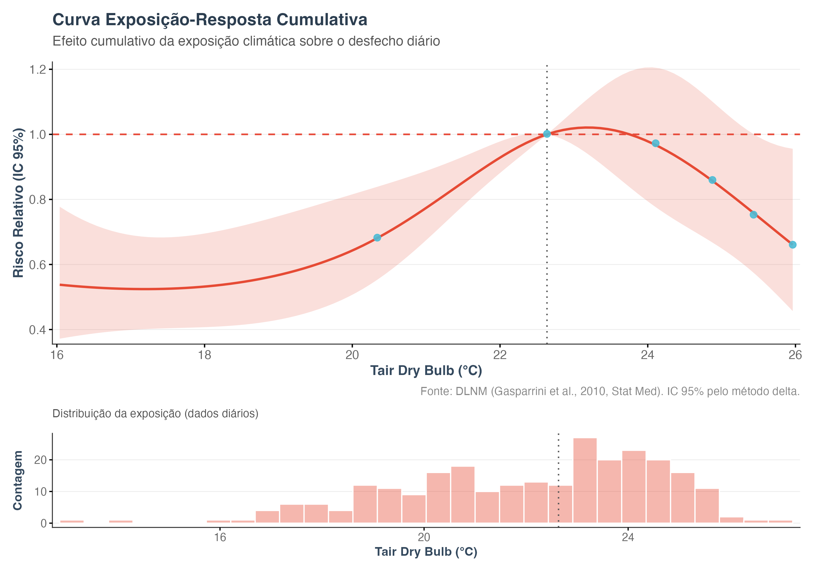
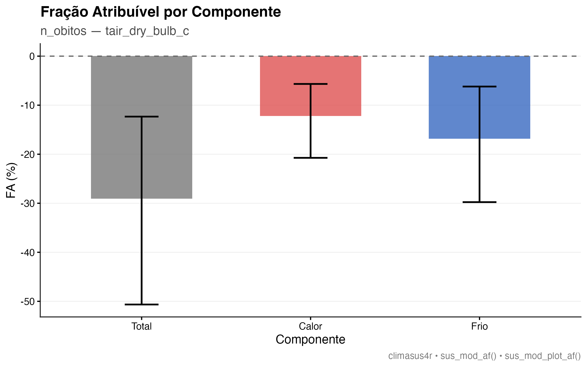

No recorte de fumaça e qualidade do ar do Capítulo 0, apresentamos a ideia de que fumaça
de queimada e má qualidade do ar podem se transformar em crise respiratória — com crianças
pequenas entre os grupos mais vulneráveis. Este capítulo retoma o desfecho respiratório
pediátrico em uma sequência completa, usando a temperatura como exposição principal e a
umidade como covariável; fumaça e poluição entram como extensão do Pipeline. Vai do dado
bruto do SIM-DO à fração atribuível, pelas três Etapas percorridas nos capítulos
anteriores. Público principal: acadêmico e gestor técnico que já percorreram o piloto e
querem ver um Pipeline inteiro montado, sem interrupção entre Etapas.

## O pipeline completo, etapa por etapa

Recorte: óbitos por causas respiratórias (CID-10, capítulo J) em crianças menores de 5
anos, no Sudeste (SP, RJ, MG, ES), 2015-2019, contra a temperatura do ar registrada pelas
estações do INMET. O Modelo de catálogo `ec-01-respiratorio-pediatrico` traz este
Pipeline pronto para carregar no Centro de Pipelines.

O exemplo usa o Sudeste para manter continuidade com o caso ec-01. O mesmo Pipeline se
aplica à Amazônia, onde a exposição principal pode ser MP2,5 ou fumaça e a série climática
deve vir de grade; a lógica de Preparação, Integração e Modelagem é a mesma.



**Preparação**

1. **Importar dados do DATASUS** (`sus_data_import`) — importa óbitos do sistema `SIM-DO`, UFs `SP`, `RJ`, `MG`, `ES`,
   anos de 2015 a 2019.
2. **Corrigir acentuação e caracteres** (`sus_data_clean_encoding`) — corrige encoding, herança comum de arquivos DATASUS
   antigos.
3. **Padronizar nomes e valores** (`sus_data_standardize`) — padroniza nomes de coluna e tipos.
4. **Filtrar por CID-10 ou grupo de doença** (`sus_data_filter_cid`) — filtra pelo grupo de doença respiratório.
5. **Criar variáveis derivadas** (`sus_data_create_variables`) — cria faixas etárias (`c(0, 5, 15, 60, Inf)`) e
   variáveis de calendário.
6. **Filtrar por características demográficas** (`sus_data_filter_demographics`) — recorta para a faixa etária `c(0, 5)`, isolando a
   população pediátrica.
7. **Agregar dados em série temporal** (`sus_data_aggregate`) — agrega a série por
   **semana**, com `complete_dates = TRUE`. A resolução semanal é compatível com as
   defasagens em dias usadas no DLNM e evita a sobreposição quase total das janelas
   mensais.

**Integração**

8. **Juntar dados a limites geográficos** (`sus_spatial_join`) — liga a série de saúde aos
   municípios, pré-requisito para o cruzamento com clima.
9. **Importar dados das estações do INMET** (`sus_climate_inmet`) — traz temperatura e
   umidade das estações INMET das mesmas UFs e anos.
10. **Cruzar dados de saúde e clima** (`sus_climate_aggregate`) — cria as colunas de
    defasagem de **0 a 21 dias** para as variáveis climáticas disponíveis, com
    `temporal_strategy = "distributed_lag"`. A umidade entra como covariável no modelo.

**Análise & Modelagem**

11. **Modelar risco com DLNM** (`sus_mod_dlnm`) — ajusta o Modelo DLNM sobre a série
    semanal, com `outcome_col` apontando para a contagem de óbitos, `climate_col` para a
    temperatura e `covariates = "rh_mean_porc_lag0"` para ajustar pela umidade da semana.
    `dof_per_year = 2` reduz a flexibilidade da tendência em cinco anos de dados.
12. **Visualizar resultados do DLNM** (`sus_mod_plot_dlnm`) — Resultado gráfico da curva
    exposição–defasagem–risco.
13. **Calcular fração atribuível** (`sus_mod_af`) — calcula a fração e o número
    atribuível.

## Dados usados

**Fonte:** SIM-DO (DATASUS), óbitos por causas respiratórias (CID-10 capítulo J) em
menores de 5 anos, em SP, RJ, MG e ES, 2015–2019.
**Recorte:** série semanal por município; a exposição é a temperatura do ar na estação
INMET mais próxima, com a umidade relativa como covariável.
**N:** 187.330 linhas município-semana; 715 municípios; 262 semanas (2014-12-28 a
2019-12-29). O modelo agrega os municípios por semana: **258 semanas** e **4.765 óbitos**
no período; após as defasagens, a AF usa **4.715** óbitos.
**Snapshot:** `data/ec01/analytic.parquet` (MD5 `ebeb29b507eaff67a7cd051ccf7337a1`),
gerado em 26/10/2026. Dicionário de variáveis: `data/ec01/codebook.csv`.
**Avisos do Motor:** dispersão moderada (1,68) e autocorrelação residual
(Ljung-Box p < 0,001).

## Resultados

### Série e cobertura

{#fig-ec01-serie}

**Como ler:** o eixo x é a semana; o eixo y é o número de óbitos notificados. A série tem
sazonalidade e anos com picos diferentes; o modelo precisa separar essa sazonalidade da
exposição climática. O gráfico descreve a série, não o efeito da temperatura.

### Modelo DLNM

| Medida | Valor |
|---|---:|
| RR no p75 de temperatura (24,1 °C) vs referência (22,6 °C) | 0,97 (IC95% 0,78–1,21) |
| Defasagem de pico | 0 dias |
| Semanas no modelo | 258 |
| Dispersão | 1,68 (moderada) |
| Autocorrelação residual | p < 0,001 |

**Como ler:** o intervalo de 0,78 a 1,21 inclui 1; não há evidência de associação no
p75 versus a referência. O pico em lag 0 não significa efeito imediato: a curva é larga e
o modelo tem autocorrelação residual, o que estreita artificialmente a incerteza. O
resultado é compatível com ausência de efeito ou com um efeito pequeno que este recorte
não consegue separar.

{#fig-ec01-dlnm}

**Como ler:** o eixo x é a temperatura; o eixo y é o RR cumulativo. A curva é baixa nos
extremos e máxima perto da referência, mas a faixa de confiança é ampla. Não leia o ponto
de mínimo como "temperatura segura" individual.

### Fração atribuível

| Componente | AF (%) | IC95% | Número atribuível |
|---|---:|---:|---:|
| Total | -29,1 | -50,7 a -12,3 | -1.370 |
| Calor | -12,2 | -20,7 a -5,7 | -576 |
| Frio | -16,8 | -29,8 a -6,2 | -794 |

**Como ler — e por que este resultado não vira manchete:** a AF saiu **negativa**. Isso
não significa que a temperatura "protege"; significa que a referência (mediana), a forma
da curva e a instabilidade do modelo produzem uma conta que não é interpretável como
carga atribuível. Quando a AF é negativa, o correto é **não reportar** "29% dos óbitos
evitados pelo clima" e voltar ao modelo: revisar referência (MMT), especificação, dispersão
e autocorrelação. Este é um exemplo real de por que a fração atribuível não deve ser lida
isolada da curva e dos diagnósticos.

{#fig-ec01-af}

**Como ler:** as barras de AF total, calor e frio estão abaixo de zero. Isso é um sinal de
diagnóstico, não de "proteção": a referência e a curva produzem uma conta que não se
sustenta como carga atribuível.

## Interpretando o resultado

O resultado real deste snapshot é um **exemplo de modelo que não sustenta uma conclusão
de carga**. O RR no p75 inclui 1, a AF é negativa e os diagnósticos mostram
autocorrelação residual e dispersão moderada. Isso não significa que a temperatura não
importa; significa que este recorte — óbitos respiratórios em menores de 5 anos, 715
municípios, cinco anos, série semanal agregada — não é suficiente para estimar a relação
com estabilidade.

Antes de concluir qualquer coisa, o caminho é revisar o desenho:

- trocar a referência mediana por uma **temperatura de mortalidade mínima (MMT)** ou um
  valor pré-especificado;
- investigar a **autocorrelação** (harmônicos, `dof_per_year`, modelo com erro
  autorregressivo);
- testar **agregação por estado/município**, em vez de somar 715 municípios em uma série;
- adicionar **poluição do ar** e outras causas respiratórias;
- **não reportar a AF negativa** como carga atribuível.

## O que os números mostram {#numeros-ec01}

| Pergunta | Resposta neste snapshot |
|---|---|
| A temperatura no p75 se associa a mais óbitos? | Não; RR 0,97 (IC95% 0,78–1,21), intervalo inclui 1. |
| Qual é a fração atribuível? | Negativa (-29,1%); não é interpretável como carga. |
| O modelo está bem especificado? | Não; há autocorrelação residual e dispersão 1,68. |
| O que a série mostra? | Sazonalidade e picos anuais; isso não é o efeito da temperatura. |

**O que não podemos concluir:** que a temperatura não tenha efeito; que a AF negativa
seja "proteção"; que uma criança específica tenha sido afetada. O resultado é compatível
com ausência de efeito **ou** com um efeito que este desenho não consegue separar.

## O que isso significa para ação

Este é um caso de **resultado nulo/instável**, não de sucesso. A ação responsável não é
montar um alerta com a AF negativa; é revisar o desenho antes de usar o número:
referência (MMT), autocorrelação, agregação por estado/município, poluição e definição
de caso. Um resultado assim é útil porque mostra, com dados reais, por que a etapa de
diagnóstico existe.

Na Amazônia, o mesmo desenho pode ser estendido para fumaça, mas a exposição precisa ser
medida por MP2,5 ou focos de calor, e o modelo precisa lidar com a sazonalidade da
queima. Sem essa extensão, a temperatura sozinha não sustenta uma conclusão de carga.

Para levar este Pipeline além do Studio — relatório técnico, publicação, ou execução
automatizada semanal com dados atualizados — use **Salvar projeto** e **Exportar `.R`**,
registrando fontes, filtros, versões, referência e limitações.

## Reproduzir

```bash
Rscript book/scripts/01-run-ec01.R
```

O script grava a tabela analítica em `data/ec01/analytic.parquet`, as tabelas em
`tables/results/ec01/`, as figuras em `images/results/ec01/` e os metadados em
`results/ec01.json`. O snapshot usado neste capítulo foi gerado em 26/10/2026.

::: {.callout-note collapse="true"}
## Verifique se ficou

**1. Por que este Pipeline usa a função Filtrar por características demográficas
(`sus_data_filter_demographics`) com `age_range = c(0, 5)` depois de já ter criado faixas
etárias mais largas com Criar variáveis derivadas (`sus_data_create_variables`)?**

**Criar variáveis derivadas** (`sus_data_create_variables`) cria a variável de faixa etária para toda a base (adequado se o
Pipeline quisesse comparar faixas depois); **Filtrar por características demográficas** (`sus_data_filter_demographics`) é o Passo que
efetivamente recorta a população de interesse (menores de 5 anos) para a análise deste
capítulo.

**2. O que o Resultado de Calcular fração atribuível (`sus_mod_af`) acrescenta que a
curva de Visualizar resultados do DLNM (`sus_mod_plot_dlnm`), isoladamente, não mostra?**

A curva DLNM mostra a forma da relação exposição-resposta e da defasagem; a fração
atribuível traduz essa curva em uma proporção (e um número absoluto) de casos que podem
ser atribuídos à exposição — o dado que efetivamente entra num argumento de política
pública. **Neste snapshot, porém, a AF saiu negativa**, então a resposta correta é não
usá-la como carga: primeiro é preciso revisar referência, dispersão e autocorrelação.

**3. Se o gestor público quiser incluir queimadas na análise, além de temperatura, que
Função do catálogo ele adicionaria ao Pipeline, e em qual Etapa?**

**Importar focos de queimadas** (`sus_grid_fires`), ou uma função de poluição como
**Importar poluição do ar de alta resolução (GHAP)** (`sus_grid_pollution_ghap`) — com
CAMS (`sus_grid_pollution_cams`) como checagem de sensibilidade —, na Etapa Integração.
Depois, esses dados entram junto à série de saúde por **Juntar dados ambientais por
município** (`sus_grid_join`), antes de seguir para a Etapa Análise & Modelagem.
:::
