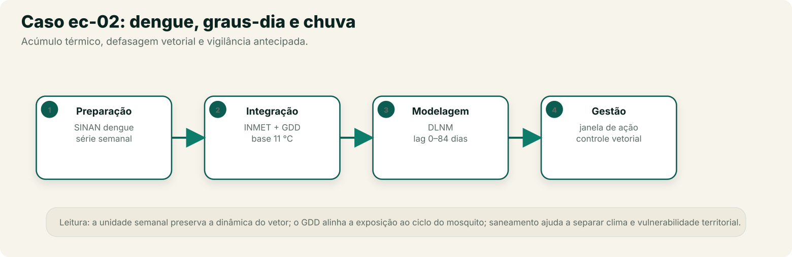
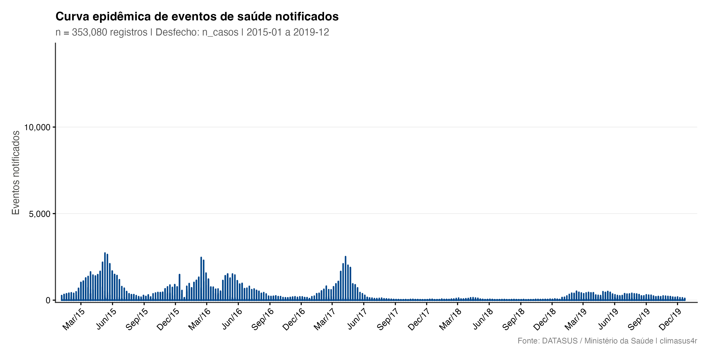
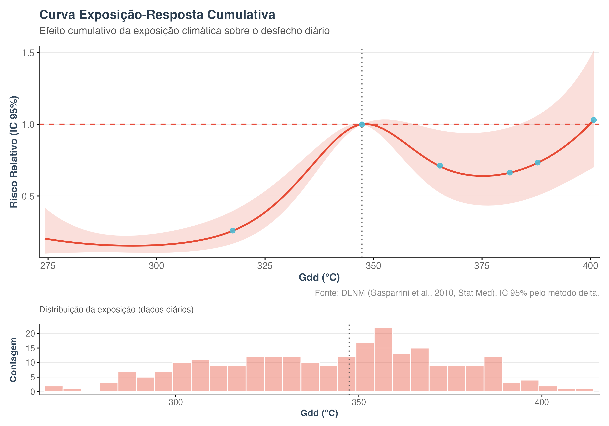
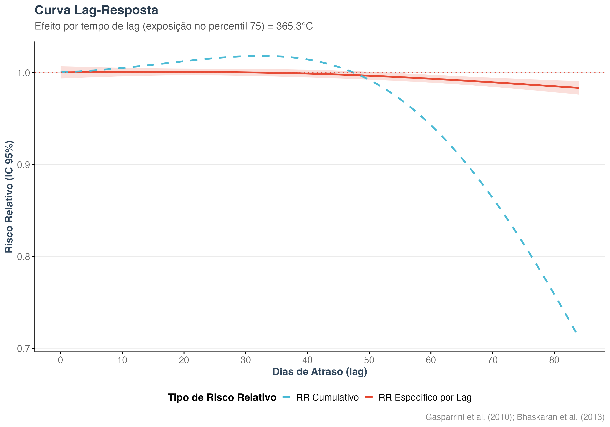

No recorte de chuva, enchente e vetores do Capítulo 0, retomado na Etapa Integração
(Capítulo 3), apresentamos o arco de dengue e clima. A pergunta central é: **quanto do
risco de dengue acompanha o acúmulo de calor favorável ao vetor, e com que atraso?**
Este capítulo fecha esse arco, do dado bruto do SINAN ao Modelo DLNM ajustado. A conclusão
é tão importante quanto o método: em cidade única, o GDD **não é identificável** como
exposição principal; a resposta exige chuva/PDSI e escala multicidade. Público
principal: acadêmico e gestor técnico responsável por vigilância de arboviroses. O
snapshot usa quatro estados do Nordeste; a replicação testa Recife e Fortaleza
separadamente. A mesma lógica vale para a Amazônia, onde a cobertura irregular de estações
torna a checagem da distância estação–município ainda mais importante.

## O pipeline completo, etapa por etapa

Recorte: casos notificados de dengue (SINAN) em **Ceará, Pernambuco, Bahia e Maranhão**,
2015–2019, contra **graus-dia de desenvolvimento (GDD)** calculados a partir das
estações INMET. O Modelo de catálogo `ec-02-dengue-clima` traz este Pipeline pronto para
carregar no Centro de Pipelines.

{fig-alt="Arco do caso ec-02 em quatro etapas — preparação no SINAN-DENGUE por semana epidemiológica, integração com graus-dia e chuva, modelagem DLNM com defasagem longa e gestão com janela de ação. À direita, a ficha do estudo; abaixo, a curva de acúmulo de graus-dia e a janela de transmissão."}

**Preparação**

1. **Importar dados do DATASUS** (`sus_data_import`) — importa casos do sistema
   `SINAN-DENGUE`, UFs `CE`, `PE`, `BA` e `MA`, anos de 2015 a 2019.
2. **Corrigir acentuação e caracteres** (`sus_data_clean_encoding`) — corrige encoding.
3. **Padronizar nomes e valores** (`sus_data_standardize`) — padroniza nomes de coluna e
   tipos. Em português, a data de primeiros sintomas fica como `data_primeiros_sintomas`.
4. **Criar variáveis derivadas** (`sus_data_create_variables`) — cria variáveis de
   calendário, incluindo a semana epidemiológica.
5. **Agregar dados em série temporal** (`sus_data_aggregate`) — agrega por **semana
   epidemiológica**, usando a **data dos primeiros sintomas** (não a de notificação) e
   `complete_dates = TRUE` para preencher semanas sem casos com zero.

**Integração**

6. **Juntar dados a limites geográficos** (`sus_spatial_join`) — liga a série de saúde aos
   municípios, pré-requisito para o cruzamento com clima.
7. **Importar dados das estações do INMET** (`sus_climate_inmet`) — traz temperatura das
   estações dos mesmos quatro estados e anos.
8. **Preencher falhas nos dados do INMET** (`sus_climate_fill_inmet`) — completa as falhas da série de temperatura das estações com um modelo de aprendizado de máquina treinado por estação (XGBoost). Pode levar vários minutos.
9. **Calcular índices de conforto térmico** (`sus_climate_compute_indicators`) — calcula
   **GDD com base 11 °C e teto 35 °C**, a faixa biológica do *Aedes aegypti*. O Parâmetro
   `custom_thresholds` fixa esses valores; sem ele, a função usaria a base regional.
10. **Cruzar dados de saúde e clima** (`sus_climate_aggregate`) — cria as colunas de
    defasagem do GDD, com `temporal_strategy = "distributed_lag"`. O snapshot usou 0–84
    **dias**; como o desfecho é semanal, a replicação usa 0–12 **semanas**.

**Análise & Modelagem**

11. **Modelar risco com DLNM** (`sus_mod_dlnm`) — ajusta o Modelo DLNM sobre a contagem
    semanal de casos (`n_casos`) e o GDD (`gdd_c`), com `dof_per_year = 2`.
12. **Visualizar resultados do DLNM** (`sus_mod_plot_dlnm`) — Resultado gráfico da curva
    exposição–defasagem–risco.

::: {.callout-warning title="Por que GDD, e não temperatura do dia?"}
A dengue não responde à temperatura de um único dia: o mosquito precisa acumular energia
térmica para completar o ciclo larval, e o vírus precisa de tempo de incubação extrínseca
no vetor. **Graus-dia** resumem esse acúmulo. A base 11 °C é o limiar de desenvolvimento
do *Aedes aegypti*; o teto de 35 °C evita contar calor extremo que suprime o
desenvolvimento. Uma curva de temperatura diária com defasagem é uma aproximação
diferente — útil, mas não substitui o GDD quando a pergunta é o ciclo do vetor. Em cidades
tropicais com temperatura alta o ano todo, porém, o GDD pode não ser o fator limitante: a
replicação mostra que chuva, umidade e imunidade precisam entrar no desenho.
:::

::: {.callout-note title="Por que 0–84 dias?"}
O ciclo relevante soma desenvolvimento larval (cerca de 7–10 dias), incubação extrínseca
do vírus (cerca de 8–12 dias a 28 °C), incubação humana e atraso de notificação. Uma
janela de 0–28 dias trunca essa cauda. O Modelo usa 0–12 **semanas** (0–84 dias) como ponto de partida
biológico; **4, 8 e 12 semanas devem ser testadas como sensibilidade**, porque a janela
certa depende do clima local, da qualidade da série e da pergunta. O snapshot manteve 84
lags **diários** sobre um desfecho semanal — a replicação corrige a unidade.
:::

::: {.callout-note title="O que este Modelo não inclui"}
GDD sozinho não representa criadouros. **Chuva acumulada** (2–6 semanas) e **umidade
relativa** são determinantes importantes e entram como extensão do Pipeline. O ideal é
usar CHIRPS **diário** (`resolution = "daily"`) ou uma estação diária e acumular a chuva
em janelas de 2–6 semanas. CHIRPS **mensal** não permite estimar defasagens semanais e
não deve ser usado para essa pergunta.
:::

## Dados usados

**Fonte:** SINAN-DENGUE (DATASUS), casos notificados em CE, PE, BA e MA, 2015–2019.
**Recorte:** semana epidemiológica, data de primeiros sintomas, município de residência;
GDD com base 11 °C e teto 35 °C, calculado a partir das estações INMET dos mesmos estados.

**O que o snapshot fez:** manteve 1.358 municípios e deixou `sus_mod_dlnm()` agregar tudo por
semana. O modelo tem **248 semanas e 638.616 casos** — uma série regional. As colunas de
defasagem são **84 dias** aplicados a um desfecho **semanal**, e o GDD está em unidade
horária (a soma de 24 horas), não em °C·dia.

**O que a replicação fez:** testou duas cidades separadamente — **Recife** (estação A301;
217 semanas; 38.974 casos) e **Fortaleza** (A305; 225 semanas; 73.834 casos) —, com GDD
semanal em °C·dia (soma de 7 dias) e defasagens em **semanas** (0–12). Modelo com mês,
3 df de exposição e 3 df de defasagem. Também testou temperatura semanal no lugar do GDD.
O filtro municipal é feito no script de replicação; o template do catálogo importa as UFs.

**Snapshot:** `data/ec02/analytic.parquet` (MD5 `89f86931dd8e77e36bc3ed2fd2bd5eff`),
gerado em 26/10/2026. Dicionário de variáveis: `data/ec02/codebook.csv`.
**Avisos do Motor (snapshot):** dispersão **95,6** (alta) e autocorrelação residual
(Ljung-Box p = 0).
**Replicação:** dispersão 7,55 (Recife) e 15,46 (Fortaleza); Ljung-Box p < 0,001.

## Resultados

### Série e cobertura (snapshot)

{#fig-ec02-serie}

**Como ler:** o eixo x é a semana; o eixo y é o número de casos notificados. A série tem
picos epidêmicos em 2015, 2016, 2017 e 2019, com anos de vale entre eles. A série é
agregada por município e depois somada por semana no snapshot; ela descreve o padrão
regional, não a transmissão de um município específico.

### Modelo DLNM: snapshot e replicação em duas cidades

| Medida | Snapshot (4 estados) | Recife (PE) | Fortaleza (CE) |
|---|---:|---:|---:|
| Unidade | 1.358 municípios agregados | 1 município | 1 município |
| Casos no modelo | 638.616 | 38.974 | 73.834 |
| Semanas | 248 | 217 | 225 |
| GDD | °C·hora, 0–84 **dias** | °C·dia, 0–12 **semanas** | °C·dia, 0–12 **semanas** |
| Referência | mediana (347,3) | MMT 97,1 (p29) | MMT 121,9 (p90) |
| RR no p75 vs referência | 0,71 (0,53–0,96) | — | — |
| RR no p90 vs MMT | — | 1,07 (0,32–3,64) | 1,00 (referência) |
| RR no p99 vs MMT | — | 0,49 (0,08–2,82) | 3,57 (0,97–13,14) |
| RR no p01 vs MMT | — | 2,15 (0,48–9,68) | 10,56 (3,71–30,08) |
| Dispersão | 95,6 | 7,55 | 15,46 |
| Autocorrelação residual | p = 0 | p < 0,001 | p < 0,001 |

**Como ler — com muita cautela:** nenhuma das duas cidades produz uma curva interpretável.
Em Recife, o MMT cai no p29, o RR no p90 é 1,07 (IC 0,32–3,64) e o no p01 sobe a 2,15; em
Fortaleza, o MMT cai no p90 e o RR no p01 chega a 10,56. Esses padrões não descrevem a
transmissão de dengue — descrevem um modelo que não consegue separar GDD, estação e
imunidade. A dispersão (7,55 e 15,46) confirma que o quasi-Poisson não é adequado.

**Teste com temperatura.** Em Recife, substituir GDD por temperatura semanal também não
recupera o sinal: RR no p90 0,99 (0,97–1,01), RR no p01 1,51 (0,30–7,72), dispersão 7,08.
Ou seja, o problema não é apenas a unidade do GDD: em uma cidade tropical com temperatura
alta o ano todo, a temperatura não é o fator limitante da transmissão.

{#fig-ec02-dlnm}

**Como ler:** o eixo x é o GDD acumulado; o eixo y é o RR cumulativo. A curva cai até
cerca de 370 °C·dia e volta a subir perto de 400, com intervalo muito largo no extremo
superior. A figura é do snapshot; as réplicas cidade-específicas (tabela) também não
estabilizam. Não interprete o ponto de mínimo como “GDD ideal” nem o trecho final como
“proteção”.

{#fig-ec02-lag}

**Como ler:** a linha cheia é o RR específico por lag; a tracejada é o acumulado. O
acumulado cai de 1,0 para cerca de 0,7 até o lag 84. O “pico” em 84 dias é o **limite da
janela diária**, não um pico biológico; a replicação usa 12 semanas e também não encontra
um pico estável.

## Interpretando o resultado

O resultado do snapshot **não é um caso de GDD que “não funciona” por acaso**. É um caso de
exposição mal-especificada e de escala errada. Três fatos se somam:

1. **GDD acumulado é altamente colinear** entre dias consecutivos; usar 84 lags diários
    sobre uma série semanal cria dezenas de variáveis quase duplicadas.
2. **Quatro estados agregados** misturam imunidade, sorotipo, transmissão e clima; a
    exposição média não representa nenhum território.
3. **Em cidades tropicais, a temperatura é alta o ano todo.** O GDD pode não ser o fator
    limitante: chuva, umidade, criadouros, imunidade e sorotipo dominam a sazonalidade.

A replicação em Recife e Fortaleza mostra que o problema não é específico de uma cidade.
O desenho publicado que recupera o sinal (Lowe et al., 2021) usa **PDSI/chuva**, 558
microrregiões e um modelo espaço-temporal bayesiano — não GDD em cidade única. Um desenho
brasileiro de temperatura e internação por dengue (2024) encontra RR 3,47 no p95 com efeito
imediato (lag 0–2), mas em escala nacional e com desfecho de hospitalização, não de
notificação.

O caminho responsável é: (a) usar **chuva/PDSI** como exposição principal e GDD como
covariável; (b) ajustar por município e combinar com `sus_mod_pool`, ou usar um modelo
espaço-temporal; (c) incluir saneamento, imunidade e sorotipo; (d) não calcular AF de dengue
com este desenho.

## O que os números mostram {#numeros-ec02}

| Pergunta | Snapshot (4 estados) | Replicação (Recife/Fortaleza) |
|---|---|---|
| O GDD no p75 se associa a mais casos? | Não; RR 0,71 (0,53–0,96) | Não estimável |
| Qual é o pico de defasagem? | 84 dias — limite da janela | Sem pico estável em 0–12 semanas |
| O modelo está estável? | Não; dispersão 95,6 | Não; dispersão 7,55/15,46 |
| A temperatura funciona melhor? | Não testada | Não; RR p90 0,99 (0,97–1,01) |
| O que usar? | Revisar o desenho | **Chuva/PDSI + escala multicidade** |

**O que não podemos concluir:** que o GDD proteja contra dengue; que o efeito apareça em
12 semanas; que o número de casos de um município específico seja atribuível ao GDD. O
resultado é compatível com **exposição inadequada e instabilidade do modelo**, não com uma
conclusão biológica.

**Antes de concluir:** teste chuva acumulada (2–6 semanas), PDSI, umidade, GDD como
covariável, e ajuste por município/estado com `sus_mod_pool` ou modelo espaço-temporal. Se
o resultado mudar de forma relevante, ele não deve sustentar uma decisão. Veja o
[roteiro de interpretação](05-da-evidencia-a-acao.qmd#ler-resultados).

## O que isso significa para ação

Este resultado **não sustenta** um limiar operacional de GDD para vigilância. A ação
responsável é revisar o desenho antes de usar o número: chuva/PDSI como exposição
principal, GDD como covariável, escala multicidade e controle de imunidade/sorotipo. Um
resultado assim é útil porque mostra, com dados reais, por que a escolha da exposição e a
escala de análise importam.

O GDD não substitui a chuva. Em municípios com estação distante ou séries incompletas,
combine GDD de estação com chuva de satélite diária e trate a distância
estação–município como uma limitação explícita. Para levar este Pipeline além do Studio —
relatório técnico, publicação ou execução automatizada a cada semana epidemiológica — use
**Arquivo → Salvar projeto** e **Exportar `.R`**, registrando a semana epidemiológica, as fontes, a
distância das estações e os atrasos considerados.

## Reproduzir

::: {.callout-note title="Reprodutibilidade"}
**Abrir no Studio.** Baixe [`ec-02-dengue-clima.climasus.json`](pipeline/ec-02-dengue-clima.climasus.json) e use **Arquivo → Abrir projeto**. O projeto guarda os 11 Passos, a ordem e os Parâmetros descritos neste capítulo.

**Copiar em R.** O bloco abaixo é o espelho do mesmo Pipeline; a versão completa está em [`pipeline/R/ec-02-dengue-clima.R`](pipeline/R/ec-02-dengue-clima.R). A replicação que mostra por que o GDD não é identificável em Recife e Fortaleza está em `book/scripts/90-replicacao/01-fit-replicacao.R`.
:::

::: {.r-positron}
```r
# Caso ec-02 — espelho R de ec-02-dengue-clima.climasus.json
library(climasus4r)

dados <- sus_data_import(
  system = "SINAN-DENGUE",
  uf = c("CE", "PE", "BA", "MA"),
  year = 2015:2019
) |>
  sus_data_clean_encoding() |>
  sus_data_standardize(lang = "pt") |>
  sus_data_create_variables(create_calendar_vars = TRUE) |>
  sus_data_aggregate(
    time_unit = "week",
    group_by = "codigo_municipio_residencia",
    complete_dates = TRUE,
    date_col = "data_primeiros_sintomas"
  )

saude <- sus_spatial_join(dados)
clima_raw <- sus_climate_inmet(years = 2015:2019, uf = c("CE", "PE", "BA", "MA"))

clima <- sus_climate_compute_indicators(
  clima_raw,
  indicators = "gdd",
  custom_thresholds = list(gdd_base = 11, gdd_upper = 35)
)

integrado <- sus_climate_aggregate(
  health_data = saude,
  climate_data = clima,
  climate_var = "gdd_c",
  temporal_strategy = "distributed_lag",
  lag_days = 84
)

ajuste <- sus_mod_dlnm(
  integrado,
  outcome_col = "n_casos",
  climate_col = "gdd_c",
  dof_per_year = 2
)

sus_mod_plot_dlnm(ajuste)
```
:::

**O que o `.json` preserva — e o que não preserva.** O arquivo guarda Passos, ordem,
Parâmetros, notas e o modo de uso. Não guarda os dados, o cache, os Resultados, os
Artefatos, caminhos absolutos nem a versão do Studio. Ao compartilhar, envie também a
fonte e o período dos dados, a versão do Studio/`climasus4r` e, se possível, o checksum do
arquivo analítico. A biblioteca completa está no
[Capítulo 12](12-parametros-avancados.qmd#biblioteca-de-pipelines).

::: {.callout-note collapse="true"}
## Verifique se ficou

**1. Por que este Pipeline usa GDD (`gdd_c`) em vez de temperatura diária
(`tair_dry_bulb_c`) com defasagem?**

Porque a dengue responde ao **acúmulo de energia térmica** ao longo do ciclo do vetor, não
à temperatura de um dia isolado. O GDD com base 11 °C e teto 35 °C representa essa
acumulação de forma mais próxima da biologia do *Aedes aegypti*. A temperatura diária com
defasagem é uma aproximação alternativa, não equivalente. A replicação mostra, porém, que
em cidade única o GDD não basta: chuva/PDSI, imunidade e escala multicidade precisam entrar
no desenho.

**2. Por que a série de saúde é agregada por semana e a data usada é a de primeiros
sintomas, não a de notificação?**

A semana epidemiológica é a unidade de vigilância da dengue e preserva a resolução
necessária para enxergar defasagens de semanas. A data de primeiros sintomas é a âncora
biológica da infecção; a notificação ocorre depois e, se usada sem correção, desloca a
exposição. `complete_dates = TRUE` garante semanas sem casos como zero, em vez de omiti-las.

**3. Por que o Modelo usa quatro estados, e não o Nordeste inteiro em uma única série?**

Porque transmissão, imunidade e clima variam entre estados. Agregar tudo em uma série
regional mistura populações heterogêneas e pode produzir um efeito que não representa
nenhum estado. O caminho mais defensável é ajustar por estado/município e combinar com
**Combinar DLNM entre cidades** (`sus_mod_pool`), ou pelo menos estratificar.

**4. O que estaria faltando para responder com mais segurança "quanto do risco de dengue
é atribuível ao clima, e não a saneamento precário"?**

Chuva acumulada e umidade (além do GDD), indicadores de território/saneamento
(**Calcular indicadores socioeconômicos e de saúde**, `sus_socio_compute_indicators`) e
um desenho que lide com imunidade e anos epidêmicos. Sem isso, o Pipeline corre o risco
de atribuir ao clima um efeito que também tem componente de vulnerabilidade social e
territorial.

**5. Por que o GDD falha em Recife e Fortaleza, mas funciona na literatura?**

Porque a literatura que recupera o sinal não usa GDD em cidade única: usa chuva/PDSI,
centenas de microrregiões e um modelo espaço-temporal bayesiano (Lowe et al., 2021). Em
cidades tropicais, a temperatura é alta o ano todo e deixa de ser o fator limitante; chuva,
umidade, criadouros e imunidade passam a dominar. O GDD é biologicamente motivado, mas
insuficiente como exposição principal em uma série municipal curta.
:::
