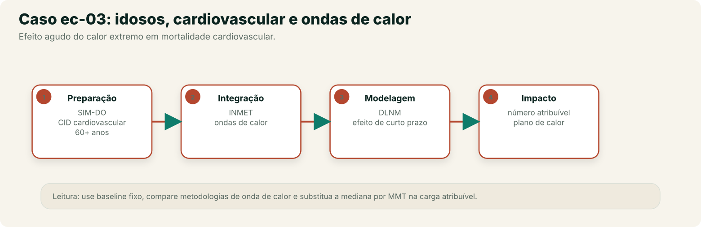
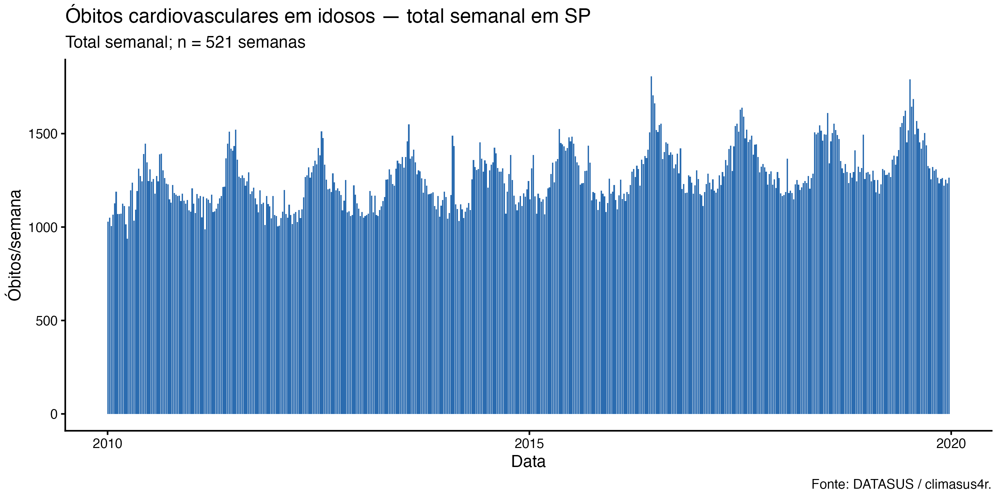
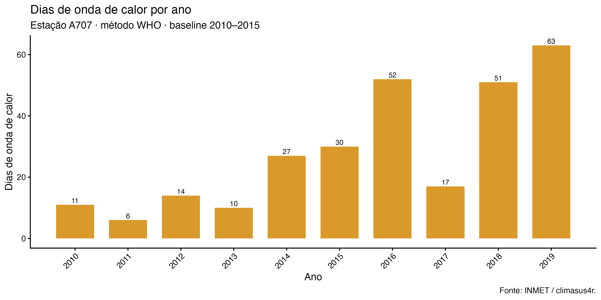
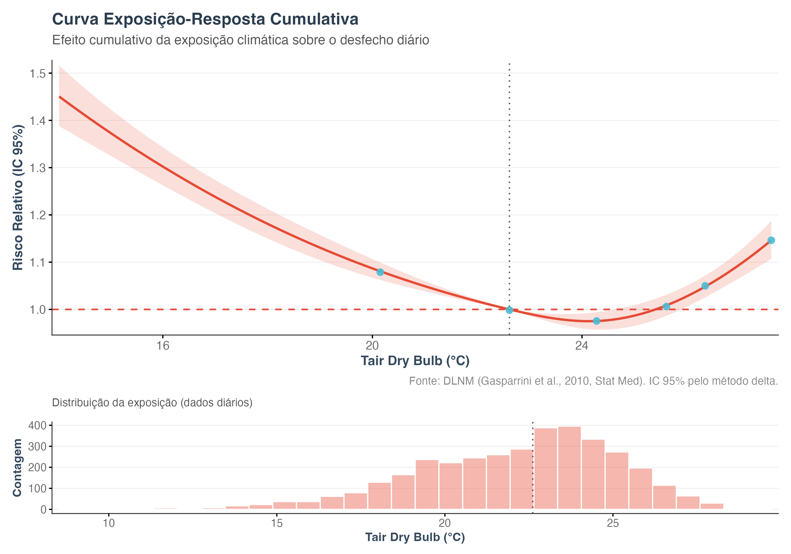

No recorte de calor e frio do Capítulo 0, usado como exemplo principal da Etapa Análise &
Modelagem (Capítulo 6), apresentamos o arco de calor extremo e doença cardiovascular em
idosos — um caso de efeito agudo, com defasagem curta. Este capítulo acompanha o recorte
do dado bruto do SIM-DO à carga atribuível ao calor **e ao frio**. Público
principal: acadêmico e gestor técnico responsável por planos de contingência para ondas
de calor. O exemplo usa a capital paulista; o snapshot original agregou o Estado inteiro,
e a replicação cidade-específica corrige essa unidade de análise. O mesmo Pipeline vale
para a Amazônia, com as adaptações de exposição descritas adiante.

## O pipeline completo, etapa por etapa

Recorte: óbitos cardiovasculares (CID-10, capítulo I) em idosos (60 anos ou mais) no
município de São Paulo (código 355030), 2010-2019, contra a temperatura das estações
INMET. O Modelo de catálogo `ec-03-cardio-idosos-calor` traz este Pipeline pronto para
carregar no Centro de Pipelines.

Em Manaus e em outras cidades amazônicas, o mesmo desenho se aplica, mas a exposição deve
considerar calor úmido — por exemplo, WBGT ou UTCI, índices que combinam temperatura,
umidade e ventilação — e a definição de onda de calor precisa ser revista; temperatura do
ar isolada pode subestimar o risco.

{fig-alt="Arco do caso ec-03 em quatro etapas — preparação no SIM-DO para idosos, integração com ondas de calor de São Paulo, modelagem DLNM de efeito agudo e impacto com fração e número atribuível. À direita, a ficha do estudo; abaixo, a série de óbitos diários com pico durante a onda de calor e déficit posterior por efeito colheita."}

**Preparação**

1. **Importar dados do DATASUS** (`sus_data_import`) — importa óbitos do sistema `SIM-DO`, UF `SP`, anos de 2010 a 2019
   — uma janela mais longa que o recorte respiratório pediátrico do Capítulo 7, porque
   ondas de calor extremas não acontecem todo ano.
2. **Corrigir acentuação e caracteres** (`sus_data_clean_encoding`) — corrige encoding.
3. **Padronizar nomes e valores** (`sus_data_standardize`) — padroniza nomes de coluna e tipos.
4. **Filtrar por CID-10 ou grupo de doença** (`sus_data_filter_cid`) — filtra pelo capítulo I inteiro (`match_type = "chapter"`),
   cobrindo todo o espectro de doenças cardiovasculares.
5. **Criar variáveis derivadas** (`sus_data_create_variables`) — cria a faixa etária `c(0, 60, Inf)`.
6. **Filtrar por características demográficas** (`sus_data_filter_demographics`) — recorta para `age_range = c(60, Inf)`, isolando a
   população idosa.
7. **Agregar dados em série temporal** (`sus_data_aggregate`) — agrega a série por dia e por
   município, com `complete_dates = TRUE` — a unidade de tempo certa aqui, porque
   o efeito do calor sobre óbito cardiovascular agudo se concentra nos primeiros dias
   (Capítulo 6).

**Integração**

8. **Juntar dados a limites geográficos** (`sus_spatial_join`) — liga a série de saúde aos
   municípios.
9. **Importar dados das estações do INMET** (`sus_climate_inmet`) — traz temperatura das estações INMET de SP, mesmos anos.
10. **Preencher falhas nos dados do INMET** (`sus_climate_fill_inmet`) — completa as falhas das séries de temperatura média, máxima e mínima com um modelo de aprendizado de máquina treinado por estação (XGBoost), para que a detecção de ondas de calor e as defasagens não tenham buracos. Pode levar vários minutos.
11. **Detectar ondas de calor** (`sus_climate_compute_heatwaves`) — detecta ondas de calor com o método WHO do catálogo
    (`method = "WHO"`), usando percentil 90 e um período de referência fixo (2010–2015);
    há sete metodologias disponíveis, e a escolha deve ser declarada e testada.
12. **Visualizar ondas de calor** (`sus_climate_plot_heatwaves`) — mostra os dias
    classificados como onda de calor. É um ramo descritivo, não um regressor do modelo.
13. **Cruzar dados de saúde e clima** (`sus_climate_aggregate`) — cria as colunas de
    defasagem de **0 a 21 dias** da temperatura, com
    `temporal_strategy = "distributed_lag"`.

**Análise & Modelagem**

14. **Modelar risco com DLNM** (`sus_mod_dlnm`) — ajusta o Modelo DLNM sobre a série diária,
    com `outcome_col` apontando para a contagem de óbitos. O template usa a mediana da
    temperatura como referência; a replicação usa o **MMT estimado** (23,1 °C) e reporta as
    caudas p99 (calor) e p01 (frio).
15. **Calcular fração atribuível** (`sus_mod_af`) — calcula a fração e o número atribuível
    ao calor extremo, usando o limiar de referência definido no modelo.
16. **Visualizar fração atribuível** (`sus_mod_plot_af`) — Resultado gráfico/tabela pronto para comunicação.

## Dados usados

**Fonte:** SIM-DO (DATASUS), óbitos por causas cardiovasculares (CID-10 capítulo I) em
pessoas de 60 anos ou mais, em São Paulo, 2010–2019.

**O que o snapshot fez:** o Pipeline importou a UF `SP` e não filtrou o município. Como
`sus_mod_dlnm()` agrega todas as linhas por data, o modelo do snapshot é uma série
**estadual**: 645 municípios, 659.351 óbitos e 3.631 dias após as defasagens. O capítulo
chamava isso de “São Paulo”, mas o número não descreve a capital.

**O que a replicação fez:** filtrou o município de São Paulo (código 355030) e usou a
estação A701 (Mirante), com 99% de cobertura diária em 2010–2019. Série de 3.636 dias e
**184.893 óbitos** cardiovasculares em 60+. Modelo diário com dia da semana, feriados,
7 df/ano de tendência, defasagem 0–21 dias e referência no **MMT**. O filtro municipal é
feito no script de replicação; o template do catálogo importa a UF inteira.

**Snapshot:** `data/ec03/analytic.parquet` (MD5 `0ee2a03b96da684eeaff0a4a32442d26`),
gerado em 26/10/2026. Dicionário de variáveis: `data/ec03/codebook.csv`.
**Avisos do Motor (snapshot):** dispersão 1,25 (adequada) e autocorrelação residual
(Ljung-Box p < 0,001); o baseline de 2010–2015 tem apenas cinco anos.
**Replicação:** dispersão 1,08; Ljung-Box p = 0,014.

## Resultados

### Série e cobertura (snapshot)

{#fig-ec03-serie}

**Como ler:** o eixo x é o tempo; o eixo y é o número de óbitos. A série tem sazonalidade e
tendência; o modelo precisa separar esses componentes da temperatura. A figura é do
snapshot estadual; a réplica cidade-específica está na tabela adiante.

### Ondas de calor detectadas

{#fig-ec03-ondas}

**Como ler:** as barras são os dias classificados como onda de calor (WHO, percentil 90,
baseline 2010–2015) em uma estação de referência. A detecção é **descritiva**; o DLNM
abaixo usa temperatura contínua, não o indicador binário de onda.

### Modelo DLNM: snapshot e replicação

| Medida | Snapshot (Estado de SP) | Replicação (cidade de SP) |
|---|---:|---:|
| Unidade de análise | 645 municípios agregados | 1 município (355030) |
| Óbitos no modelo | 659.351 | 184.893 |
| Dias | 3.631 | 3.636 |
| Referência | mediana (22,6 °C) | **MMT 23,1 °C (p76)** |
| RR no p75 vs referência | 0,98 (0,96–0,99) | — |
| RR no p99 (calor) vs MMT | — | **1,21 (1,10–1,33)** |
| RR no p01 (frio) vs MMT | — | **1,67 (1,50–1,85)** |
| Defasagem de pico | 0 dias | 0 dias |
| Dispersão | 1,25 | 1,08 |
| Autocorrelação residual | p < 0,001 | p = 0,014 |

**Como ler:** o RR no p75 do snapshot (0,98) não é um contraste de calor extremo: 24,3 °C
fica perto do mínimo da curva. O contraste correto é o das caudas — p99 para calor e p01
para frio, ambos contra o MMT. A replicação mostra **calor moderado** (RR 1,21) e **frio
forte** (RR 1,67), com MMT em 23,1 °C.

{#fig-ec03-dlnm}

**Como ler:** o eixo x é a temperatura; o eixo y é o RR cumulativo. A curva é mais alta no
frio (RR ~1,45 perto de 13 °C), mínima perto de 24 °C e sobe novamente no calor extremo
(RR ~1,14 perto de 28 °C). O padrão é **dominado pelo frio**, com um componente de calor
menor. A figura é do snapshot (referência mediana); a replicação confirma a forma e estima
o MMT em 23,1 °C.

### Fração atribuível: snapshot e replicação

| Componente | Snapshot (Estado) | Replicação (cidade) |
|---|---:|---:|
| Total | 4,36% (3,24–5,39) | **7,9% (5,0–10,8)** |
| Calor | 2,12% (1,57–2,61) | **1,1%** |
| Frio | 2,25% (1,67–2,79) | **6,8%** |
| Óbitos atribuíveis | 28.630 | ≈ 14.600 |

**Como ler:** no snapshot, calor e frio eram quase iguais (2,12% vs 2,25%). Na replicação, o
frio responde por **6,8%** e o calor por **1,1%**. A mudança não é “o frio ficou maior”: é
que o snapshot agregava o Estado, usava a mediana e não controlava o dia da semana. O sinal
de calor não desaparece — RR p99 1,21 —, mas a carga de calor é menor que a de frio.

**Comparação com a literatura.** Em São Paulo, Gasparrini et al. (2015) estimaram AF total
de 4,62% para todas as causas (frio 3,93%; calor 0,69%), com MMT em 21,5 °C; Son et al.
(2016) encontraram +6,1% no p99 vs p90 (calor) e +8,6% no p1 vs p10 (frio), também para
todas as causas. A réplica é qualitativamente consistente — U, frio dominante, calor
moderado — e maior em magnitude porque o desfecho é cardiovascular e restrito a 60+.

## Interpretando o resultado

O resultado corrigido sustenta três afirmações e desfaz uma leitura errada:

1. **Há efeito de calor**, mas ele é modesto no contraste de cauda: RR 1,21 no p99.
2. **O frio pesa mais** neste recorte: RR 1,67 no p01 e AF de 6,8% contra 1,1% do calor.
3. **O p75 não serve para decidir**: 24,3 °C está perto do MMT; um RR de 0,98 nesse ponto
    não significa que o calor protege.
4. **O snapshot estadual não é a cidade**: a agregação de 645 municípios, a ausência de dia
    da semana e a referência na mediana produziam uma AF de calor de 2,12% que não se
    reproduz na capital.

O que ainda limita a conclusão: o modelo não ajusta poluição do ar (PM2,5/O3), não
estratifica por sexo ou causa específica, usa uma única estação para representar a cidade e
tem autocorrelação residual moderada (p = 0,014). A AF é uma estimativa populacional, não
uma contagem individual. A definição de onda de calor (WHO, p90) é descritiva e não entra
como regressor; para uma pergunta sobre dias de onda, é preciso um modelo com indicador
binário ou análise de excesso.

## O que os números mostram {#numeros-ec03}

| Pergunta | Snapshot (Estado) | Replicação (cidade) |
|---|---|---|
| O calor aumenta o risco? | RR no p75 0,98, mas o p75 está perto do mínimo | **Sim: RR p99 1,21 (1,10–1,33)** |
| O frio aumenta o risco? | AF de frio 2,25% | **Sim: RR p01 1,67 (1,50–1,85); AF 6,8%** |
| Qual componente pesa mais? | Quase empate (2,12% vs 2,25%) | **Frio (6,8% vs 1,1%)** |
| Qual é a carga total? | 4,36% (3,24–5,39) | **7,9% (5,0–10,8)** |
| Onde está o MMT? | Não estimado (mediana = 22,6 °C) | **23,1 °C (p76)** |

**O que não podemos concluir:** que o calor “protege” porque o RR no p75 é menor que 1; que
a AF de calor seja 1,1% para cada pessoa; que os dias de onda de calor, isoladamente,
expliquem toda a carga. A AF integra a cauda acima do MMT; o RR no p75 é apenas um ponto da
curva. Também não podemos transferir o número para Manaus sem rever a exposição (calor
úmido, WBGT/UTCI) e a definição de onda.

**Antes de concluir:** teste outra definição de onda de calor, considere PM2,5/O3 e
estratifique por sexo e causa. A autocorrelação residual (p = 0,014) indica que a incerteza
pode estar levemente subestimada.

## O que isso significa para ação

A carga estimada é **7,9%** dos óbitos cardiovasculares em idosos no período, com **6,8%**
atribuíveis ao frio e **1,1%** ao calor. Isso não justifica um plano de contingência
dimensionado apenas pelo calor: no recorte de São Paulo, o frio também pesa — e mais. A ação
responsável é usar as duas componentes, adotar o MMT como referência, testar as definições
de onda e considerar poluição do ar antes de transformar a AF em meta de programa.

Em Manaus e em outras cidades amazônicas, o plano deve considerar calor úmido e noites
quentes; só a temperatura máxima diurna pode subestimar o risco. A mesma cautela vale para o
frio: friagem e moradias sem isolamento térmico não aparecem na temperatura média da cidade.

Para levar este Pipeline além do Studio — relatório técnico, publicação, ou execução
automatizada a cada nova temporada de calor — use **Arquivo → Salvar projeto** e **Exportar `.R`**,
sempre registrando fontes, versões e limitações.

## Reproduzir

```bash
Rscript book/scripts/03-run-ec03.R
# ou, para reaproveitar o parquet já gerado e rodar a AF com 200 simulações:
Rscript book/scripts/03b-ec03-af.R
# replicação cidade-específica (São Paulo, A701, MMT, DOW):
Rscript book/scripts/90-replicacao/00-build-city-climate.R
python3 book/scripts/90-replicacao/prep_city_series.py
Rscript book/scripts/90-replicacao/01-fit-replicacao.R
```

O script grava a tabela analítica em `data/ec03/analytic.parquet`, as tabelas em
`tables/results/ec03/`, as figuras em `images/results/ec03/` e os metadados em
`results/ec03.json`. O snapshot usado neste capítulo foi gerado em 26/10/2026.

::: {.callout-note collapse="true"}
## Verifique se ficou

**1. Por que este Pipeline agrega a série de saúde por dia, enquanto o recorte de
dengue do Capítulo 8 agregava por semana?**

Porque o efeito do calor extremo sobre óbito cardiovascular agudo se concentra nos primeiros
dias (Capítulo 6) — agregar por dia preserva a resolução temporal necessária para capturar
esse efeito de curtíssimo prazo, diferente da dinâmica mais lenta da dengue.

**2. Qual a função de Detectar ondas de calor (`sus_climate_compute_heatwaves`) neste
Pipeline, e por que ela vem antes do Modelo DLNM?**

Ela detecta, a partir da série de temperatura, quais dias configuram onda de calor
segundo uma das metodologias disponíveis (aqui, método WHO/percentil 90). É um ramo
**descritivo**: o DLNM deste Pipeline usa temperatura contínua, não o indicador de onda
de calor. Para estimar o efeito específico dos dias de onda, seria necessário um modelo
com esse indicador (ou uma análise de excesso).

**3. O texto sugere repetir a análise com mais de uma metodologia de detecção de onda de
calor usando Comparar sensibilidade entre grupos (`sus_mod_sensitivity`). Por que isso é
recomendável?**

Porque **Detectar ondas de calor** (`sus_climate_compute_heatwaves`) oferece sete metodologias diferentes de detecção,
e cada uma pode gerar limiares distintos; repetir a análise com mais de uma e comparar
os resultados com **Comparar sensibilidade entre grupos** (`sus_mod_sensitivity`) é a forma
indicada no Capítulo 6 para verificar se a conclusão se mantém quando a escolha
metodológica muda.

**4. Por que o snapshot estimou 4,36% e a replicação 7,9%?**

Por quatro decisões diferentes: o snapshot agregava 645 municípios (série estadual), usava a
mediana como referência, não incluía dia da semana e controlava a tendência com 4 df/ano. A
replicação usa a cidade de São Paulo, referência no MMT, dia da semana/feriados e 7 df/ano.
O efeito de calor diminui (2,12% → 1,1%) e o de frio aumenta (2,25% → 6,8%) — o total sobe
porque a carga de frio passa a ser corretamente atribuída.
:::
