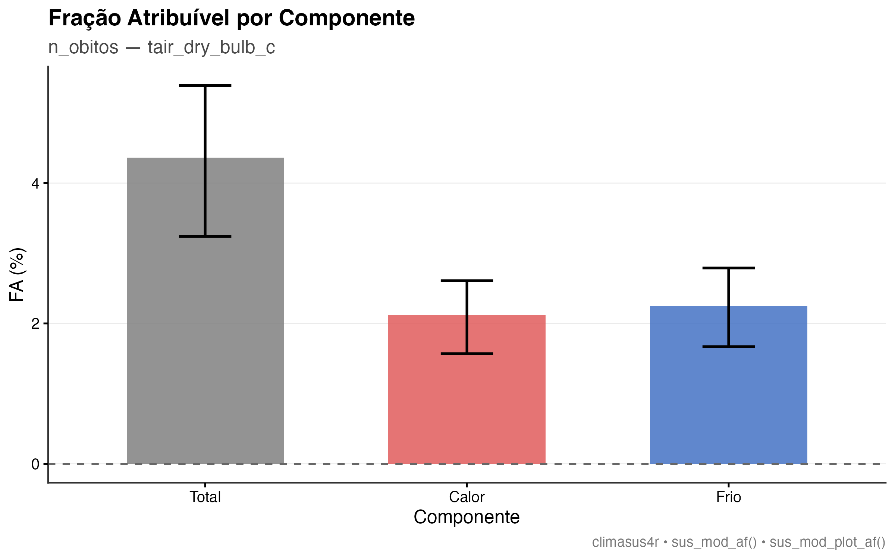

No recorte de calor e frio do Capítulo 0, usado como exemplo principal da Etapa Análise &
Modelagem (Capítulo 6), apresentamos o arco de calor extremo e doença cardiovascular em
idosos — um caso de efeito agudo, com defasagem curta. Este capítulo acompanha o recorte
do dado bruto do SIM-DO à carga atribuível ao calor. Público
principal: acadêmico e gestor técnico responsável por planos de contingência para ondas
de calor. O exemplo usa São Paulo; o mesmo Pipeline vale para a Amazônia, com as
adaptações de exposição descritas adiante.

## O pipeline completo, etapa por etapa

Recorte: óbitos cardiovasculares (CID-10, capítulo I) em idosos (60 anos ou mais) em São
Paulo, 2010-2019, contra ondas de calor detectadas a partir da temperatura das estações
INMET. O Modelo de catálogo `ec-03-cardio-idosos-calor` traz este Pipeline pronto para
carregar no Centro de Pipelines.

Em Manaus e em outras cidades amazônicas, o mesmo desenho se aplica, mas a exposição deve
considerar calor úmido — por exemplo, WBGT ou UTCI, índices que combinam temperatura,
umidade e ventilação — e a definição de onda de calor precisa ser revista; temperatura do
ar isolada pode subestimar o risco.


**Preparação**

1. **Importar dados do DATASUS** (`sus_data_import`) — importa óbitos do sistema `SIM-DO`, UF `SP`, anos de 2010 a 2019
   — uma janela mais longa que o recorte respiratório pediátrico do Capítulo 7, porque
   ondas de calor extremas não acontecem todo ano.
2. **Corrigir acentuação e caracteres** (`sus_data_clean_encoding`) — corrige encoding.
3. **Padronizar nomes e valores** (`sus_data_standardize`) — padroniza nomes de coluna e tipos.
4. **Filtrar por CID-10 ou grupo de doença** (`sus_data_filter_cid`) — filtra pelo capítulo I inteiro (`match_type = "chapter"`),
   cobrindo todo o espectro de doenças cardiovasculares.
5. **Criar variáveis derivadas** (`sus_data_create_variables`) — cria a faixa etária `c(0, 60, Inf)`.
6. **Filtrar por características demográficas** (`sus_data_filter_demographics`) — recorta para `age_range = c(60, Inf)`, isolando a
   população idosa.
7. **Agregar dados em série temporal** (`sus_data_aggregate`) — agrega a série por dia e por
   município, com `complete_dates = TRUE` — a unidade de tempo certa aqui, porque
   o efeito do calor sobre óbito cardiovascular agudo se concentra nos primeiros dias
   (Capítulo 6).

**Integração**

8. **Juntar dados a limites geográficos** (`sus_spatial_join`) — liga a série de saúde aos
   municípios.
9. **Importar dados das estações do INMET** (`sus_climate_inmet`) — traz temperatura das estações INMET de SP, mesmos anos.
10. **Detectar ondas de calor** (`sus_climate_compute_heatwaves`) — detecta ondas de calor com o método WHO do catálogo
    (`method = "WHO"`), usando percentil 90 e um período de referência fixo (2010–2015);
    há sete metodologias disponíveis, e a escolha deve ser declarada e testada.
11. **Visualizar ondas de calor** (`sus_climate_plot_heatwaves`) — mostra os dias
    classificados como onda de calor. É um ramo descritivo, não um regressor do modelo.
12. **Cruzar dados de saúde e clima** (`sus_climate_aggregate`) — cria as colunas de
    defasagem de **0 a 21 dias** da temperatura, com
    `temporal_strategy = "distributed_lag"`.

**Análise & Modelagem**

13. **Modelar risco com DLNM** (`sus_mod_dlnm`) — ajusta o Modelo DLNM sobre a série diária,
    com `outcome_col` apontando para a contagem de óbitos. O template usa a mediana da
    temperatura como referência; para carga atribuível, substitua por uma temperatura de
    mortalidade mínima (MMT) ou um valor pré-especificado.
14. **Calcular fração atribuível** (`sus_mod_af`) — calcula a fração e o número atribuível
    ao calor extremo, usando o limiar de referência definido no modelo.
15. **Visualizar fração atribuível** (`sus_mod_plot_af`) — Resultado gráfico/tabela pronto para comunicação.

## Dados usados

**Fonte:** SIM-DO (DATASUS), óbitos por causas cardiovasculares (CID-10 capítulo I) em
pessoas de 60 anos ou mais, em São Paulo, 2010–2019.
**Recorte:** série diária por município; temperatura do ar da estação INMET mais próxima;
ondas de calor detectadas com método WHO, percentil 90, baseline 2010–2015.
**N:** 2.355.540 linhas município-dia; 645 municípios; 3.652 dias. Total de **659.351
óbitos**; média de 0,28 por município-dia; máximo de 89 em um único município-dia. A AF
usa **656.228** óbitos após as defasagens.
**Modelo:** 3.631 dias após as defasagens; 0–21 dias.
**Snapshot:** `data/ec03/analytic.parquet` (MD5 `0ee2a03b96da684eeaff0a4a32442d26`),
gerado em 26/10/2026. Dicionário de variáveis: `data/ec03/codebook.csv`.
**Avisos do Motor:** dispersão 1,25 (adequada) e autocorrelação residual (Ljung-Box
p < 0,001); o baseline de 2010–2015 tem apenas cinco anos.

## Resultados

### Série e cobertura

{#fig-ec03-serie}

**Como ler:** o eixo x é o dia; o eixo y é o número de óbitos. A série tem sazonalidade e
tendência; o modelo precisa separar esses componentes da temperatura. O gráfico descreve
a série, não o efeito do calor.

### Ondas de calor detectadas

{#fig-ec03-ondas}

**Como ler:** as barras são os dias classificados como onda de calor (WHO, percentil 90,
baseline 2010–2015) em uma estação de referência. A detecção é **descritiva**; o DLNM
abaixo usa temperatura contínua, não o indicador binário de onda.

### Modelo DLNM

| Medida | Valor |
|---|---:|
| RR no p75 de temperatura (24,3 °C) vs referência (22,6 °C) | 0,98 (IC95% 0,96–0,99) |
| Defasagem de pico | 0 dias |
| Dias no modelo | 3.631 |
| Dispersão | 1,25 (adequada) |
| Autocorrelação residual | p < 0,001 |

**Como ler:** o RR no p75 é ligeiramente abaixo de 1, mas o p75 fica **perto do mínimo da
curva** — não é o ponto que representa "calor extremo". O RR pontual não deve ser lido
como "calor protege"; a carga de calor está na cauda acima da referência e é resumida pela
AF de calor.

{#fig-ec03-dlnm}

**Como ler:** o eixo x é a temperatura; o eixo y é o RR cumulativo. A curva é mais alta
no frio (RR ~1,45 perto de 13 °C), mínima perto de 24 °C e sobe novamente no calor
extremo (RR ~1,14 perto de 28 °C). O padrão é **dominado pelo frio**, com um componente
de calor menor. A referência é a mediana (22,6 °C); para carga atribuível, o ideal é MMT.

### Fração atribuível

| Componente | AF (%) | IC95% | Número atribuível |
|---|---:|---:|---:|
| Total | 4,36 | 3,24–5,39 | 28.630 |
| Calor | 2,12 | 1,57–2,61 | 13.907 |
| Frio | 2,25 | 1,67–2,79 | 14.735 |

**Como ler:** no período, o modelo estima **4,36%** dos óbitos cardiovasculares em idosos
como atribuíveis à temperatura fora da referência; **2,12%** ao calor e **2,25%** ao frio.
O componente de frio é ligeiramente maior. A AF de calor não é o RR no p75: ela integra a
cauda de calor acima da referência. O número atribuível é uma estimativa populacional,
não uma contagem individual.

{#fig-ec03-af}

**Como ler:** as barras mostram AF total, calor e frio, com intervalos de 95%. O intervalo
do total não cruza zero; os componentes de calor e frio são positivos, mas pequenos.


## Interpretando o resultado

Neste snapshot, o DLNM mostra um padrão em **U dominado pelo frio**: RR mais alto perto
de 13 °C, mínimo perto de 24 °C e nova subida no calor extremo. O pico de lag é 0, mas a
maior carga estimada está no frio (2,25%) e não no calor (2,12%). A fração atribuível de
**Calcular fração atribuível** (`sus_mod_af`) responde à pergunta de gestão — que
proporção dos óbitos é atribuível ao calor e ao frio sob o cenário definido — e precisa
ser conferida antes de associá-la ao limiar de onda de calor detectado.

**Detectar ondas de calor** (`sus_climate_compute_heatwaves`) oferece sete metodologias de detecção de
onda de calor (OMS, OMM, INMET, entre outras) — o Capítulo 3 não detalhou essa escolha
metodológica; para um estudo publicável, recomenda-se repetir a análise com mais de uma
metodologia, com **Comparar sensibilidade entre grupos** (`sus_mod_sensitivity`), e reportar se a conclusão se mantém estável.
Não há limiar universal de onda de calor: o percentil 90 é relativo à distribuição local e
precisa ser informado junto com o período de referência. O template usa uma referência
fixa de 2010–2015; cinco anos é uma base curta e deve ser declarada como limitação.

O ramo de **Detectar ondas de calor** é descritivo: o DLNM ajustado em seguida usa
temperatura contínua, não o indicador binário de onda de calor. Se a pergunta for
"quantos óbitos a mais ocorrem especificamente nos dias de onda de calor", é preciso um
modelo com esse indicador (ou uma análise de excesso), não apenas a curva contínua. Além
disso, o template **não ajusta poluição do ar** (PM2.5/O3); calor e poluição são
correlacionados, e a ausência desse ajuste deve ser tratada como limitação ou análise de
sensibilidade.

## O que os números mostram {#numeros-ec03}

| Pergunta | Resposta neste snapshot |
|---|---|
| O RR no p75 mostra efeito do calor? | Não diretamente; RR 0,98 (0,96–0,99), mas o p75 fica perto do mínimo da curva. |
| Qual é a carga de calor? | AF de calor 2,12% (IC95% 1,57–2,61). |
| Qual é a carga de frio? | AF de frio 2,25% (1,67–2,79), ligeiramente maior. |
| Qual é a carga total? | AF total 4,36% (3,24–5,39) dos óbitos no período. |
| O que a curva mostra? | Padrão em U dominado pelo frio: RR ~1,45 perto de 13 °C, mínimo perto de 24 °C, RR ~1,14 perto de 28 °C. |

**O que não podemos concluir:** que o calor "protege" porque o RR no p75 é menor que 1;
que a AF de calor seja 2,12% para cada pessoa; que os dias de onda de calor, isoladamente,
expliquem toda a carga de calor. A AF integra a cauda acima da referência; o RR no p75 é
apenas um ponto da curva.

**Antes de concluir:** use MMT em vez da mediana, teste outra definição de onda de calor e
considere PM2.5/O3. A autocorrelação residual (p < 0,001) indica que a incerteza pode estar
subestimada.

## Reproduzir

```bash
Rscript book/scripts/03-run-ec03.R
# ou, para reaproveitar o parquet já gerado e rodar a AF com 200 simulações:
Rscript book/scripts/03b-ec03-af.R
```

O script grava a tabela analítica em `data/ec03/analytic.parquet`, as tabelas em
`tables/results/ec03/`, as figuras em `images/results/ec03/` e os metadados em
`results/ec03.json`. O snapshot usado neste capítulo foi gerado em 26/10/2026.

## O que isso significa para ação

A carga de calor estimada é **modesta** (2,12% dos óbitos no período), e a de frio é
ligeiramente maior (2,25%). Isso não justifica um plano de contingência dimensionado
apenas pelo calor: o resultado sugere que, neste recorte, o frio também pesa. A ação
responsável é usar as duas componentes, testar MMT e outras definições de onda, e
considerar poluição do ar antes de transformar a AF em meta de programa.

Em Manaus e em outras cidades amazônicas, o plano deve considerar calor úmido e noites
quentes; só a temperatura máxima diurna pode subestimar o risco.

Para levar este Pipeline além do Studio — relatório técnico, publicação, ou execução
automatizada a cada nova temporada de calor — use **Salvar projeto** e **Exportar `.R`**, sempre registrando fontes, versões e limitações.

::: {.callout-note collapse="true"}
## Verifique se ficou

**1. Por que este Pipeline agrega a série de saúde por dia, enquanto o recorte de
dengue do Capítulo 8 agregava por semana?**

Porque o efeito do calor extremo sobre óbito cardiovascular agudo se concentra nos primeiros
dias (Capítulo 6) — agregar por dia preserva a resolução temporal necessária para capturar
esse efeito de curtíssimo prazo, diferente da dinâmica mais lenta da dengue.

**2. Qual a função de Detectar ondas de calor (`sus_climate_compute_heatwaves`) neste
Pipeline, e por que ela vem antes do Modelo DLNM?**

Ela detecta, a partir da série de temperatura, quais dias configuram onda de calor
segundo uma das metodologias disponíveis (aqui, método WHO/percentil 90). É um ramo
**descritivo**: o DLNM deste Pipeline usa temperatura contínua, não o indicador de onda
de calor. Para estimar o efeito específico dos dias de onda, seria necessário um modelo
com esse indicador (ou uma análise de excesso).

**3. O texto sugere repetir a análise com mais de uma metodologia de detecção de onda de
calor usando Comparar sensibilidade entre grupos (`sus_mod_sensitivity`). Por que isso é
recomendável?**

Porque **Detectar ondas de calor** (`sus_climate_compute_heatwaves`) oferece sete metodologias diferentes de detecção,
e cada uma pode gerar limiares distintos; repetir a análise com mais de uma e comparar
os resultados com **Comparar sensibilidade entre grupos** (`sus_mod_sensitivity`) é a forma
indicada no Capítulo 6 para verificar se a conclusão se mantém quando a escolha
metodológica muda.
:::
