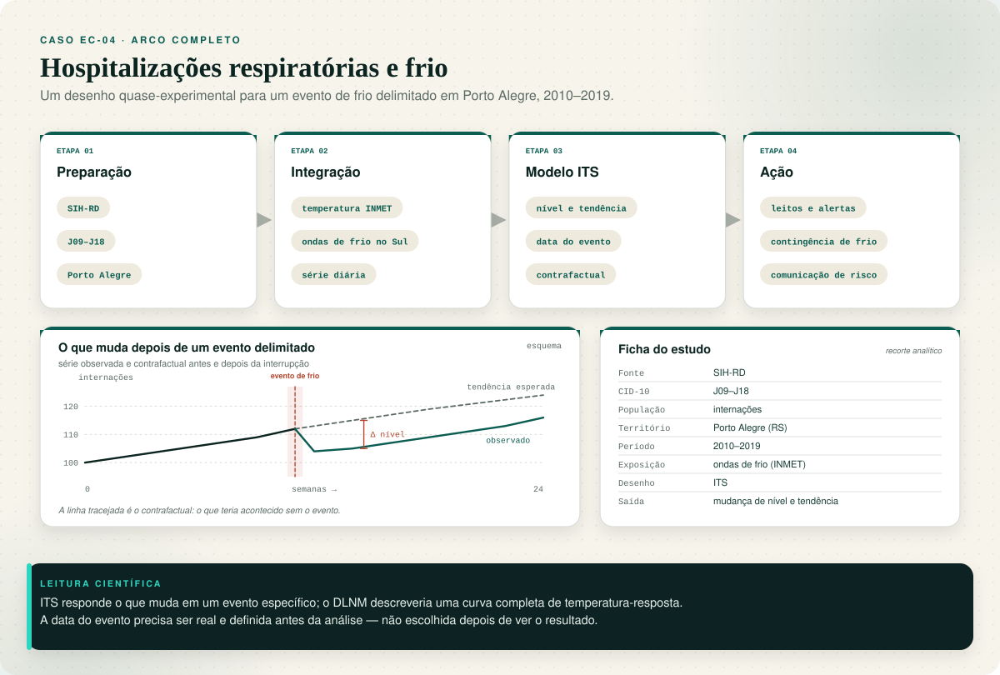
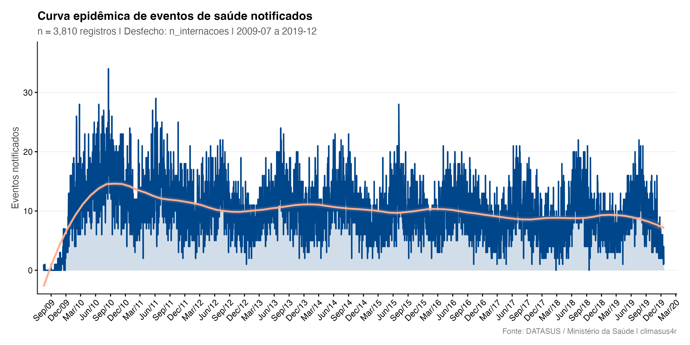
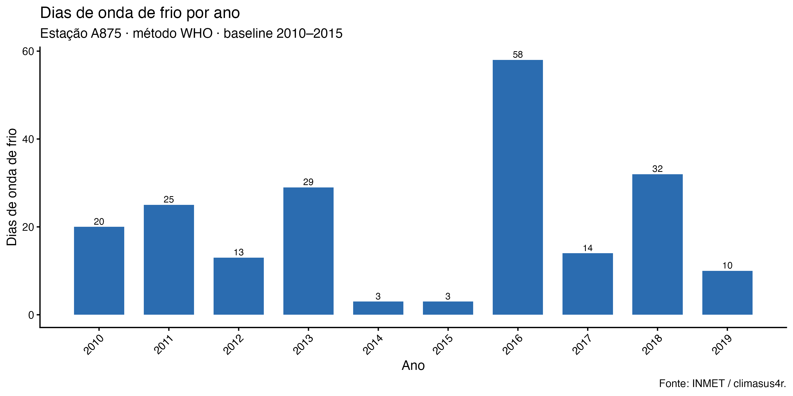
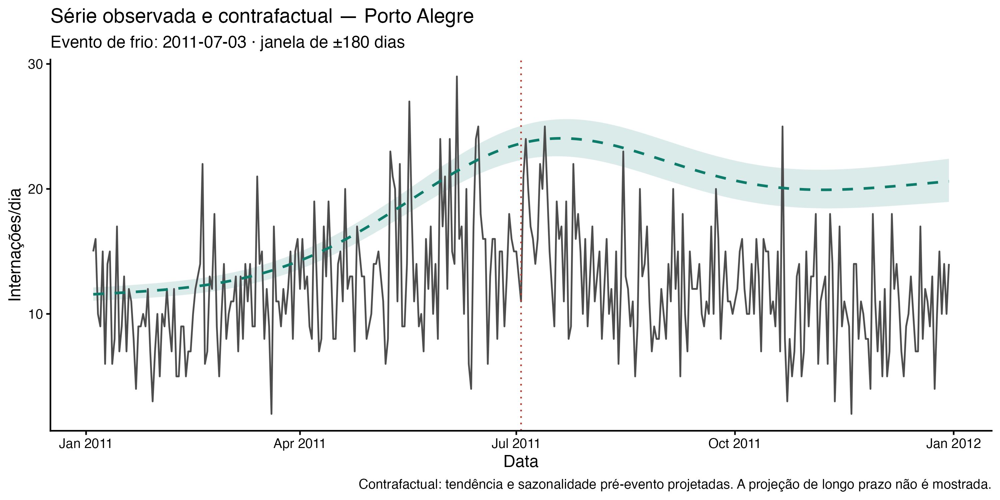

No recorte de calor e frio do Capítulo 0, apresentamos brevemente o outro lado do espectro
de temperatura: assim como o calor extremo, o frio extremo também tem efeito sobre a saúde
respiratória, com relevância maior para regiões de clima mais frio ou de altitude — e, na
Amazônia, para as incursões de ar polar conhecidas como friagem. Este capítulo acompanha
esse recorte em uma sequência completa, e é o único dos quatro estudos de caso que usa um
desenho quase-experimental (Capítulo 6) em vez do núcleo temporal DLNM. Público
principal: acadêmico e gestor técnico responsável por planos de contingência para
frio extremo.

## O pipeline completo, etapa por etapa

Recorte: internações respiratórias (SIH, CID-10 `J09`-`J18`, pneumonias e influenza) em
**Porto Alegre (RS)**, 2010-2019, contra ondas de frio detectadas para a região Sul a
partir da temperatura das estações INMET. O Modelo de catálogo
`ec-04-hospitalizacoes-frio` traz este Pipeline pronto para carregar no Centro de
Pipelines. A série analisada é de **um único município**; a detecção de ondas de frio é
feita para o Sul e serve como contexto climático.



**Preparação**

1. **Importar dados do DATASUS** (`sus_data_import`) — importa internações do sistema `SIH-RD`, região Sul, anos de
   2010 a 2019, todos os meses (`month = 1:12`), porque a detecção de onda de frio por
   percentil precisa da distribuição do ano inteiro.
2. **Corrigir acentuação e caracteres** (`sus_data_clean_encoding`) — corrige encoding.
3. **Padronizar nomes e valores** (`sus_data_standardize`) — padroniza nomes de coluna e tipos.
4. **Filtrar por CID-10 ou grupo de doença** (`sus_data_filter_cid`) — filtra pela faixa `J09-J18` (`match_type = "range"`),
   pneumonias e influenza — um recorte mais específico que o capítulo I inteiro usado no
   Capítulo 9.
5. **Criar variáveis derivadas** (`sus_data_create_variables`) — cria variáveis de calendário.
6. **Agregar dados em série temporal** (`sus_data_aggregate`) — agrega a série por dia e por
   município, com `complete_dates = TRUE`.

**Integração**

7. **Juntar dados a limites geográficos** (`sus_spatial_join`) — liga a série de saúde aos
   municípios.
8. **Importar dados das estações do INMET** (`sus_climate_inmet`) — traz temperatura das estações INMET da região Sul, mesmos anos.
9. **Detectar ondas de frio** (`sus_climate_compute_coldwaves`) — detecta ondas de frio com o método WHO do catálogo
   (`method = "WHO"`), usando percentil 10 (o espelho do percentil 90 usado para calor no
   Capítulo 9) e um período de referência fixo (2010–2015). Há sete metodologias
   disponíveis, e a escolha deve ser declarada e testada.
10. **Visualizar ondas de frio** (`sus_climate_plot_coldwaves`) — mostra os dias
    classificados como onda de frio. É um ramo descritivo, não um regressor do modelo.
11. **Filtrar por características demográficas** (`sus_data_filter_demographics`) — restringe
    a série de saúde a **Porto Alegre**, porque a ITS é um desenho de série única. Na
    execução real deste guia, o filtro foi aplicado **antes da agregação**, para evitar
    cerca de 4,5 milhões de linhas; o resultado para um município é equivalente.

**Análise & Modelagem**

12. **Avaliar impacto com série interrompida** (`sus_mod_its`) — ajusta uma série temporal
    interrompida sobre a série diária de internações de Porto Alegre, avaliando se um
    evento de frio específico muda o nível ou a tendência das internações
    (`outcome_col = "n_internacoes"`). A execução real usa **2011-07-03**, o evento mais
    longo da estação A801 (Porto Alegre); a data foi escolhida a partir dos eventos
    detectados, não de um valor fixo.

::: {.callout-warning title="ITS para um evento, não para todas as ondas de frio"}
A série temporal interrompida compara o que aconteceu antes e depois de **uma data de
interrupção**. Ondas de frio recorrentes não se tornam uma única interrupção
automaticamente. Se a pergunta é "qual o efeito de qualquer onda de frio", o desenho mais
adequado é uma série temporal com indicador de onda de frio (ou temperatura abaixo de um
limiar) e defasagens — não uma ITS com uma data escolhida. A execução real usa o evento
mais longo da estação de Porto Alegre; ainda assim, o resultado precisa ser lido com as
limitações da seção de resultados.
:::

## Dados usados

**Fonte:** SIH-RD (DATASUS), internações por J09–J18 (pneumonias e influenza) em Porto
Alegre (RS), 2010–2019, todos os meses.
**Recorte:** série diária de um único município; a detecção de ondas de frio usa as
estações INMET do Sul (método WHO, percentil 10, baseline 2010–2015).
**N:** 3.810 dias (2009-07-17 a 2019-12-21); **38.349 internações**; média de 10,07 por
dia; máximo de 34; sem dias ausentes.
**Evento:** estação A801 (Porto Alegre), **2011-07-03 a 2011-07-09**, 7 dias; temperatura
média 2,94 °C; distância da estação ao município 5,5 km.
**Snapshot:** `data/ec04/analytic.parquet` (MD5 `cee0f28d72809b5365961b13c5e7ff91`),
gerado em 26/10/2026. Dicionário de variáveis: `data/ec04/codebook.csv`.

## Resultados

### Série e cobertura

{#fig-ec04-serie}

**Como ler:** o eixo x é o dia; o eixo y é o número de internações. A série tem
sazonalidade e um pico inicial em 2009–2010; o modelo ITS precisa separar tendência e
sazonalidade antes de atribuir uma mudança ao evento.

### Ondas de frio detectadas

{#fig-ec04-ondas}

**Como ler:** as barras são os dias classificados como onda de frio (WHO, percentil 10,
baseline 2010–2015) na estação de Porto Alegre. A detecção é descritiva; o ITS abaixo usa
uma data de evento, não o indicador binário de onda.

### Série temporal interrompida

| Medida | Valor |
|---|---:|
| Mudança imediata de nível (RR) | 0,62 (IC95% 0,58–0,66) |
| Mudança de tendência (razão anual) | 0,54 (IC95% —; p < 0,001) |
| Data da interrupção | 2011-07-03 |
| Dias no modelo | 3.810 |

**Como ler — com muita cautela:** no modelo, o evento é seguido de uma **queda** de
internações (RR 0,62), não de um aumento. Isso é contraintuitivo para frio e não deve ser
lido como "frio protege". O ITS controla tendência e harmônicos, mas **não controla
temperatura contínua, poluição, influenza/RSV, mudanças de codificação ou cobertura**.
Uma queda pode refletir sazonalidade, tendência, mudança de registro ou um evento que não
funcionou como choque isolado.

{#fig-ec04-its}

**Como ler:** a linha cinza é a série observada; a tracejada é o contrafactual
(tendência e sazonalidade pré-evento projetadas); a faixa é a incerteza; a linha vertical
é o evento. A janela é de ±180 dias. A projeção de longo prazo (9 anos) **não é mostrada**
porque a extrapolação linear explode e não é crível. Mesmo nesta janela, o contrafactual
é uma projeção, não uma prova do que teria acontecido.


## Interpretando o resultado

Este é o único dos quatro estudos de caso que não usa **Modelar risco com DLNM** (`sus_mod_dlnm`). A escolha de
**Avaliar impacto com série interrompida** (`sus_mod_its`) — em vez do núcleo temporal completo — segue o critério
apresentado no Capítulo 6: perguntas sobre **um evento específico** (aqui, "o que muda
nas internações de Porto Alegre quando ocorre um evento de frio delimitado?") tendem a
ser respondidas por um desenho quase-experimental, sem exigir o ajuste mais pesado
de um Modelo DLNM completo. O Resultado de **Avaliar impacto com série interrompida** (`sus_mod_its`) estima se houve
mudança de nível (alta ou queda nas internações no início do evento) e/ou de tendência
(uma inclinação diferente enquanto o evento persiste).

Há uma diferença importante em relação ao Capítulo 9: calor extremo usou
DLNM porque o interesse era a curva completa de exposição-resposta ao longo de toda a
série; aqui, o interesse é mais pontual (o efeito de períodos específicos de onda de
frio), o que favorece o ITS. Nada impede repetir este mesmo recorte com **Modelar risco com DLNM** (`sus_mod_dlnm`) se
o objetivo for uma curva de exposição-resposta completa para temperaturas baixas — os
dois desenhos respondem perguntas diferentes, não são mutuamente exclusivos.

Não há limiar universal de onda de frio: o percentil 10 é relativo à distribuição local e
precisa ser informado junto com o período de referência. Este template usa uma referência
fixa de 2010–2015; são cinco anos, uma base curta que deve ser declarada como limitação.

## O que os números mostram {#numeros-ec04}

| Pergunta | Resposta neste snapshot |
|---|---|
| O evento mudou o nível das internações? | Sim, para baixo: RR 0,62 (IC95% 0,58–0,66). |
| O evento mudou a tendência? | Sim, para baixo: razão anual 0,54 (p < 0,001). |
| Qual evento foi usado? | A801 (Porto Alegre), 2011-07-03 a 2011-07-09, 7 dias. |
| O contrafactual é crível no longo prazo? | Não; a projeção de 9 anos explode. Mostramos apenas ±180 dias. |

**O que não podemos concluir:** que o frio proteja; que o evento tenha causado a queda;
que o resultado valha para todas as ondas de frio. O ITS controla tendência e
sazonalidade, mas não temperatura contínua, poluição, influenza/RSV, codificação ou
cobertura. A queda pode ser sazonalidade, tendência, mudança de registro ou um evento que
não funcionou como choque isolado.

**Antes de concluir:** teste um DLNM com temperatura contínua, um indicador de onda de
frio, outra data de evento e covariáveis (poluição, influenza); verifique a codificação
do SIH e a cobertura ao longo do período.

## Reproduzir

```bash
Rscript book/scripts/04-run-ec04.R
# para reaproveitar o parquet e refazer o ITS no evento A801:
Rscript book/scripts/04b-ec04-its.R
# para gerar a janela de ±180 dias:
Rscript book/scripts/04c-ec04-window-plot.R
```

O script grava a tabela analítica em `data/ec04/analytic.parquet`, as tabelas em
`tables/results/ec04/`, as figuras em `images/results/ec04/` e os metadados em
`results/ec04.json`. O snapshot usado neste capítulo foi gerado em 26/10/2026.

## O que isso significa para ação

Este resultado **não mostra aumento** de internações durante o evento; ele mostra uma
queda (RR 0,62). Portanto, não use este número para dimensionar um plano de contingência
de frio nem para afirmar que o frio protege. A ação responsável é revisar o desenho:
DLNM com temperatura contínua, indicador de onda de frio, outra data de evento,
covariáveis (poluição, influenza/RSV) e checagem de codificação/cobertura do SIH.

Na Amazônia, o mesmo desenho pode apoiar planos para a friagem, com atenção a populações
ribeirinhas e a moradias sem isolamento térmico — mas somente depois de um resultado
consistente.

Com este capítulo, os quatro estudos de caso do guia — respiratório, dengue, calor e frio —
retomam os recortes de fumaça, chuva e calor/frio apresentados no Capítulo 0. O recorte de seca e
isolamento, também apresentado lá, não tem estudo de caso próprio; a mesma sequência de
Preparação, Integração e Modelagem se aplica, com desfechos de água, alimentos, malária e
continuidade do cuidado. Para levar qualquer um deles além do Studio —
relatório técnico ou nova execução — use **Salvar projeto** e **Exportar `.R`**, registrando fontes, parâmetros e limitações.

::: {.callout-note collapse="true"}
## Verifique se ficou

**1. Por que este Pipeline usa Avaliar impacto com série interrompida (`sus_mod_its`) em
vez de Modelar risco com DLNM (`sus_mod_dlnm`), diferente dos Capítulos 7 a 9?**

Porque a pergunta de interesse aqui é mais pontual — o efeito de **um evento de frio
delimitado** sobre o nível/tendência das internações — um desenho quase-experimental
como o ITS responde bem a esse tipo de pergunta sem exigir o ajuste completo de uma
curva de exposição-resposta como o DLNM.

**2. Detectar ondas de frio (`sus_climate_compute_coldwaves`) usa percentil 10 como
limiar, o espelho do percentil 90 usado para calor no Capítulo 9. O que esse limiar
representa?**

Um limiar baseado na distribuição histórica local de temperatura (os 10% dos dias mais
frios, ou os 10% dos dias mais quentes) — não um valor absoluto fixo — o que permite que a
mesma metodologia se adapte a climas regionais diferentes. Registre a classificação e o
período de referência usados.

**3. O texto diz que nada impede repetir este recorte com Modelar risco com DLNM
(`sus_mod_dlnm`). O que se ganharia com isso, que o ITS não oferece?**

Uma curva de exposição-resposta completa relacionando qualquer nível de temperatura
(não só os períodos classificados como onda de frio) ao risco de internação, incluindo a
estrutura de defasagem ao longo dos dias — informação mais detalhada do que a mudança de
nível/tendência que o ITS reporta.
:::
