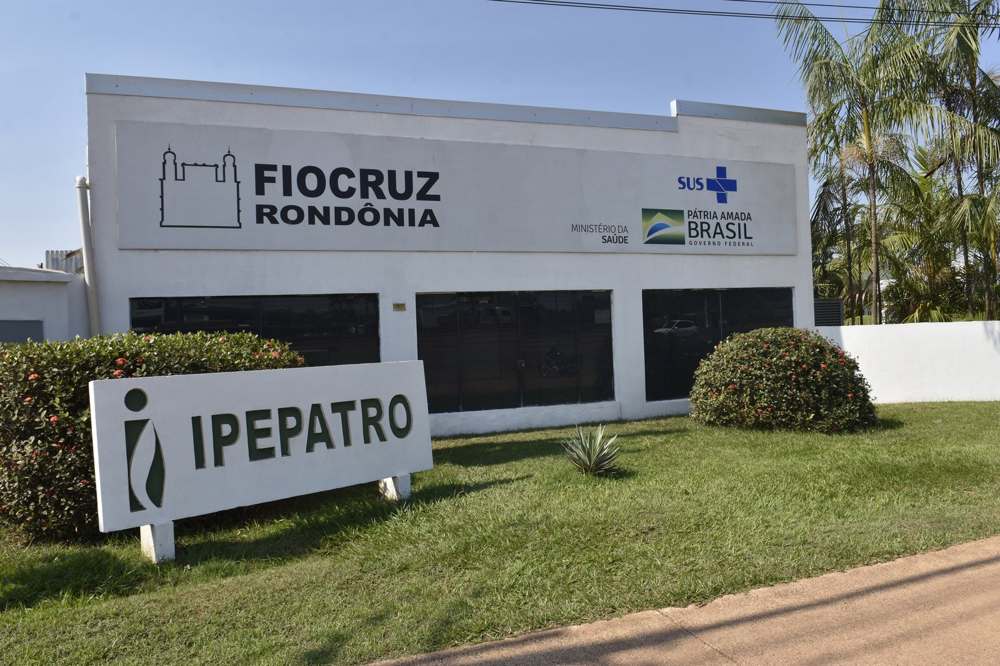

## Uma publicação do ecossistema climaSUS

O **climasus+ Studio** é um estúdio visual para montar e executar análises de saúde, clima e ambiente do DATASUS, encadeando as funções do pacote [climasus4r](https://github.com/ByMaxAnjos/climasus4r) como um Pipeline — sem precisar saber programar. O motor de análise já vem embutido no aplicativo.

Este guia é material de formação da rede. Reúne os conceitos de clima e saúde, o passo a passo das Etapas, os Modelos de vigilância e os critérios para usar resultados com responsabilidade.

```{=html}
<div class="support">
<h2>Realização e apoio</h2>
<p>Desenvolvimento articulado ao <strong>Centro de Clima de Saúde de Rondônia</strong>, à <strong>Fiocruz Rondônia</strong> e ao <strong>INCT-CONEXAO</strong>, no âmbito do ecossistema climaSUS.</p>
<div class="support-logos" aria-label="Logos institucionais">
<a href="https://github.com/ByMaxAnjos/climasus-plus"></a>
<a href="https://www.gov.br/cnpq/"></a>
<a href="https://www.fiocruz.br/"></a>
<a href="https://www.gov.br/cnpq/"></a>
<a href="https://www.ufjf.br/"></a>
</div>
</div>
```

::: {.pdf-only}
## Realização e apoio

Desenvolvimento articulado ao **Centro de Clima de Saúde de Rondônia**, à **Fiocruz Rondônia** e ao **INCT-CONEXAO**, no âmbito do ecossistema climaSUS.
:::

## Ficha técnica

| | |
|---|---|
| **Título** | climasus+ Studio: guia prático sobre clima, saúde e Amazônia |
| **Edição** | 1ª edição · outubro de 2026 |
| **Coordenação e curadoria** | Max Anjos |
| **Equipe** | Sergio Lins de Carvalho · Marlon Resende Faria · Thauã Menezes · Andrey Araújo · Nathalia A. Franqlin |
| **Instituições** | UFJF · Fiocruz Rondônia (CCSRO) · INCT-CONEXAO · UERJ · USP · UNESP · UNIR |
| **Software** | climasus+ Studio v1.1.0-beta.2 · climasus4r |
| **Licença do software** | MIT |

## O que mudou nesta edição

Esta edição foi conferida contra o catálogo e o código do Studio em **22 de outubro de 2026**. As mudanças editoriais e de conteúdo em relação à versão anterior são:

- Catálogo confirmado em **79 funções**: 15 na Preparação, 32 na Integração e 32 na Análise & Modelagem.
- A Etapa Integração passa a documentar as funções de censo e vínculo espacial **`sus_census_join`**, **`sus_census_select`** e **`sus_spatial_join`**, além de **`sus_grid_plot`**.
- **`sus_data_import`**: o parâmetro `month` é obrigatório para sistemas mensais (SIH, CNES e SIA) e aceita `1`, `1:12` ou combinações como `c(1, 4, 6)`.
- **`sus_climate_inmet`**: o padrão de `parallel` passou a ser `FALSE`; `TRUE` explícito continua permitido.
- **`sus_data_plot_aggregate_ts`**: o padrão de `plot_type` passou a ser `epidemic`, preservando as demais opções.
- Nova identidade visual: capa, aberturas de parte, paleta amazônica, tipografia editorial e fotografias do acervo Fiocruz Imagens.

Os itens acima foram verificados por leitura do catálogo (`src/catalog/functions.json`) e do código do motor; não substituem um teste de execução em cada sistema operacional.

## Fotografias

As fotografias deste guia vêm do **Fiocruz Imagens** e são usadas para fins educativos e não comerciais, com atribuição. A licença de cada imagem é **by-nc** (uso não comercial), conforme os termos do acervo. Os créditos seguem o padrão recomendado pelo Fiocruz Imagens: **autor | acervo**.

<div class="photo-credits">

**Capa e abertura da Parte V** — Crianças tembés brincam puxando os braços de um homem sentado em um tronco. Aldeia Turé Mariquita, Tomé-Açu (PA), 2009. *João Roberto Ripper | Acervo João Roberto Ripper / Fiocruz Imagens.*

**Parte I** — Homem ashaninka observa pedras aquecidas em ritual de purificação na floresta. Aldeia Apiwtxa, Marechal Thaumaturgo (AC), 2018. *João Roberto Ripper | Acervo João Roberto Ripper / Fiocruz Imagens.*

**Parte III e abertura** — Menino tembé com cocar, em meio à mata, segura a base de um cipó. Aldeia Turé Mariquita, Tomé-Açu (PA), 2009. *João Roberto Ripper | Acervo João Roberto Ripper / Fiocruz Imagens.*

**Parte IV** — Pesquisa científica com o mosquito Aedes aegypti, vetor de arboviroses como a dengue. *Vinícius Marinho | Acervo Fiocruz Imagens.*


**Fiocruz Rondônia** — Prédio do Instituto de Pesquisas em Patologias Tropicais (IPEPATRO), Porto Velho (RO), 2022. *Rodrigo Méxas | Acervo Fiocruz Imagens.*

</div>

```{=html}
<figure>

<figcaption>Fiocruz Rondônia, Porto Velho (RO). Foto: Rodrigo Méxas | Acervo Fiocruz Imagens.</figcaption>
</figure>
```

## Tipografia e identidade

A identidade do guia traduz o encontro entre floresta, água e saúde:

- **Fraunces** — capa impressa. Uma serifa de display, usada apenas na imagem de capa.
- **Petrona** — títulos, texto corrido e citações. Uma serifa editorial, usada em pesos 400 a 700.
- **Archivo** — interface, legendas, rótulos e dados. Uma grotesca de desenho latino-americano.
- **IBM Plex Mono** — código, parâmetros e nomes de funções.

A paleta combina a tinta da floresta (`#0B2420`), o verde do rio (`#0E7C6B`), a água (`#2DD4BF`), o ocre da terra (`#D99A2B`) e o papel (`#F7F4EC`). O motivo de contorno topográfico e a linha de rio aparecem como elementos de navegação, não como ornamento.

```{=html}
<div class="palette" aria-label="Paleta do guia">
<span style="background:#0B2420;color:#F7F4EC">#0B2420</span>
<span style="background:#0E7C6B;color:#F7F4EC">#0E7C6B</span>
<span style="background:#2DD4BF;color:#0B2420">#2DD4BF</span>
<span style="background:#D99A2B;color:#0B2420">#D99A2B</span>
<span style="background:#F7F4EC;color:#0B2420">#F7F4EC</span>
</div>
```

## Como citar

Para citar o guia:

> ANJOS, Max. **climasus+ Studio: guia prático sobre clima, saúde e Amazônia**. 1. ed. 2026. Disponível em: <https://github.com/ByMaxAnjos/climasus-plus>.

Para citar o software, use os metadados de [`CITATION.cff`](https://github.com/ByMaxAnjos/climasus-plus/blob/main/CITATION.cff):

> Anjos, M. (2026). *climasus+ Studio* (v1.1.0-beta.2) [Software]. GitHub. <https://github.com/ByMaxAnjos/climasus-plus>

## Licença e reuso

O código do climasus+ Studio é distribuído sob licença **MIT**. Este guia é material educativo: o texto e os diagramas podem ser reutilizados em contextos não comerciais, com atribuição à rede climaSUS e citação desta edição. As **fotografias** mantêm a licença **by-nc** do Fiocruz Imagens e exigem crédito ao autor e ao acervo; consulte os [termos de uso](https://www.fiocruzimagens.fiocruz.br/s/fiocruzimagens/page/licencas) antes de reutilizá-las.

## Como contribuir

Encontrou um erro, uma função desatualizada ou uma passagem que pode ser mais clara? Abra uma issue no repositório do projeto:

- <https://github.com/ByMaxAnjos/climasus-plus/issues>

O guia é um documento vivo: ele acompanha a evolução do catálogo, do motor e da interface do Studio.
