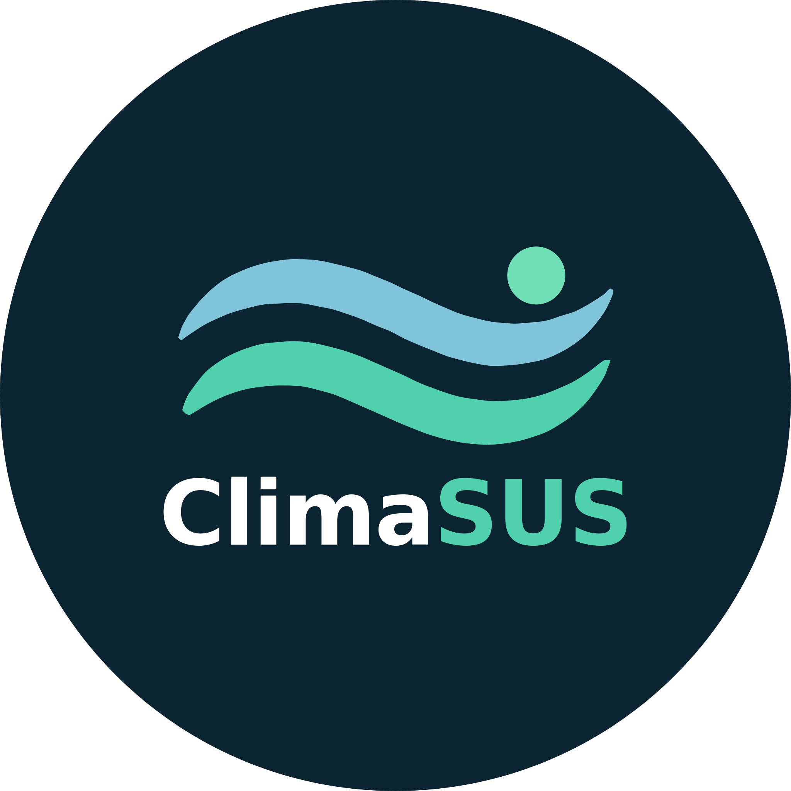
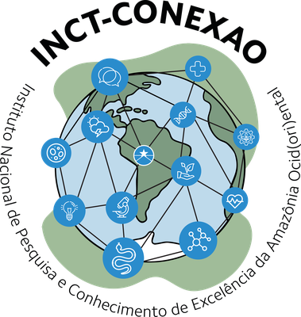
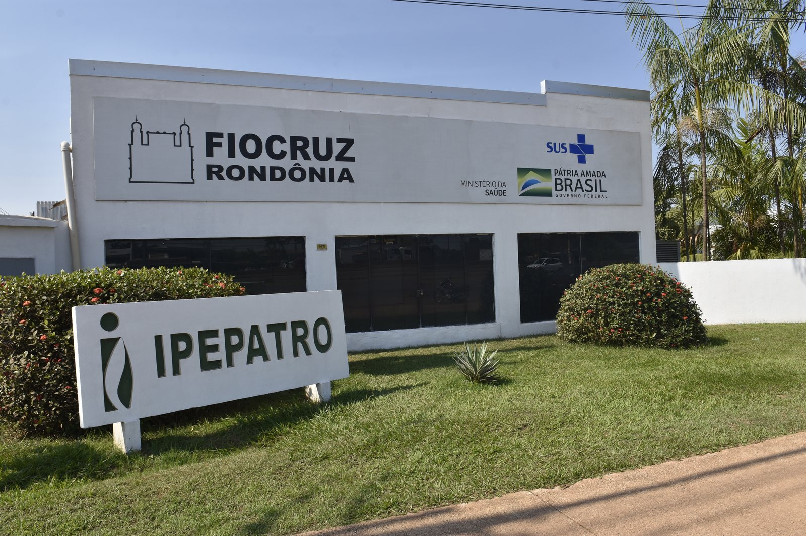

## Uma publicação do ecossistema climaSUS

O **climasus+ Studio** é um estúdio visual para montar e executar análises de saúde, clima e ambiente do DATASUS, encadeando as funções do pacote [climasus4r](https://github.com/ByMaxAnjos/climasus4r) como um Pipeline, sem precisar saber programar. O motor de análise já vem embutido no aplicativo.

Este guia reúne os conceitos na área de clima e saúde, o passo a passo das etapas de preparação, integração e análise, os Modelos de vigilância e Pequisa, realçando os critérios para usar os resultados com responsabilidade.

```{=html}
<div class="support">
<h2>Realização e apoio</h2>
<p>Desenvolvimento articulado ao <strong>Centro de Clima de Saúde de Rondônia</strong>, à <strong>Fiocruz Rondônia</strong> e ao <strong>INCT-CONEXAO</strong>, no âmbito do ecossistema climaSUS.</p>
<div class="support-logos" aria-label="Logos institucionais">
<a href="https://climasus.github.io/"></a>
<a href="https://inct-conexao.com.br/"></a>
<a href="https://www.fiocruz.br/"></a>
<a href="https://www.gov.br/cnpq/"></a>
<a href="https://www.ufjf.br/"></a>
</div>
</div>
```

::: {.pdf-only}
## Realização e apoio

Desenvolvimento articulado ao **Centro de Clima de Saúde de Rondônia**, à **Fiocruz Rondônia** e ao **INCT-CONEXAO**, no âmbito do ecossistema climaSUS.
:::

## Ficha técnica

| | |
|---|---|
| **Título** | climasus+ Studio: guia prático sobre clima, saúde, ambiente e território |
| **Edição** | 1ª edição · outubro de 2026 |
| **Coordenação e curadoria** | Max Anjos |
| **Equipe** | Sergio Lins de Carvalho · Marlon Resende Faria · Thauã Menezes · Andrey Araújo · Nathalia A. Franqlin · Cecília Cassab |
| **Instituições** | UFJF · Fiocruz Rondônia (CCSRO) · INCT-CONEXAO · UERJ · USP · UNESP · UNIR |
| **Software** | climasus+ Studio v1.1.0-beta.2 · climasus4r v.1.0.0 |
| **Licença do software** | MIT |


## Fotografias

As fotografias deste guia vêm do **Fiocruz Imagens** e são usadas para fins educativos e não comerciais, com atribuição. A licença de cada imagem é **by-nc** (uso não comercial), conforme os termos do acervo. Os créditos seguem o padrão recomendado pelo Fiocruz Imagens: **autor | acervo**.

<div class="photo-credits">

**Capa e abertura da Parte V** — Crianças tembés brincam puxando os braços de um homem sentado em um tronco. Aldeia Turé Mariquita, Tomé-Açu (PA), 2009. *João Roberto Ripper | Acervo João Roberto Ripper / Fiocruz Imagens.*

**Parte I** — Homem ashaninka observa pedras aquecidas em ritual de purificação na floresta. Aldeia Apiwtxa, Marechal Thaumaturgo (AC), 2018. *João Roberto Ripper | Acervo João Roberto Ripper / Fiocruz Imagens.*

**Parte III e abertura** — Menino tembé com cocar, em meio à mata, segura a base de um cipó. Aldeia Turé Mariquita, Tomé-Açu (PA), 2009. *João Roberto Ripper | Acervo João Roberto Ripper / Fiocruz Imagens.*

**Parte IV** — Pesquisa científica com o mosquito Aedes aegypti, vetor de arboviroses como a dengue. *Vinícius Marinho | Acervo Fiocruz Imagens.*


**Fiocruz Rondônia** — Prédio do Instituto de Pesquisas em Patologias Tropicais (IPEPATRO), Porto Velho (RO), 2022. *Rodrigo Méxas | Acervo Fiocruz Imagens.*

</div>

```{=html}
<figure>

<figcaption>Fiocruz Rondônia, Porto Velho (RO). Foto: Rodrigo Méxas | Acervo Fiocruz Imagens.</figcaption>
</figure>
```

## Mapas

O fundo dos mapas interativos é fornecido pelo **OpenFreeMap**, e o aplicativo exibe a atribuição exigida em cada mapa: © OpenFreeMap · © OpenMapTiles · Dados do OpenStreetMap (<https://openfreemap.org>).


## Como citar

Para citar o guia:

> ANJOS, Max. **climasus+ Studio: guia prático sobre clima, saúde, ambiente e território**. 1. ed. 2026. Disponível em: <https://github.com/ByMaxAnjos/climasus-plus>.

E também,

> Anjos et al. (2026). climasus4r: An R Package for Reproducible Climate-Health Data Integration and Epidemiological Analysis. Journal of Open
Source Software (em revisão) <https://github.com/openjournals/joss-reviews/issues/11423>.

## Licença e reuso

O código do climasus+ Studio é distribuído sob licença **MIT**. Este guia é material educativo: o texto e os diagramas podem ser reutilizados em contextos não comerciais, com atribuição à projeto climaSUS e citação desta edição. As **fotografias** mantêm a licença **by-nc** do Fiocruz Imagens e exigem crédito ao autor e ao acervo; consulte os [termos de uso](https://www.fiocruzimagens.fiocruz.br/s/fiocruzimagens/page/licencas) antes de reutilizá-las.

## Como contribuir

Encontrou um erro, uma função desatualizada ou uma passagem que pode ser mais clara? Abra uma issue no repositório do projeto:

- <https://github.com/ByMaxAnjos/climasus-plus/issues>

Desejamos uma ótima experiência com o climasus+ Studio e agradecemos sua contribuição para melhorar este guia e o software.
