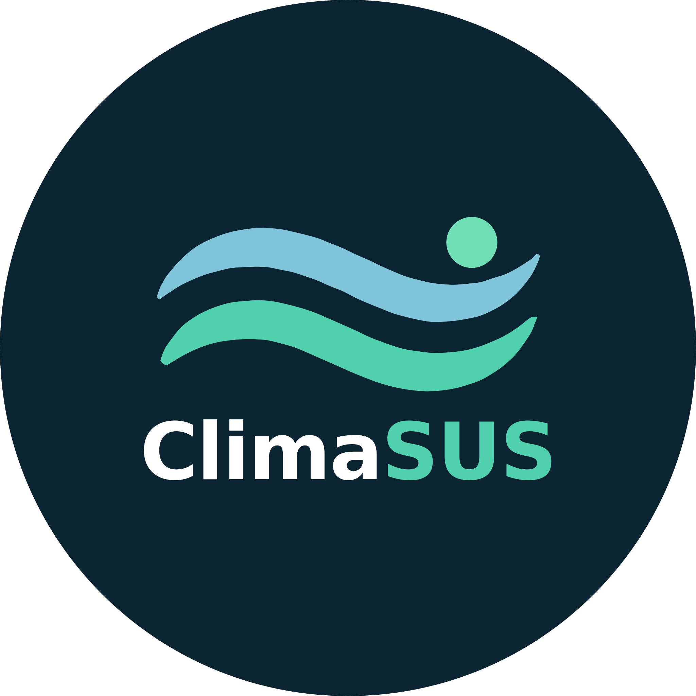
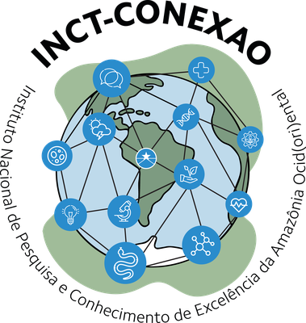

```{=html}
<div class="hero">
<div class="hero-copy">
<div class="hero-kicker">Guia prático · clima e saúde </div>
<h1>Do dado à <em>decisão</em> em saúde</h1>
<p class="hero-sub">Um guia visual para montar análises de saúde, clima e território no climasus+ Studio - sem precisar programar.</p>
<div class="hero-meta">
<span>1ª edição · 2026</span>
<span>Gestores · academia · comunidade</span>
</div>
<div class="hero-actions">
<a class="btn-hero primary" href="00-clima-saude.html">Ler o guia</a>
<a class="btn-hero" href="#sumario">Ver o sumário</a>
</div>
</div>
<div class="hero-photo">

<span class="photo-credit">Foto: João Roberto Ripper | Acervo João Roberto Ripper / Fiocruz Imagens</span>
</div>
</div>
```

## Para quem é este guia

Este guia introduz noções básicas sobre **clima e saúde** por meio do **climasus+ Studio**, um software que permite montar e executar análises que cruzam dados de saúde, clima, ambiente e território — sem precisar programar. O studio foi elaborado para três públicos:

```{=html}
<div class="publico">
<div class="publico-item">
<h3>Gestores públicos</h3>
<p>Precisam decidir políticas de saúde informadas por risco climático e querem autonomia para consultar dados sem depender de um analista para cada pergunta.</p>
</div>
<div class="publico-item">
<h3>Acadêmicos e pesquisadores</h3>
<p>Precisam de rigor metodológico e reprodutibilidade nas análises que produzem, por exemplo modelos de defesagem não linear distrbiuída (DLNM - Distributed Lag Non-linear Models em inglês).</p>
</div>
<div class="publico-item">
<h3>Comunidade em geral</h3>
<p>Quer entender por que o clima afeta a saúde no território onde vive, e o que os dados podem (e não podem) dizer.</p>
</div>
</div>
```

## Como o guia está organizado {#sumario}

Este guia prático está organizado em cinco partes:

```{=html}
<div class="sumario">
<a class="sumario-item" href="part-1-fundamentos.html">
<span class="sumario-num">I</span>
<span class="sumario-title">Fundamentos</span>
<span class="sumario-desc">Por que e quando clima e saúde se encontram, como o efeito aparece com defasagem e qual novidade que o Studio oferece.</span>
<span class="sumario-meta">2 capítulos</span>
</a>
<a class="sumario-item" href="part-2-pipeline.html">
<span class="sumario-num">II</span>
<span class="sumario-title">Etapas do pipeline</span>
<span class="sumario-desc">Funções do Studio, preparação, integração e análises de dados de saúde, clima e território.</span>
<span class="sumario-meta">2 capítulos</span>
</a>
<a class="sumario-item" href="part-3-gestor.html">
<span class="sumario-num">III</span>
<span class="sumario-title">Módulo Gestor</span>
<span class="sumario-desc">Modelos de pipelines prontos, leitura de estatísticas e critérios para gerar evidência baseada em dados.</span>
<span class="sumario-meta">2 capítulos</span>
</a>
<a class="sumario-item" href="part-4-pesquisador.html">
<span class="sumario-num">IV</span>
<span class="sumario-title">Módulo Pesquisador</span>
<span class="sumario-desc">Análise &amp; Modelagem, do DLNM aos modelos espaciais.</span>
<span class="sumario-meta">1 capítulo</span>
</a>
<a class="sumario-item" href="part-5-casos.html">
<span class="sumario-num">V</span>
<span class="sumario-title">Estudos de caso</span>
<span class="sumario-desc">Quatro recortes ilustrativos: respiratório pediátrico, dengue, cardiovascular e frio.</span>
<span class="sumario-meta">4 capítulos</span>
</a>
<div class="sumario-head">Referência</div>
<a class="sumario-item" href="11-glossario.html">
<span class="sumario-num">—</span>
<span class="sumario-title">Glossário</span>
<span class="sumario-desc">O vocabulário do Studio e da epidemiologia clima-saúde, em definições curtas para consulta rápida.</span>
<span class="sumario-meta">consulta</span>
</a>
<a class="sumario-item" href="12-parametros-avancados.html">
<span class="sumario-num">—</span>
<span class="sumario-title">Parâmetros avançados</span>
<span class="sumario-desc">Referência rápida dos parâmetros que mais mudam a pergunta, a interpretação e a reprodutibilidade.</span>
<span class="sumario-meta">consulta</span>
</a>
</div>
```

::: {.callout-tip title="Dica"}
O Studio usa o pacote R [climasus4r](https://bymaxanjos.github.io/climasus4r/) como "Motor" que executa as análises internamente. O foco é aprender a formular uma pergunta, montar um Pipeline, verificar os dados, interpretar limites e transformar evidência em ação pública.
:::

```{=html}
<div class="editorial-intro">
<figure>

<figcaption>Na floresta, o dado tem endereço. Aldeia Turé Mariquita, Tomé-Açu (PA), 2009. Foto: João Roberto Ripper | Acervo João Roberto Ripper / Fiocruz Imagens.</figcaption>
</figure>
<div class="editorial-copy">
<h2>Da e para Amazônia</h2>
A Amazônia aparece como território destaque, onde clima, floresta, água e saúde se apresentam juntos, e onde a distância entre uma série de dados e o posto de saúde é concreta. O conteúdo, porém, é nacional: os mesmos conceitos e as mesmas funções do Studio valem para qualquer município brasileiro.</p>
</div>
</div>
```

::: pdf-only
## Do dado à decisão em saúde

Um guia visual para montar análises de saúde, clima e território no climasus+ Studio — sem precisar programar.

## Da e para Amazônia

A Amazônia aparece como território destaque, onde clima, floresta, água e saúde se apresentam juntos, e onde a distância entre uma série de dados e o posto de saúde é concreta. O conteúdo, porém, é nacional: os mesmos conceitos e as mesmas funções do Studio valem para qualquer município brasileiro.

## Realização e apoio

O climasus+ Studio é parte do ecossistema [climaSUS](https://climasus.github.io/) e do Centro de Clima de Saúde de Rondônia, com desenvolvimento articulado à Fiocruz Rondônia e ao INCT-CONEXAO.
:::

```{=html}
<div class="support">
<h2>Realização e apoio</h2>
<p>O climasus+ Studio é parte do ecossistema climaSUS e do Centro de Clima de Saúde de Rondônia, com desenvolvimento articulado à Fiocruz Rondônia e ao INCT-CONEXAO. O guia prático reúne conceitos de clima e saúde, o passo a passo do Pipeline (conjunto de etapas) e critérios para uso responsável dos resultados.</p>
<p class="support-links"><a href="https://github.com/ByMaxAnjos/climasus-plus#baixar-beta">Baixar o Studio Mac, Windows e Linux</a> · <a href="https://github.com/ByMaxAnjos/climasus-plus">Repositório no GitHub</a></p>
<div class="support-logos" aria-label="Logos institucionais">
<a href="https://github.com/ByMaxAnjos/climasus-plus"></a>
<a href="https://www.gov.br/cnpq/"></a>
<a href="https://www.fiocruz.br/"></a>
<a href="https://www.gov.br/cnpq/"></a>
<a href="https://www.ufjf.br/"></a>
</div>
<p style="margin-top:1.1rem;font-size:0.78rem;color:var(--muted);">Fotografias: João Roberto Ripper | Acervo João Roberto Ripper / Fiocruz Imagens, sob licença de uso não comercial (by-nc). Créditos completos em <a href="colofao.html">Sobre esta edição</a>.</p>
</div>
```