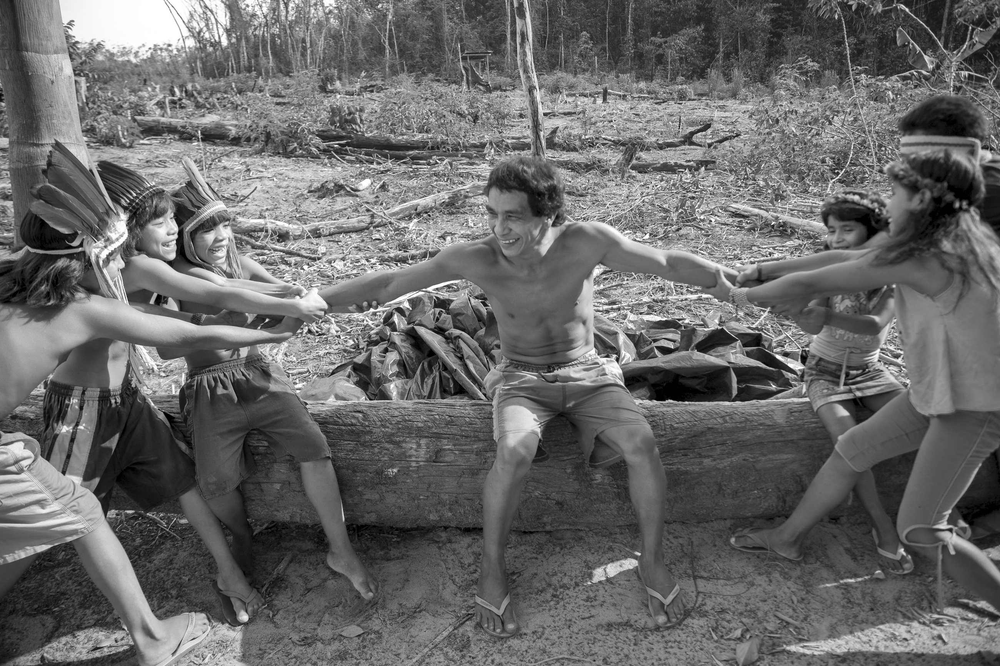
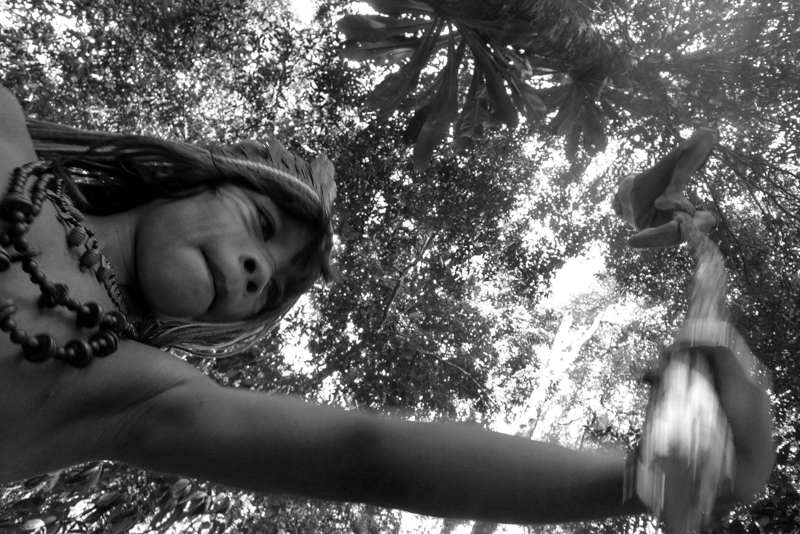
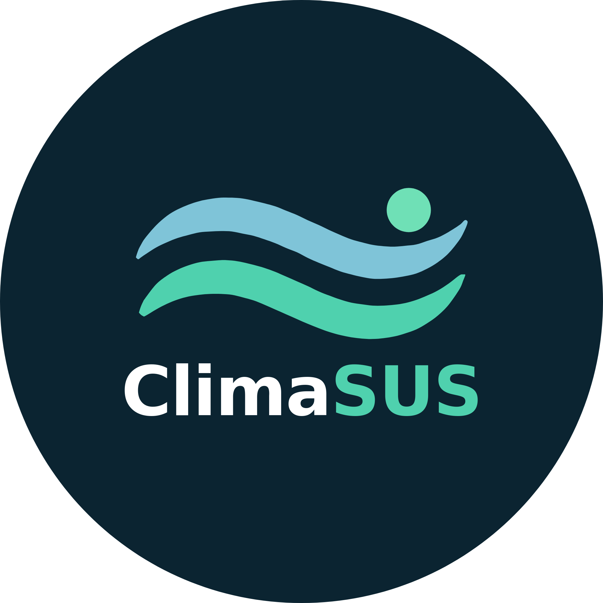
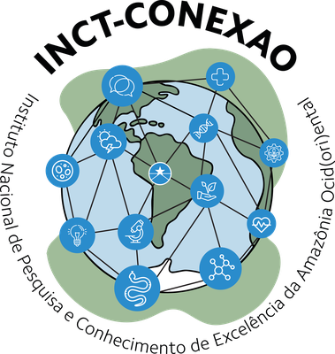

```{=html}
<div class="hero">
<div class="hero-copy">
<div class="hero-kicker">Guia prático · clima, saúde e Amazônia</div>
<h1>Do dado à <em>decisão</em> em saúde</h1>
<p class="hero-sub">Um guia visual para montar análises de saúde, clima e território no climasus+ Studio — sem precisar programar.</p>
<div class="hero-meta">
<span>1ª edição · 2026</span>
<span>Gestores · academia · comunidade</span>
<span>79 funções · 3 etapas</span>
</div>
<div class="hero-actions">
<a class="btn-hero primary" href="00-clima-saude.html">Ler o guia</a>
<a class="btn-hero" href="#sumario">Ver o sumário</a>
</div>
</div>
<div class="hero-photo">

<span class="photo-credit">Foto: João Roberto Ripper | Acervo João Roberto Ripper / Fiocruz Imagens</span>
</div>
</div>
```

## Para quem é este guia

Este guia é um curso de formação sobre **clima e saúde** e sobre o **climasus+
Studio**, o estúdio visual que permite montar e executar análises que cruzam dados
de saúde, clima e território — sem precisar programar. Ele foi escrito para três
públicos ao mesmo tempo:

```{=html}
<div class="publico">
<div class="publico-item">
<h3>Gestores públicos</h3>
<p>Precisam decidir políticas de saúde informadas por risco climático e querem autonomia para consultar dados sem depender de um analista para cada pergunta.</p>
</div>
<div class="publico-item">
<h3>Acadêmicos e pesquisadores</h3>
<p>Precisam de rigor metodológico, parâmetros explícitos e reprodutibilidade nas análises que produzem — do DLNM à fração atribuível.</p>
</div>
<div class="publico-item">
<h3>Comunidade em geral</h3>
<p>Quer entender — e poder explicar a outras pessoas — por que o clima afeta a saúde no território onde vive, e o que os dados podem (e não podem) dizer.</p>
</div>
</div>
```

Se você não sabe programar, não se preocupe: o Studio foi desenhado para que
isso nunca seja necessário. Cada capítulo assume que este é o único material
de apoio que você tem à mão.

## Como o guia está organizado {#sumario}

O Studio pergunta, logo na primeira vez que você abre um projeto, “qual é o
seu objetivo neste projeto?” e oferece dois **Modos de uso**: **Vigilância e
gestão** (linguagem direta, parâmetros avançados recolhidos, foco em
priorizar e agir) e **Pesquisa avançada** (linguagem técnica, parâmetros
abertos, foco em estimar e publicar). Os dois modos compartilham os mesmos
dados, projetos e resultados — só muda o que fica em primeiro plano. Este guia
usa esse seletor como fio condutor e organiza a leitura em cinco partes.

```{=html}
<div class="sumario">
<a class="sumario-item" href="part-1-fundamentos.html">
<span class="sumario-num">I</span>
<span class="sumario-title">Fundamentos</span>
<span class="sumario-desc">Por que clima e saúde se encontram, como o efeito aparece com defasagem e qual é o modelo mental do Studio.</span>
<span class="sumario-meta">2 capítulos</span>
</a>
<a class="sumario-item" href="part-2-pipeline.html">
<span class="sumario-num">II</span>
<span class="sumario-title">Etapas do pipeline</span>
<span class="sumario-desc">Preparação (15 funções) e Integração (32 funções): o leito do rio que organiza saúde, clima e território.</span>
<span class="sumario-meta">2 capítulos</span>
</a>
<a class="sumario-item" href="part-3-gestor.html">
<span class="sumario-num">III</span>
<span class="sumario-title">Módulo Gestor</span>
<span class="sumario-desc">Modelos prontos, tabelas comentadas, leitura de estatísticas e critérios para transformar evidência em prioridade no SUS.</span>
<span class="sumario-meta">2 capítulos</span>
</a>
<a class="sumario-item" href="part-4-pesquisador.html">
<span class="sumario-num">IV</span>
<span class="sumario-title">Módulo Pesquisador</span>
<span class="sumario-desc">Análise &amp; Modelagem (32 funções), do DLNM aos modelos espaciais, com parâmetros à vista.</span>
<span class="sumario-meta">1 capítulo</span>
</a>
<a class="sumario-item" href="part-5-casos.html">
<span class="sumario-num">V</span>
<span class="sumario-title">Estudos de caso</span>
<span class="sumario-desc">Quatro recortes — respiratório pediátrico, dengue, cardiovascular e frio — com a mesma lógica de Pipeline.</span>
<span class="sumario-meta">4 capítulos</span>
</a>
<div class="sumario-head">Referência</div>
<a class="sumario-item" href="11-glossario.html">
<span class="sumario-num">—</span>
<span class="sumario-title">Glossário</span>
<span class="sumario-desc">O vocabulário do Studio e da epidemiologia clima-saúde, em definições curtas para consulta rápida.</span>
<span class="sumario-meta">consulta</span>
</a>
<a class="sumario-item" href="12-parametros-avancados.html">
<span class="sumario-num">—</span>
<span class="sumario-title">Parâmetros avançados</span>
<span class="sumario-desc">Referência rápida dos parâmetros que mais mudam a pergunta, a interpretação e a reprodutibilidade.</span>
<span class="sumario-meta">consulta</span>
</a>
</div>
```

::: {.callout-tip title="Dica"}
O guia usa “Motor” para a camada que executa as análises. A linguagem técnica
fica em segundo plano: o foco é aprender a formular uma pergunta, montar um
Pipeline, verificar os dados, interpretar limites e transformar evidência em
ação pública responsável.
:::

```{=html}
<div class="editorial-intro">
<figure>

<figcaption>Na floresta, o dado tem endereço. Aldeia Turé Mariquita, Tomé-Açu (PA), 2009. Foto: João Roberto Ripper | Acervo João Roberto Ripper / Fiocruz Imagens.</figcaption>
</figure>
<div class="editorial-copy">
<h2>Amazônia como ponto de partida</h2>
<p>O guia nasce no ecossistema <strong>climaSUS</strong>, articulado ao <strong>Centro de Clima de Saúde de Rondônia</strong>, à <strong>Fiocruz Rondônia</strong> e ao <strong>INCT-CONEXAO</strong>. A Amazônia aparece aqui como ponto de partida — não como cenário decorativo, mas como território onde clima, floresta, água e saúde se apresentam juntos, e onde a distância entre uma série de dados e o posto de saúde é concreta.</p>
<p>Essa escolha orienta a identidade visual do guia: a tinta da floresta, a água do rio, o ocre da terra e as fotografias do acervo Fiocruz Imagens. O conteúdo, porém, é nacional: os mesmos conceitos e as mesmas funções valem para qualquer município brasileiro.</p>
</div>
</div>
```

::: {.pdf-only}
## Do dado à decisão em saúde

Um guia visual para montar análises de saúde, clima e território no climasus+ Studio — sem precisar programar.

## Amazônia como ponto de partida

O guia nasce no ecossistema **climaSUS**, articulado ao **Centro de Clima de Saúde de Rondônia**, à **Fiocruz Rondônia** e ao **INCT-CONEXAO**. A Amazônia aparece aqui como ponto de partida — não como cenário decorativo, mas como território onde clima, floresta, água e saúde se apresentam juntos. O conteúdo, porém, é nacional: os mesmos conceitos e as mesmas funções valem para qualquer município brasileiro.

## Realização e apoio

O climasus+ Studio é parte do ecossistema climaSUS e do Centro de Clima de Saúde de Rondônia, com desenvolvimento articulado à Fiocruz Rondônia e ao INCT-CONEXAO.
:::

```{=html}
<div class="support">
<h2>Realização e apoio</h2>
<p>O climasus+ Studio é parte do ecossistema climaSUS e do Centro de Clima de Saúde de Rondônia, com desenvolvimento articulado à Fiocruz Rondônia e ao INCT-CONEXAO. O guia prático é material de formação da rede: reúne conceitos de clima e saúde, o passo a passo do Pipeline e critérios para uso responsável dos resultados.</p>
<p class="support-links"><a href="https://github.com/ByMaxAnjos/climasus-plus/releases">Baixar o Studio</a> · <a href="https://github.com/ByMaxAnjos/climasus-plus">Repositório no GitHub</a></p>
<div class="support-logos" aria-label="Logos institucionais">
<a href="https://github.com/ByMaxAnjos/climasus-plus"></a>
<a href="https://www.gov.br/cnpq/"></a>
<a href="https://www.fiocruz.br/"></a>
<a href="https://www.gov.br/cnpq/"></a>
<a href="https://www.ufjf.br/"></a>
</div>
<p style="margin-top:1.1rem;font-size:0.78rem;color:var(--muted);">Fotografias: João Roberto Ripper | Acervo João Roberto Ripper / Fiocruz Imagens, sob licença de uso não comercial (by-nc). Créditos completos em <a href="colofao.html">Sobre esta edição</a>.</p>
</div>
```
