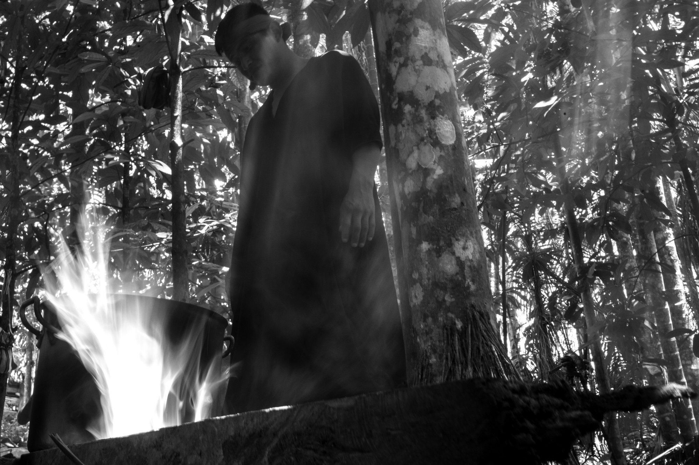

```{=html}
<div class="part-opener">
<div class="part-copy">
  <div class="part-number">I</div>
  <div class="part-kicker">Parte um · o ponto de partida</div>
  <h1>Conhecer o Studio antes do Pipeline</h1>
  <p class="part-standfirst">Antes de montar qualquer Pipeline, o guia apresenta o problema que o climasus+ Studio resolve e o modelo mental que organiza todo o trabalho: Função, Passo, Nó e Pipeline.</p>
  <ul class="part-list">
    <li><a href="01-conhecendo-o-studio.html"><span class="part-ch">01</span> Conhecendo o climasus+ Studio</a></li>
  </ul>
</div>
<div class="part-photo">
  
  <span class="photo-credit">Foto: João Roberto Ripper | Acervo João Roberto Ripper / Fiocruz Imagens</span>
</div>
</div>
```

::: {.pdf-only}
Antes de montar qualquer Pipeline, o guia apresenta o problema que o climasus+ Studio resolve e o modelo mental que organiza todo o trabalho: Função, Passo, Nó e Pipeline.


:::
