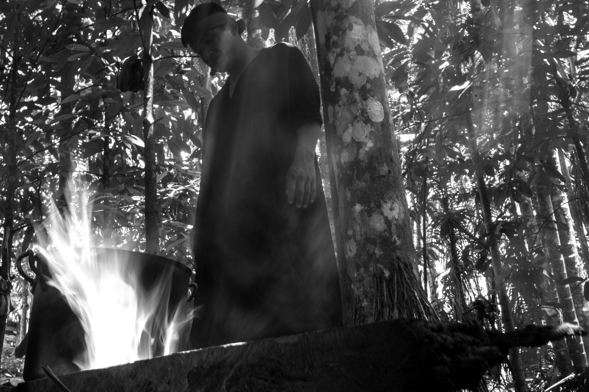

```{=html}
<div class="part-opener">
<div class="part-copy">
  <div class="part-number">I</div>
  <div class="part-kicker">Parte um · o problema</div>
  <h1>Clima, saúde e o ponto de partida</h1>
  <p class="part-standfirst">Antes de montar qualquer Pipeline, o guia situa o problema: por que o clima afeta a saúde, como o efeito aparece com defasagem e por que a vulnerabilidade é social e territorial. Depois, apresenta o Studio e o seu modelo mental.</p>
  <ul class="part-list">
    <li><a href="00-clima-saude.html"><span class="part-ch">00</span> Por que isso importa: clima, saúde e o que os dados escondem</a></li>
    <li><a href="01-conhecendo-o-studio.html"><span class="part-ch">01</span> Conhecendo o climasus+ Studio</a></li>
  </ul>
</div>
<div class="part-photo">
  
  <span class="photo-credit">Foto: João Roberto Ripper | Acervo João Roberto Ripper / Fiocruz Imagens</span>
</div>
</div>
```

::: {.pdf-only}
Antes de montar qualquer Pipeline, o guia situa o problema: por que o clima afeta a saúde, como o efeito aparece com defasagem e por que a vulnerabilidade é social e territorial. Depois, apresenta o Studio e o seu modelo mental.


:::
