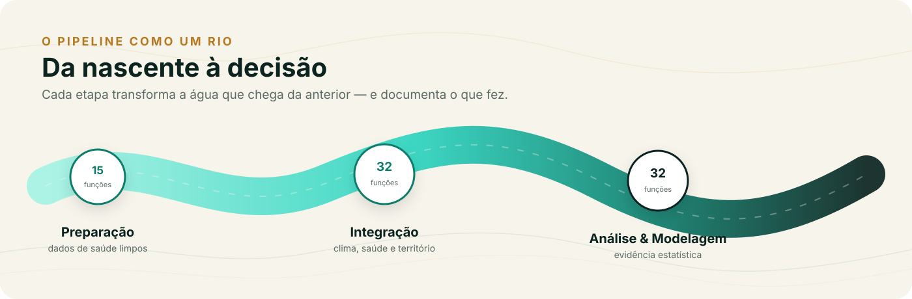

```{=html}
<div class="part-opener no-photo">
<div class="part-copy">
  <div class="part-number">II</div>
  <div class="part-kicker">Parte dois · o método</div>
  <h1>As etapas do pipeline</h1>
  <p class="part-standfirst">Preparação e Integração são o leito do rio: organizam os dados de saúde, encontram o clima e o território, e deixam a série pronta para a modelagem. Cada Passo documenta uma decisão.</p>
  <ul class="part-list">
    <li><a href="02-etapa-preparacao.html"><span class="part-ch">02</span> Preparação: dados de saúde prontos antes de tudo <span class="part-count">· 15 funções</span></a></li>
    <li><a href="03-etapa-integracao.html"><span class="part-ch">03</span> Integração: clima, saúde e território na mesma análise <span class="part-count">· 32 funções</span></a></li>
  </ul>
</div>
<div class="part-graphic">
  
</div>
</div>
```

::: {.pdf-only}
Preparação e Integração são o leito do rio: organizam os dados de saúde, encontram o clima e o território, e deixam a série pronta para a modelagem. Cada Passo documenta uma decisão.


:::
