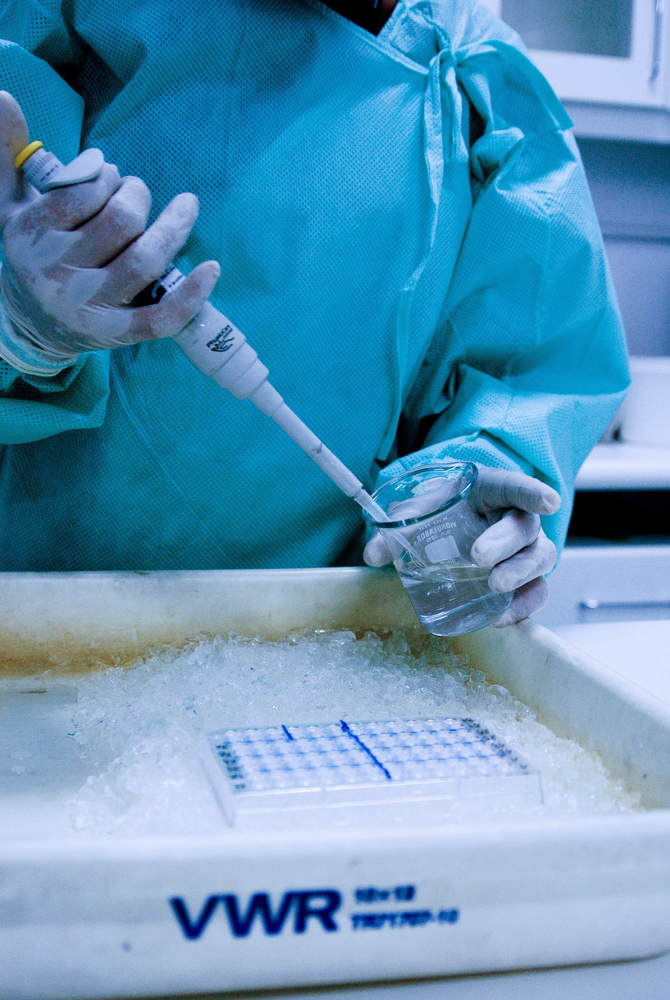

```{=html}
<div class="part-opener">
<div class="part-copy">
  <div class="part-number">IV</div>
  <div class="part-kicker">Parte quatro · pesquisa avançada</div>
  <h1>Estimar com método</h1>
  <p class="part-standfirst">Para quem quer estimar: DLNM, desenhos quase-experimentais, modelos espaciais e aprendizado de máquina, com os parâmetros à vista e as limitações declaradas. A referência rápida de Parâmetros fica ao final do guia, junto ao Glossário.</p>
  <ul class="part-list">
    <li><a href="06-etapa-analise-modelagem.html"><span class="part-ch">06</span> Análise &amp; Modelagem: do padrão à evidência estatística <span class="part-count">· 32 funções</span></a></li>
  </ul>
</div>
<div class="part-photo">
  
  <span class="photo-credit">Foto: Vinícius Marinho | Acervo Fiocruz Imagens</span>
</div>
</div>
```

::: {.pdf-only}
Para quem quer estimar: DLNM, desenhos quase-experimentais, modelos espaciais e aprendizado de máquina, com os parâmetros à vista e as limitações declaradas. A referência rápida de Parâmetros fica ao final do guia, junto ao Glossário.


:::
